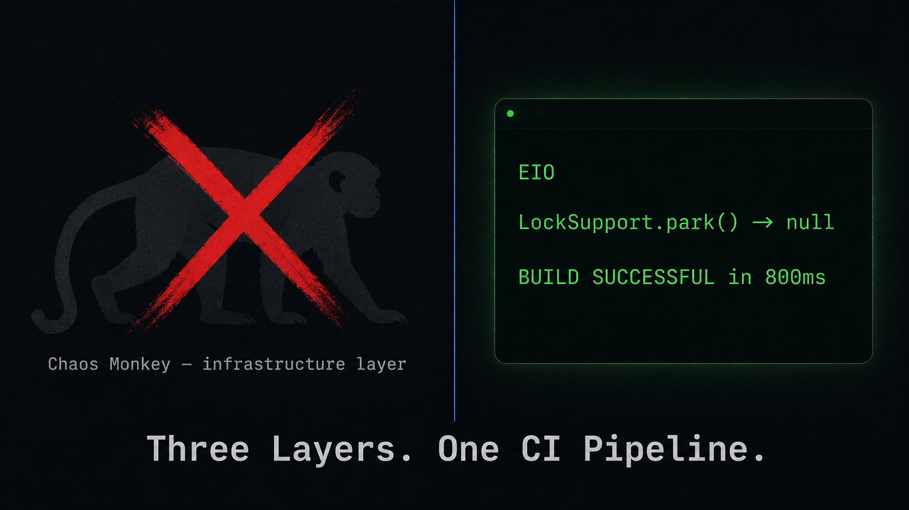
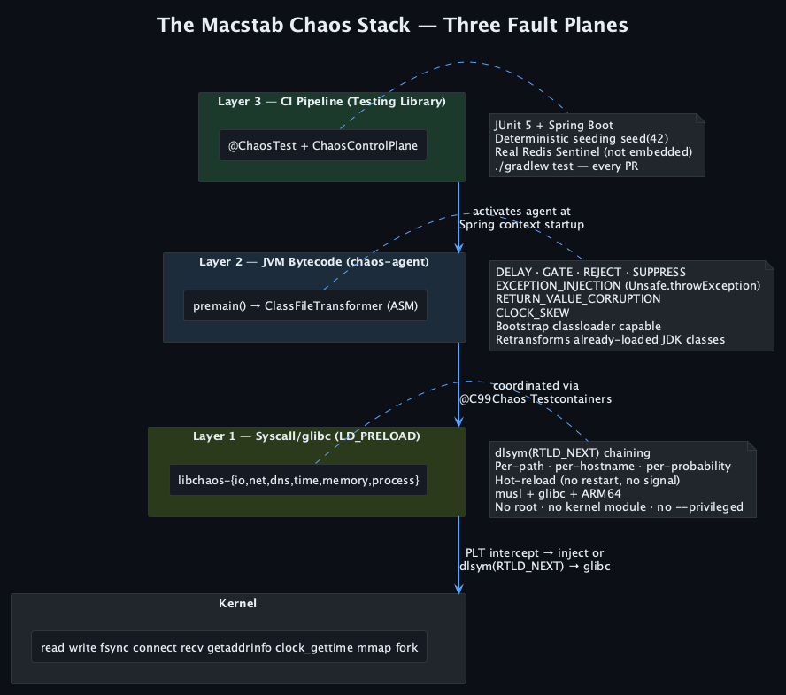
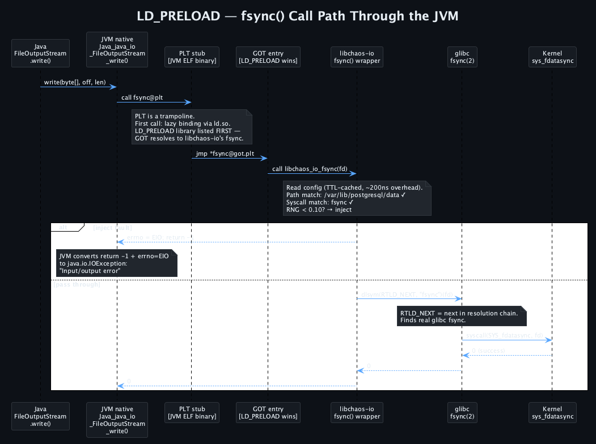
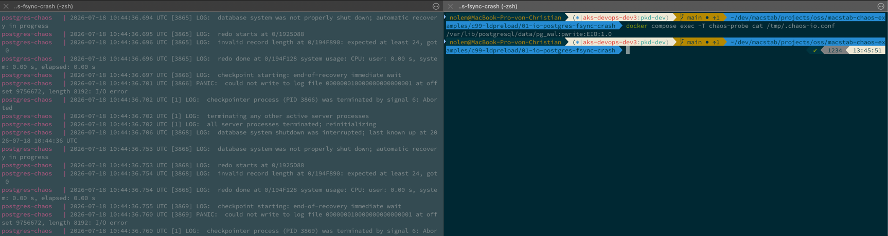
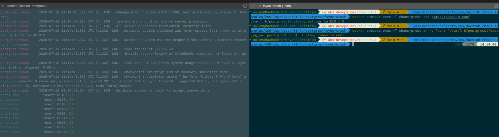
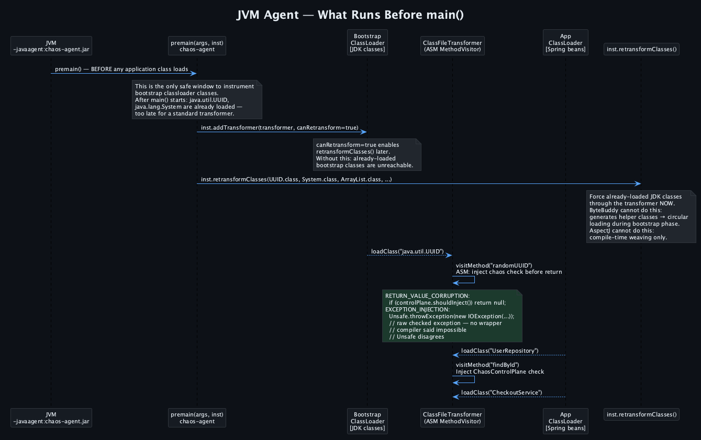
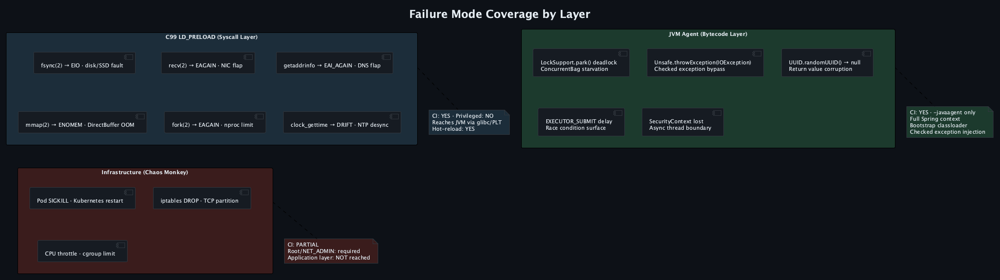
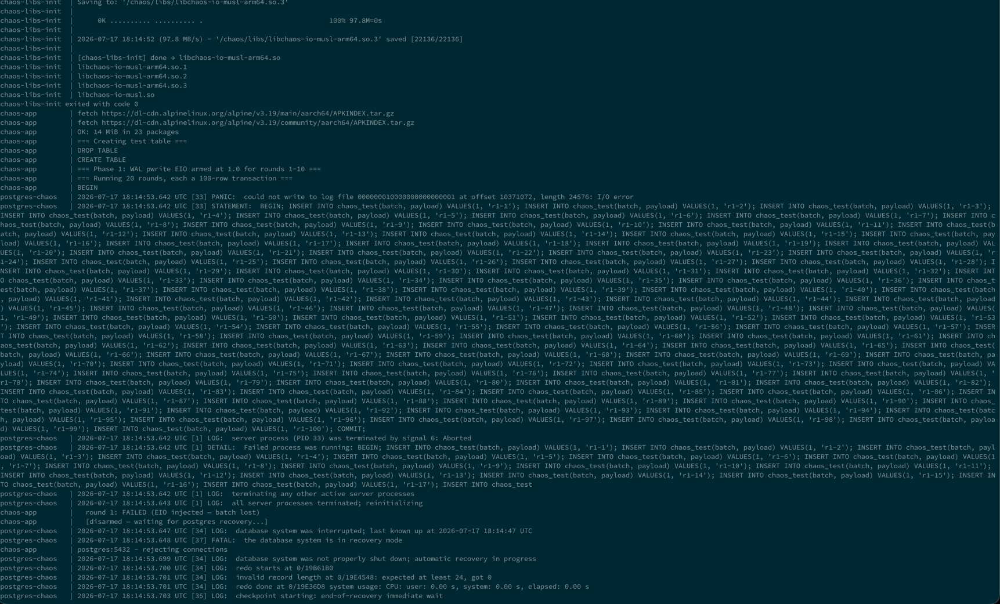
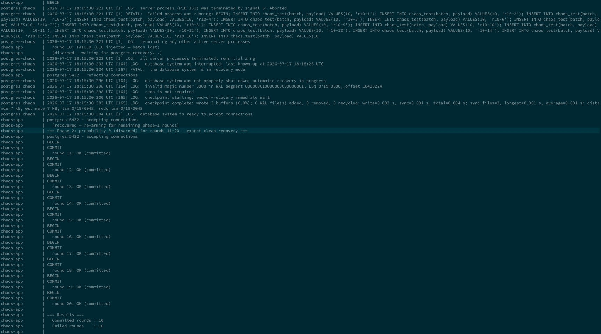
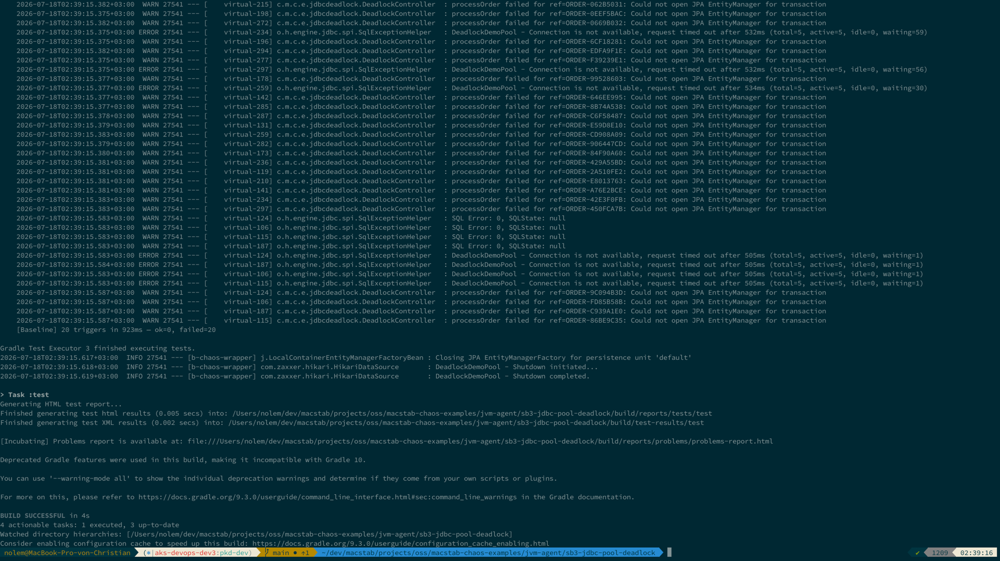

# Der Macstab Chaos Stack: Den vertikalen Pfad testen — vom Syscall bis zur CI-Pipeline

**Zielplattformen — ein Markdown-Master, in Prioritätsreihenfolge cross-gepostet:**
**DE:** Heise/iX *(primär — auf Deutsch pitchen)* → Java Magazin (Entwickler.de) → Xing → JAX-Blog → t3n.
**EN (Original):** Medium → DZone → Dev.to → Baeldung → InfoQ → The New Stack → LinkedIn.
**SEO primär:** Chaos Engineering CI-Pipeline Syscall Bytecode Java
**SEO sekundär:** LD_PRELOAD Chaos Testing · JVM-Agent Fault Injection · Chaos Engineering vs. Chaos Testing
**Tags:** chaos-engineering · java · spring-boot · ci-cd · testing · linux · syscall · ld-preload

> ▶ **Begleitvideo** — der vollständige Durchlauf vom Syscall bis zur CI auf dem **[Macstab-Engineering](https://www.youtube.com/@MacstabEngineering)**-Kanal.
> *Redaktionshinweis: Auf Medium / Dev.to die direkte Episode-00-Video-URL in einer eigenen Zeile einfügen, damit der Player automatisch eingebettet wird; dieser Kanal-Link dient als Fallback.*

---



## Die Fehlerbilder, die Chaos Monkey nicht erreicht

[Chaos Monkey](https://netflix.github.io/chaosmonkey/) killt deinen Pod. Der Linux-Kernel schickt SIGKILL. Der Prozess beendet sich. Der Kernel schließt jeden offenen File Descriptor. Die TCP-Verbindungen verschwinden als Ganzes — Aufrufer und nachgelagerte Peers beobachten je nach Socket-Zustand ein EOF, einen Reset oder ein Timeout, das als `SocketException` an der Oberfläche erscheint. Kubernetes erkennt den beendeten Container und startet bzw. ersetzt ihn gemäß der Workload-Policy. Die Circuit Breaker der Aufrufer öffnen. Ihre Retry-Logik greift. Dein Runbook sagt: Dieses Szenario ist abgedeckt.

Es ist abgedeckt. Für dieses eine Fehlerbild.

Und so sah ein realer Produktionsvorfall aus: Ein Storage-Controller unter Last brachte `pwrite(2)`- und `fdatasync(2)`-Aufrufe auf dem WAL-Pfad dazu, `EIO` zurückzugeben. Nicht alle Writes. Nicht alle Verbindungen. Nur WAL-Segment-Writes, nur unter Last, nur manchmal. PostgreSQL meldete einen I/O-Fehler auf dem WAL-Pfad, löste einen Fehler auf PANIC-Ebene aus und ging in die Crash Recovery — das Data Directory war damit unten. Die Anwendung nahm weiterhin HTTP-Requests an. Der Pool hatte noch nicht jede Verbindung als unbrauchbar markiert. Der Health-/Liveness-Endpoint lieferte weiterhin 200, weil er die Schreibfähigkeit der Datenbank nicht prüfte. Kubernetes sah nichts, was neu zu starten gewesen wäre. Vier Stunden Debugging, bevor jemand `dmesg` ausführte und die Storage-Fehler sah.

Chaos Monkey, [Toxiproxy](https://github.com/Shopify/toxiproxy) und [`iptables`](https://man7.org/linux/man-pages/man8/iptables.8.html) arbeiten auf Prozess-, Proxy- oder Netzwerkebene; sie können die exakte Semantik der hier beschriebenen `pwrite()`-/`fdatasync()`-Aufrufe nicht reproduzieren. Das kernel-eigene Disk-Fault-Primitiv — das Device-Mapper-Target [`dm-flakey`](https://docs.kernel.org/admin-guide/device-mapper/dm-flakey.html) — kommt dem am nächsten, benötigt aber ein dediziertes Device-Mapper-Gerät und Root-Rechte, keine pro-Pfad-, pro-Syscall-Wahrscheinlichkeit, die man in einem CI-Job live umschaltet. Breitere Plattformen wie [Chaos Mesh](https://chaos-mesh.org/) bieten ebenfalls Fault Injection auf Dateisystem- und JVM-Ebene, jedoch über eine andere Control Plane und ein anderes Deployment-Modell. Der Macstab Stack konzentriert sich auf aufrufspezifische libc-Interposition und JVM-Fault-Tests, die direkt als PR-Regressions-Gates laufen.

---

## Die Taxonomie-Lücke, über die niemand spricht

Viele gängige Chaos-Experimente zielen auf infrastrukturnahes Verhalten: Pod-Termination, Netzwerkpartitionen, Ressourcendruck und Ausfall ganzer Komponenten. Vollwertige Plattformen reichen über diese Grenze hinaus — Chaos Mesh etwa bietet Experimente für Dateisystem, JVM, DNS, Zeit und Kernel — doch ihr Ausführungsmodell unterscheidet sich von einem test-gebundenen PR-Regressions-Gate mit deterministisch geseedetem JVM-Sampling.

**Fehler auf Infrastrukturebene** sind binär und abrupt:
- Pod-Kill → SIGKILL → Kernel schließt File Descriptors → Verbindung abgebrochen → `SocketException` → behandelt
- Netzwerkpartition → `iptables -j DROP` → TCP-Keepalive läuft nach Timeout ab → Verbindung für tot erklärt → behandelt
- CPU-Throttling → cgroup `cpu.cfs_quota_us`-Reduktion → langsam, aber laufend
- Volllaufende Disk → `fallocate` → `ENOSPC` beim nächsten Write → behandelt

Diese erzeugen saubere, detektierbare Signale. Circuit Breaker, Retry-Logik und Service Mesh reagieren wie vorgesehen. Das ist echtes, sinnvolles Testen — es validiert, dass deine Resilienz-Infrastruktur funktioniert.

Solche Experimente validieren wichtige Resilienz-Eigenschaften, decken aber nicht von sich aus jeden aufrufspezifischen oder JVM-internen Fehlerpfad ab, der in Produktion auftritt.

**Fehler auf Syscall-Ebene** sind partiell und probabilistisch:

`recv(2)` gibt `EAGAIN` auf einem nicht-blockierenden ESTABLISHED-Socket zurück, nachdem die Anwendung Read-Bereitschaft erwartet hatte: Der Socket lebt, und der nächste Aufruf könnte erfolgreich sein. Deine Retry-Logik behandelt das womöglich nicht korrekt — sie wurde in der Annahme geschrieben, `EAGAIN` trete nur beim Setup nicht-blockierender I/O auf, nicht bei Daten-Reads auf einer lebenden Verbindung. `iptables -j DROP` bringt TCP-Keepalive dazu, die Verbindung schließlich für tot zu erklären — eine saubere `SocketException`. Das sind unterschiedliche Fehlersemantiken. Man kann die eine nicht reproduzieren, indem man die andere simuliert.

`getaddrinfo(3)` gibt `EAI_AGAIN` zurück: Zeigt man DNS auf einen kaputten Resolver, erhält man `EAI_NONAME` (NXDOMAIN — permanenter Fehler) oder ein Timeout. `EAI_AGAIN` steht für einen temporären Resolver-Fehler und gehört normalerweise auf einen wiederholbaren Fehlerpfad. Anderer Fehlerpfad. Anderer Handler. Anderes Produktionsverhalten.

**JVM-interne Fehler** bilden eine dritte Kategorie — das Betriebssystem kann sie nicht sehen, und das eigene Tooling der JVM oft auch nicht:

`ThreadMXBean.findDeadlockedThreads()` gibt `null` zurück, während eine [HikariCP](https://github.com/brettwooldridge/HikariCP)-Connection-Pool-Erschöpfung live läuft. Im lauffähigen Beispiel halten fünf äußere Transaktionen je eine Connection, während geschachtelte `REQUIRES_NEW`-Arbeit eine weitere anfordert. Jeder Pool-Eintrag ist von Arbeit belegt, die nicht abschließen kann, bevor ein zusätzlicher Eintrag frei wird. Der Warte-Pfad von HikariCP nutzt schließlich `LockSupport.parkNanos()`, aber der JVM-Deadlock-Detektor meldet nur Zyklen über Objekt-Monitore oder Ownable Synchronizers. Ein solcher Besitz-Zyklus existiert hier nicht. Die Threads bleiben geparkt, bis HikariCP `Connection is not available, request timed out` loggt — und `ThreadMXBean` gibt weiterhin `null` zurück.

Quellcode-Proxies und Interceptoren müssen eine nicht deklarierte Checked Exception oft in einen anderen Typ verpacken, bevor sie sie durch eine API propagieren, die diesen Typ nicht deklariert. Anderer Wrapper, anderer Handler. Der JVM-Agent injiziert stattdessen das konfigurierte Throwable am Methodeneintritt in transformierten Bytecode, sodass der ursprüngliche Ausnahmetyp den aufrufenden Frame erreicht.

Das sind keine Randfälle. Das sind die Fehlerbilder hinter mehrstündigen Produktionsvorfällen, bei denen dir jedes Diagnose-Tool ein `null` oder ein falsch-negatives Ergebnis liefert.

---

## Drei Schichten, eine CI-Pipeline

Der Macstab Chaos Stack besteht aus drei Komponenten, jede auf einer dieser Fehler-Ebenen.


*Drei Fehler-Ebenen — die CI-/Testing-Schicht aktiviert den JVM-Agenten, der mit der Syscall-Schicht koordiniert wird; jede fängt ab, was die anderen nicht sehen.*

### Schicht 1: C99-LD_PRELOAD-Bibliotheken

Der Linux-Dynamic-Linker löst Symbolreferenzen auf, indem er die `DT_NEEDED`-Einträge im Dynamic-Abschnitt des Binaries und die `LD_PRELOAD`-Liste in Prioritätsreihenfolge durchläuft. Das erste passende Symbol gewinnt.

Sechs Shared Libraries, per `LD_PRELOAD` vorgeladen. Jede fängt eine Gruppe verwandter Syscalls an der Grenze der Procedure Linkage Table (PLT) ab und entscheidet pro Aufruf, ob sie einen Fault injiziert oder per `dlsym(RTLD_NEXT, "symbol_name")` — die nächste Implementierung in der Auflösungskette — durchreicht:

| Bibliothek | Repräsentative abgefangene Aufrufe | Fault-Typen |
|---|---|---|
| `libchaos-io` | `open`, `write`, `read`, `fsync`, `fdatasync`, `close` | EIO, ENOSPC, EAGAIN, Latenz |
| `libchaos-net` | `connect`, `accept`, `recv`, `recvfrom`, `send`, `sendto` | ECONNREFUSED, EAGAIN, ECONNRESET, EPIPE |
| `libchaos-dns` | `getaddrinfo` | EAI_AGAIN, EAI_NONAME, Latenz |
| `libchaos-time` | `clock_gettime` | OFFSET ±ms, pro clock_id |
| `libchaos-memory` | `mmap`, `munmap`, `mprotect`, `madvise` | ENOMEM, EINVAL |
| `libchaos-process` | `pthread_create`, `fork`, `posix_spawn`, `execve`, `waitpid` | EAGAIN, EACCES |

Releases für alle Varianten (musl, glibc, amd64, arm64) liegen auf GitHub:
→ **[github.com/macstab/macstab-chaos-testing-libraries](https://github.com/macstab/macstab-chaos-testing-libraries)**

Unter Linux nehmen der JVM-Launcher und die native Runtime am ELF-Dynamic-Linking-Modell teil. Native I/O, die libc über interposierbare Symbole erreicht, kann daher durch einen `LD_PRELOAD`-Wrapper laufen. Statisch gelinkte Binaries und Code, der direkte Syscalls absetzt, umgehen diesen Mechanismus. Wenn Java-Datei-I/O libc erreicht, sieht der Pfad so aus:

```
Java bytecode
  → JNI native: Java_java_io_FileOutputStream_write / writeBytes
    → glibc write(2) via PLT stub
      → libchaos-io's write() wrapper  ← intercept here
        → dlsym(RTLD_NEXT, "write") → glibc → kernel
```


*Wo `LD_PRELOAD` gewinnt: Der `GOT`-Eintrag löst `fsync` zum Wrapper von libchaos-io auf — noch vor glibc, das ist der Interception-Punkt — und `dlsym(RTLD_NEXT)` reicht beim Durchreichen zum echten glibc-Aufruf weiter.*

**Konfiguration:**

```
# .chaos-io.conf — per-path, per-syscall, per-probability
/var/lib/postgresql/data:fsync:EIO:0.10
/var/log/app:write:ENOSPC:0.05

# .chaos-net.conf — selectors are socket endpoints (ipv4-or-* : port),
# not container DNS names; libchaos-net normalizes the sockaddr to an endpoint.
tcp4://*:6379:recv:EAGAIN:0.10
tcp4://*:5432:recv:ECONNRESET:0.05

# .chaos-dns.conf — DNS selectors DO take names; LATENCY takes <ms>@<probability>
dns://downstream-service:EAI_AGAIN:0.30
dns://kafka:LATENCY:500@0.20
```

**Hot Reload:** Jeder abgefangene Aufruf führt ein `stat()` auf die Konfigurationsdatei aus. Ändert sich die mtime der Datei, tauscht die Bibliothek atomar auf einen frischen Konfigurations-Snapshot — kein TTL, kein Signal, kein API-Call. Die Änderung greift beim nächsten abgefangenen Aufruf nach dem Write.

```bash
# Docker example: update the config in the shared volume that the process reads.
docker compose exec -T chaos-probe sh -c \
  "printf '/var/lib/postgresql/data/pg_wal:fdatasync:EIO:0.80\n' \
   > /tmp/.chaos-io.conf"
# The next matching fdatasync observes the new snapshot; no process restart.
```


*Scharf geschaltet: Mit der Regel in der Shared-Config scheitert jeder Commit am WAL-Write — PostgreSQL läuft in einer Crash-Loop, und kein Prozess wurde neu gestartet.*


*Regel löschen → der nächste abgefangene WAL-Write gelingt → PostgreSQL macht Crash Recovery und die Commits werden wieder grün. Nur Konfiguration, kein Neustart, kein Redeploy.*

**Kein Root. Kein Kernel-Modul. Kein `--privileged`.** Läuft auf gewöhnlichen GitHub-Actions-, GitLab-CI- und Jenkins-Runnern.

### Schicht 2: JVM-Bytecode-Agent

Der Agent lädt auf eine von zwei Arten. Über `premain(String agentArgs, Instrumentation inst)` vor dem Anwendungsstart — der früheste Instrumentierungspunkt, sodass Klassen des Bootstrap-Classloaders (`java.lang.*`, `java.util.*`, `java.io.*`, `java.util.UUID`) transformiert werden, bevor auf sie erstmals zugegriffen wird. Oder über dynamisches Self-Attach via `agentmain`, das bereits geladene, modifizierbare Zielklassen zur Laufzeit re-transformiert — so installiert `@ChaosTest` den Agent ohne `-javaagent`-Flag in eine laufende Test-JVM.

Wir registrieren einen `ClassFileTransformer`. Jeder Klassenladevorgang aus jedem Classloader läuft durch ihn hindurch. Für bereits geladene JDK-Klassen rufen wir explizit `inst.retransformClasses()` mit `canRetransform=true` auf. Der Agent verdrahtet aktuell 62 von 67 Operationstypen über 57 Bootstrap-Interception-Handles und nutzt dabei [ByteBuddy](https://bytebuddy.net/) `@Advice` mit Inline-Advice-Copy — der Advice-Code wird direkt in den Bytecode der Zielmethode eingewoben und erzeugt keine Hilfsklassen. Eine `BootstrapDispatcher`-Klasse liegt fest im Bootstrap-Classloader und brückt via `MethodHandle` zur Agent-Logik. Das eliminiert zirkuläres Classloading auf Bootstrap-Ebene, während durchgehend ByteBuddy verwendet wird. Quellcode-Weaving und Proxy-Interception unterliegen anderen Restriktionen bei der Ausnahmepropagierung. Der Agent injiziert das konfigurierte Throwable stattdessen am Methodeneintritt in transformierten Bytecode.


*`premain()` ist das einzige sichere Fenster, um Bootstrap-Classloader-Klassen zu instrumentieren; `retransformClasses()` zwingt bereits geladene JDK-Klassen erneut durch den Transformer — etwas, das ByteBuddys Hilfsklassen-Generierung und AspectJs Compile-Time-Weaving in dieser Phase nicht leisten können.*

**Zwei Familien von Effekten.** *Inline- (Interceptor-) Effekte* laufen auf dem aufrufenden Thread, sobald eine passende Methode zündet; *Background-Stressor-Effekte* erzeugen anhaltenden Druck auf JVM-Ressourcen. Effekte komponieren über passende Szenarien hinweg — Delays akkumulieren, terminale Aktionen (`reject` / `suppress` / `injectException` / `corruptReturnValue`) werden per Precedence aufgelöst.

*Inline- (Interceptor-) Effekte — 9:*

| Effekt | Was er tut |
|---|---|
| `delay(Duration)` · `delay(min, max)` | Feste oder gleichverteilt-zufällige Pause vor der Operation — verbreitert Race-Fenster deterministisch |
| `gate(Duration maxBlock)` | Blockiert, bis `handle.release()` aufgerufen wird (oder `maxBlock` abläuft) — ein hängendes Downstream |
| `reject(String)` | Wirft eine für den Operationstyp semantisch korrekte Exception |
| `suppress()` | Verwirft still; gibt `null` / `false` gemäß Operationsvertrag zurück |
| `exceptionalCompletion(FailureKind, String)` | Schließt ein `CompletableFuture` mit einem Fehler ab |
| `injectException(String className, String message)` | Injiziert eine beliebige Exception am Methodeneintritt |
| `corruptReturnValue(ReturnValueStrategy)` | Korrumpiert den Rückgabewert: `NULL`, `ZERO`, `EMPTY`, `BOUNDARY_MAX`, `BOUNDARY_MIN` |
| `skewClock(Duration, ClockSkewMode)` | Verzerrt `currentTimeMillis()` / `nanoTime()`: `FIXED`, `DRIFT`, `FREEZE` |
| `spuriousWakeup()` | Zwingt `Selector.select()`, sofort 0 zurückzugeben |

*Background-Stressor-Effekte — 14:*

| Effekt | Was er tut |
|---|---|
| `heapPressure(bytes, chunkSize)` | Hält `byte[]`-Allokationen auf dem Heap |
| `keepAlive(name, daemon, heartbeat)` | Startet einen leerlaufenden Keep-Alive-Thread |
| `metaspacePressure(classCount, fieldsPerClass)` | Definiert synthetische Klassen in einen isolierten Classloader |
| `directBufferPressure(totalBytes, bufferSize)` | Allokiert Off-Heap-`ByteBuffer.allocateDirect` |
| `gcPressure(bytesPerSecond, duration)` | Allokiert fortlaufend kurzlebige Objekte |
| `finalizerBacklog(objectCount, delay)` | Flutet die Finalizer-Queue |
| `deadlock(participantCount)` ¹ | Erzeugt einen echten JVM-Monitor-Deadlock zwischen N Threads |
| `threadLeak(count, prefix, daemon)` ¹ | Startet dauerhaft geparkte Threads, die nie gejoint werden |
| `threadLocalLeak(entriesPerThread, valueSize)` | Leakt `ThreadLocal`-Einträge auf einem Background-Thread |
| `monitorContention(…)` | Sättigt einen geteilten Lock mit Background-Contendern |
| `codeCachePressure(classCount, methodsPerClass)` | Erzeugt Klassen, um den JIT-Code-Cache zu füllen |
| `safepointStorm(gcInterval)` | Periodisches `System.gc()` + `retransformClasses()` → Stop-the-World-Pausen |
| `stringInternPressure(internCount, length)` | Interniert eindeutige Strings in den JVM-String-Pool |
| `referenceQueueFlood(referenceCount, interval)` | Flutet die Reference-Queue mit Phantom-Referenzen |

¹ `deadlock()` und `threadLeak(daemon=false)` sind innerhalb des JVM-Prozesses **nicht wiederherstellbar** und erfordern `ActivationPolicy.withDestructiveEffects()` bei der Registrierung. Das Schließen des Activation-Handles unterbricht die beteiligten Threads und gibt die Locks frei; nur in kontrollierten Testumgebungen einsetzen.

`injectException(...)` platziert eine beliebige Exception — auch eine *Checked* — am Methodeneintritt, und sie erreicht den aufrufenden Frame als genau dieser Ausnahmetyp, nicht als `UndeclaredThrowableException` weggewrappt. Der Compiler sagte, diese Methode könne keine `IOException` werfen. Der instrumentierte Pfad sagt etwas anderes. Genau das macht das Testen realer Produktions-Ausnahmepropagierung akkurat — dieselbe rohe Checked Exception, die den Frame erreicht, wenn Storage tatsächlich versagt.

Der Agent-Quellcode liegt auf GitHub:
→ **[github.com/macstab/macstab-chaos-jvm-agent](https://github.com/macstab/macstab-chaos-jvm-agent)**

```kotlin
// Spring Boot 4
testImplementation("com.macstab.chaos.jvm:chaos-agent-spring-boot4-test-starter:1.0.0")

// Spring Boot 3
testImplementation("com.macstab.chaos.jvm:chaos-agent-spring-boot3-test-starter:1.0.0")
```

### Schicht 3: Testing-Bibliothek

```java
@ChaosTest(classes = MyApplication.class, webEnvironment = RANDOM_PORT)
class CheckoutServiceIT {

    @Autowired TestRestTemplate testRestTemplate;
    private final CheckoutRequest request = new CheckoutRequest(/* … abridged */);

    @Test
    void checkout_handles_uuid_null_from_corrupted_generator(
            ChaosControlPlane controlPlane) throws Exception {

        try (var handle = controlPlane.activate(
                ChaosScenario.builder("uuid-null")
                    .selector(ChaosSelector.method("java.util.UUID", "randomUUID"))
                    .effect(ChaosEffect.returnValue(null))
                    // ActivationPolicy is a record: (startMode, probability,
                    // activateAfterMatches, maxApplications, activeFor, rateLimit,
                    // randomSeed, allowDestructiveEffects)
                    .activationPolicy(new ActivationPolicy(
                        ActivationPolicy.StartMode.AUTOMATIC, 0.50,
                        0L, 3L, null, null, 42L, false))
                    .build())) {

            ResponseEntity<String> response =
                testRestTemplate.postForEntity("/checkout", request, String.class);
            // Must not 500 — must handle null UUID gracefully
            assertThat(response.getStatusCode()).isNotEqualTo(HttpStatus.INTERNAL_SERVER_ERROR);
        }
    }
}
```

Eine Annotation. `@ChaosTest` ist mit `@SpringBootTest` meta-annotiert und registriert `ChaosAgentExtension`. Beim Teststart: JVM-Agent hängt sich an, `ChaosControlPlane` registriert sich im Spring-Context, alles andere — Testcontainers, WireMock, deine Datenbank-Container — bleibt unverändert.

`new ActivationPolicy(AUTOMATIC, 0.50, 0L, 3L, null, null, 42L, false)`:
- `randomSeed = 42L` — reproduzierbares Wahrscheinlichkeits-Sampling für dasselbe Szenario und denselben geordneten Strom passender Aufrufe. Unterschiedliches Thread-Scheduling kann diese Aufrufe umordnen; der Seed entfernt also eine Zufallsquelle, statt beliebige nebenläufige Ausführungen identisch zu machen.
- `maxApplications = 3L` — höchstens drei Fault-Anwendungen; nach der dritten erfolgreichen Anwendung stoppt das Szenario die Injektion. Beschränkt. Keine Flakiness durch übermäßige Injektion.

**Container-Level-C99-Koordination.** Die öffentliche Testcontainers-API markiert den Zielcontainer mit `@AppContainer` und deklariert die libc-Domäne über `@SyscallLevelChaos`. `ChaosTestingExtension` kopiert die zur Architektur/libc passende `.so` aus dem Test-Modul-JAR über die Docker-API in den Container, hängt `LD_PRELOAD` an und verwaltet die In-Container-Regeldatei:

```java
@Testcontainers
@ExtendWith(ChaosTestingExtension.class)
@SyscallLevelChaos(LibchaosLib.IO)
class FullStackChaosIT {

    @Container
    @AppContainer
    static GenericContainer<?> app =
        new GenericContainer<>("my-app:latest");

    @Test
    void application_handles_partial_write_failure() {
        // Apply the chosen L1/L2/L3 I/O annotation or transport rule,
        // then assert the real container's behavior under libc-level EIO.
    }
}
```

Weitere Domänen werden über die unterstützte `@SyscallLevelChaos`-Komposition und ihre zugehörigen L1-, L2- oder L3-Annotationen aktiviert.

**Echte Infrastruktur-Topologien.** Redis Sentinel mit echter Promotion-Semantik — keine eingebetteten Redis-Stubs. Eingebettete Stubs implementieren Sentinel-Failover nicht korrekt. Split-Brain-Tests für Distributed Locks erfordern echte Sentinel-Promotion. Die Testing-Bibliothek stellt sie automatisch über Testcontainers bereit.

---

## Abdeckungsvergleich


*Welches Fehlerbild welche Schicht erreicht. (Auf Medium, wo Tabellen nicht gerendert werden, dieses Bild anstelle der Tabelle unten verwenden.)*

| Fehlerbild | C99 LD_PRELOAD | JVM-Agent | Nur Pod-/Netzwerk-Tools |
|---|:---:|:---:|:---:|
| `fsync(2)` → EIO (Disk-/SSD-Fehler) | ✅ | ❌ | ❌ |
| `recv(2)` → EAGAIN auf ESTABLISHED | ✅ | ❌ | ❌ |
| `getaddrinfo(3)` → EAI_AGAIN | ✅ | ❌ | ❌ |
| `mmap(2)` → ENOMEM (DirectBuffer-OOM) | ✅ | ❌ | ❌ |
| `fork(2)` → EAGAIN (nproc-Limit) | ✅ | ❌ | ❌ |
| libc `clock_gettime(2)`-Drift | ✅ | ❌ | ❌ |
| JVM-Clock-Skew via `skewClock` (FIXED/DRIFT/FREEZE) | ❌ | ✅ | ❌ |
| Transparente System-Clock-Interception nach JIT | ❌ | ❌ | ❌ |
| HikariCP-Pool-Erschöpfung, unsichtbar für JVM-Deadlock-Erkennung | ❌ | ✅ | ❌ |
| `UUID.randomUUID()` → null | ❌ | ✅ | ❌ |
| Rohe `IOException`-Injektion (Checked) | ❌ | ✅ | ❌ |
| Pod-Kill / Kubernetes-Restart | ❌ | ❌ | ✅ |
| Läuft als normaler Test ohne privilegierte Cluster-Control-Plane | ✅ | ✅ | variiert |
| Wahrscheinlichkeitsbasierte Injektion | ✅ | ✅ | variiert |
| Benutzergesteuerter deterministischer Seed | ❌ | ✅ | variiert |

Pod- und Netzwerk-Experimente bleiben essenziell. Dateisystem- und JVM-fähige Plattformen können zusätzliche Zeilen abdecken. Der Vergleich hebt das spezifische Ausführungsmodell des Macstab Stacks hervor: aufruf-gebundene libc-Faults und JVM-interne Effekte, verpackt als test-gebundene PR-Regressions-Gates. Diese Schichten ergänzen breitere Chaos-Plattformen, statt sie zu ersetzen.

---

## Loslegen: Schicht 1 in 3 Minuten

Das Beispiel-Repo klonen und das PostgreSQL-WAL-Crash-Beispiel ausführen:

```bash
git clone https://github.com/macstab/macstab-chaos-examples
cd macstab-chaos-examples/c99-ldpreload/01-io-postgres-fsync-crash
CHAOS_LIBS_VERSION=1.0.0 docker compose up
```

Die `docker-compose.yml` enthält einen `chaos-libs-init`-Service (schlichtes `alpine`), der die zur Architektur passende `.so` von GitHub Releases in ein Shared Volume lädt, sowie einen `postgres`-Service, der `LD_PRELOAD` in seinem Entrypoint setzt. Die Konfiguration liegt im Shared Volume `chaos-conf` unter `/tmp/.chaos-io.conf` — es gibt keinen Host-Bind-Mount:

```yaml
services:
  chaos-libs-init:                    # downloads libchaos-io-musl-<arch>.so → chaos-libs
    image: alpine:3.19
    volumes: [ "chaos-libs:/chaos/libs" ]

  postgres:
    image: postgres:16-alpine
    environment: { POSTGRES_USER: chaos, POSTGRES_PASSWORD: chaos, POSTGRES_DB: chaosdb }
    volumes:
      - chaos-libs:/chaos/libs:ro
      - chaos-conf:/tmp                # /tmp/.chaos-io.conf is read on every intercepted call
    entrypoint:
      - sh
      - -c
      - 'export LD_PRELOAD=/chaos/libs/libchaos-io-musl.so;
         exec su-exec postgres docker-entrypoint.sh postgres'
```

Der mitgelieferte `app`-Container schärft Chaos auf dem WAL-Verzeichnis von PostgreSQL und fährt die INSERT-Last für dich — du siehst Batches scheitern, sobald WAL-`pwrite`/`fdatasync` `EIO` zurückgeben. Um die Rate selbst zu steuern, schreibst du die Konfiguration **in** das Volume (postgres liest sie dort) und änderst sie live — ohne Neustart:

```bash
# 80% EIO on WAL sync — PostgreSQL PANICs and halts (WAL integrity is non-negotiable)
docker compose exec -T chaos-probe sh -c 'cat > /tmp/.chaos-io.conf <<EOF
/var/lib/postgresql/data/pg_wal:pwrite:EIO:0.80
/var/lib/postgresql/data/pg_wal:fdatasync:EIO:0.80
EOF'

# Remove the fault before restart/recovery.
docker compose exec -T chaos-probe rm -f /tmp/.chaos-io.conf
docker compose restart postgres
docker compose exec postgres sh -c \
  'until pg_isready -U chaos -d chaosdb -q; do sleep 0.2; done'
# Re-arm a low rate only after recovery has completed, when the next test needs it.
```


*`fsync`/`pwrite` geben EIO an der glibc-Grenze zurück → PostgreSQL löst einen PANIC aus und geht in die Crash Recovery. Mit `iptables` oder einem Pod-Kill nicht reproduzierbar.*


*Fault entfernen und neu starten → PostgreSQL schließt die Crash Recovery ab und nimmt wieder Verbindungen an. Nur committete Daten überleben.*

**→ [Alle C99-Beispiele](https://github.com/macstab/macstab-chaos-examples/tree/main/c99-ldpreload)**

---

## Loslegen: Schichten 2 und 3 in 2 Minuten

Den Starter zur `build.gradle.kts` hinzufügen:

```kotlin
testImplementation("com.macstab.chaos.jvm:chaos-agent-spring-boot4-test-starter:1.0.0")
```

Der lauffähige `JdbcPoolDeadlockIT` hält zwei Aussagen getrennt: das Baseline-Verhalten der Pool-Erschöpfung und die geseedete Fail-Fast-Injektion. Die folgenden Snippets sind gekürzt; der [vollständige Quellcode](https://github.com/macstab/macstab-chaos-examples/blob/main/jvm-agent/sb3-jdbc-pool-deadlock/src/test/java/com/macstab/chaos/examples/jdbcdeadlock/JdbcPoolDeadlockIT.java) enthält Anwendungs-Setup und Hilfsmethoden.

### A. Beweis: Pool-Erschöpfung ist für den JVM-Deadlock-Detektor unsichtbar

```java
@ChaosTest(
    classes = MyApplication.class,
    webEnvironment = RANDOM_PORT,
    properties = {
        "spring.datasource.hikari.maximum-pool-size=5",
        "spring.datasource.hikari.connection-timeout=500"
    }
)
class JdbcPoolDeadlockIT {

    @Autowired TestRestTemplate rest;

    @Test
    void twentyConcurrentRequestsExhaustPoolWhileThreadMxBeanReturnsNull()
            throws Exception {

        AtomicInteger failed = new AtomicInteger();
        ExecutorService executor = Executors.newVirtualThreadPerTaskExecutor();

        for (int i = 0; i < 20; i++) {
            executor.submit(() -> {
                Map<?, ?> result = rest.getForObject("/trigger", Map.class);
                if (result == null || ((Number) result.get("failure_count")).intValue() > 0) {
                    failed.incrementAndGet();
                }
            });
        }

        Thread.sleep(300); // active pool-exhaustion window
        assertThat(ManagementFactory.getThreadMXBean().findDeadlockedThreads())
            .isNull();

        executor.shutdown();
        assertThat(executor.awaitTermination(10, TimeUnit.SECONDS)).isTrue();
        assertThat(failed.get()).isEqualTo(20);
    }
}
```

Fünf äußere Transaktionen halten die fünf verfügbaren Connections, während geschachtelte `REQUIRES_NEW`-Arbeit eine weitere anfordert. Die Anwendung ist ressourcen-deadlocked, aber es existiert kein Monitor-/Ownable-Synchronizer-Zyklus, den `ThreadMXBean` zurückgeben könnte.


*Beide Assertions gleichzeitig grün: `ThreadMXBean.findDeadlockedThreads()` liefert `null`, während alle 20 Requests die HikariCP-Pool-Erschöpfung erleben. Der JVM-eigene Deadlock-Detektor ist dafür blind — der gesamte Macstab Stack weist es nach, und die Anwendung erholt sich, bei jedem PR.*

### B. Beweis: Geseedete JDBC-Injektion scheitert schnell und wiederholt ihre Sampling-Entscheidungen

```java
@Test
void seededJdbcFaultsExposeTheFailureBeforeTheNormalPoolTimeout(
        ChaosControlPlane plane) throws Exception {

    AtomicInteger injectedFailures = new AtomicInteger();
    long started = System.nanoTime();

    try (var scenario = plane.activate(
            ChaosScenario.builder("seeded-jdbc-fault")
                .selector(ChaosSelector.jdbc())
                .effect(ChaosEffect.reject("seeded JDBC fault"))
                .activationPolicy(new ActivationPolicy(
                    ActivationPolicy.StartMode.AUTOMATIC,
                    0.20, 0L, null, null, null, 42L, false))
                .build())) {

        runConcurrentTriggers(injectedFailures);
    }

    assertThat(Duration.ofNanos(System.nanoTime() - started))
        .isLessThan(Duration.ofSeconds(5));
    assertThat(injectedFailures.get()).isPositive();
}
```

Der feste Seed reproduziert die Wahrscheinlichkeitsentscheidungen, wenn derselbe geordnete Strom passender JDBC-Aufrufe erreicht wird. Er friert das Thread-Scheduling des Betriebssystems nicht ein.

```bash
./gradlew test
```

Keine Staging-Umgebung. Die Tests laufen als Teil des normalen Builds und fangen künftige Änderungen an Pool-Sizing, Transaktions-Propagierung, asynchronem Wrapping und Ausnahmebehandlung ab.

**→ [macstab-chaos-jvm-agent](https://github.com/macstab/macstab-chaos-jvm-agent)** · **[JVM-Agent-Beispiele](https://github.com/macstab/macstab-chaos-examples/tree/main/jvm-agent)**

---

## Manueller Test vs. CI-Test

Manuelles Chaos-Testen — Tools gegen Staging fahren, Faults auslösen, Verhalten beobachten — liefert echte Erkenntnisse. Es hat aber ein strukturelles Problem: Es ist eine Validierung zu einem Zeitpunkt.

Ein heute durchgeführter manueller Test sagt dir, dass der heutige Build Fault X in der heutigen Konfiguration verkraftet. Er sagt dir nichts über den Build des nächsten Sprints, wenn ein Entwickler einen neuen `@Async`-Wrapper hinzufügt, die HikariCP-Pool-Größe anpasst oder eine Abhängigkeit einführt, die den Pfad der Ausnahmepropagierung verändert.

Ein CI-Chaos-Test ist ein Regressions-Gate. Geseedetes Sampling macht die Wahrscheinlichkeitsentscheidungen des Agenten für einen festen geordneten Strom passender Aufrufe reproduzierbar und beseitigt eine wichtige Quelle von Flakiness. Normale Nebenläufigkeit, Timing und Umgebungsunterschiede erfordern weiterhin ordentliches Test-Engineering. Der Fehlerbericht benennt das aktive Szenario, und derselbe Ausführungspfad lässt sich lokal mit einem Kommando reproduzieren.

**Ein manueller Test validiert einmal. Ein CI-Test verhindert für immer.**

---

## Die Serie

**00-1 — C99-LD_PRELOAD-Bibliotheken:** PLT/GOT-Interception-Interna. `dlsym(RTLD_NEXT)`-Verkettung bei mehreren vorgeladenen Bibliotheken. Alle 6 Bibliotheken, alle Konfigurationsoptionen, alle injizierbaren Fehlercodes. musl vs. glibc. Hot-Reload-Implementierung.
→ [github.com/macstab/macstab-chaos-testing-libraries](https://github.com/macstab/macstab-chaos-testing-libraries)

**00-2 — JVM-Chaos-Agent:** `premain()` vs. `agentmain()` — der Unterschied im Timing-Fenster und warum er für Bootstrap-Instrumentierung wichtig ist. `ClassFileTransformer` und `inst.retransformClasses()`. ByteBuddy-`@Advice`-Inline-Copy + `BootstrapDispatcher` + `MethodHandle`-Brücke — warum diese Struktur auf Bootstrap-Classloader-Ebene notwendig ist. Alle Effekte — 9 Inline-Interceptor-Effekte + 14 Background-Stressor-Effekte. Exception-Injektion auf JVM-Bytecode-Ebene.
→ [github.com/macstab/macstab-chaos-jvm-agent](https://github.com/macstab/macstab-chaos-jvm-agent)

**00-3 — Testing-Bibliothek:** `@ChaosTest`-Interna. `ChaosControlPlane`-Aktivierungs-API. Geseedetes Wahrscheinlichkeits-Sampling. Bereitstellung echter Redis-Sentinel-Topologien. `@SyscallLevelChaos`, `@AppContainer` und Full-Stack-Koordination.
→ [github.com/macstab/chaos-testing](https://github.com/macstab/chaos-testing)

**Serie 1 — Produktionsvorfälle:** Zehn Fehlerbilder, jedes die Reproduktion eines realen Vorfalls. HikariCP-Pool-Erschöpfung, unsichtbar für die JVM-Deadlock-Erkennung. PostgreSQL-WAL-fsync-Fehler. Redis-TCP-Pool-Vergiftung. DNS-ndots:5-Amplifikation. Split-Brain bei Distributed-Lock-Clock. `fork`-EAGAIN unter nproc-Limits. DirectBuffer-OOM. Rohe Checked-Exception-Injektion am Methodeneintritt. Rückgabewert-Korruption. Sechs gleichzeitige Syscall-Faults.

---

## Repositories

| Repo | Inhalt |
|---|---|
| [macstab/macstab-chaos-jvm-agent](https://github.com/macstab/macstab-chaos-jvm-agent) | JVM-Bytecode-Agent — `premain`/`agentmain`, ByteBuddy-`@Advice`-Inline-Copy + `BootstrapDispatcher` + `MethodHandle`-Brücke, 9 Inline- + 14 Stressor-Effekte, 19 Selektoren |
| [macstab/chaos-testing](https://github.com/macstab/chaos-testing) | Testing-Bibliothek — `@ChaosTest`, `ChaosControlPlane`, Session-Isolation, Redis-Topologien |
| [macstab/macstab-chaos-testing-libraries](https://github.com/macstab/macstab-chaos-testing-libraries) | C99-LD_PRELOAD-Bibliotheken — Quellen + GitHub Releases (musl/glibc, amd64/arm64) |
| [macstab/macstab-chaos-examples](https://github.com/macstab/macstab-chaos-examples) | Lauffähige Beispiele — JVM-Agent, C99 LD_PRELOAD, Full-Stack-Kombinationen |
| `com.macstab.chaos.jvm:chaos-agent-spring-boot4-test-starter` | Spring-Boot-4-Test-Starter — Maven Central (1.0.0) |
| `com.macstab.chaos.jvm:chaos-agent-spring-boot3-test-starter` | Spring-Boot-3-Test-Starter — Maven Central (1.0.0) |

---

## Über den Autor

**Christian Schnapka** ist ein Principal+ Backend-Engineer mit 30 Jahren Erfahrung in Java, C++, Cloud und hartem Backend-Architektur-Handwerk. Er war in nahezu jedem Team, dem er beitrat, der technische Kopf — von Embedded-Systemen bis zu großskaligen verteilten Plattformen.

Er hat den Macstab Chaos Stack gebaut, weil die Kombination, die er brauchte — aufrufspezifische libc-Faults, JVM-interne Effekte, echte Container-Topologien und test-gebundene PR-Regressions-Gates — nicht in einem kohärenten Workflow verfügbar war. Manuelle Reproduktion ist möglich, aber schwer zu wiederholen; Infrastruktur-Chaos validiert dagegen eine andere, komplementäre Menge an Resilienz-Eigenschaften.

Er publiziert unter **[Macstab](https://macstab.com)**, seiner eigenen Firma. In der Demoszene war er als **Per!**, **nolem** und **chaos** unterwegs.

Aktuelle Arbeit: Autorisierungsplattformen (OAuth2, Spring Authorization Server) und Energiemanagement-Systeme (Spring Boot, React). Principal Embedded Developer. Lebt in Wentorf bei Hamburg.

Folgen:
- **Website:** [macstab.com](https://macstab.com)
- **YouTube:** [Macstab Engineering](https://www.youtube.com/@MacstabEngineering) — die Chaos-Engineering-Serie
- **GitHub:** [github.com/macstab](https://github.com/macstab)
- **LinkedIn:** Christian Schnapka

*Falls etwas davon auf deinem System scheitert — mach ein Issue auf. Die Beispiele sind zum Laufen gedacht.*
