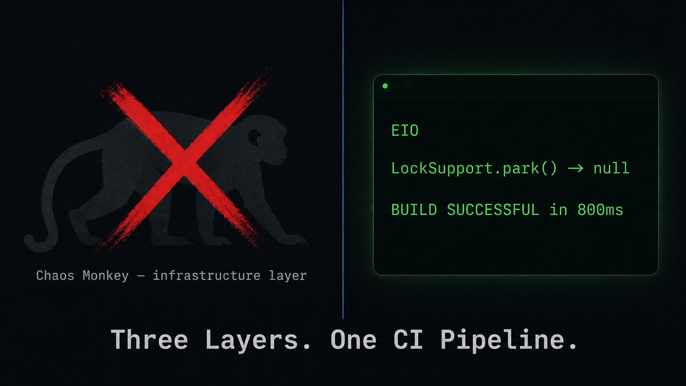
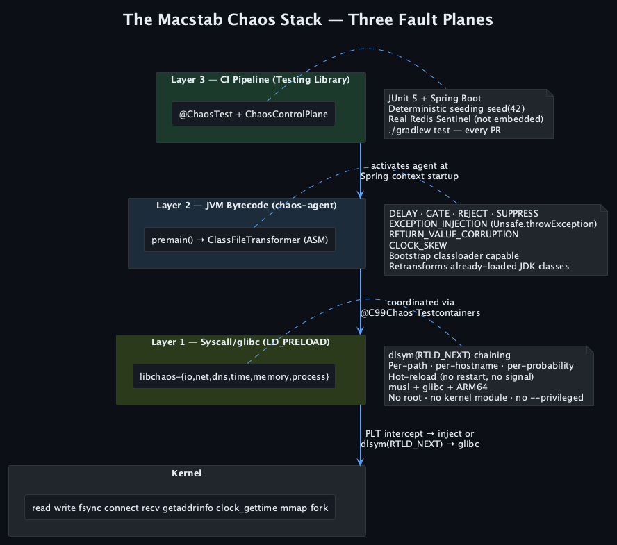
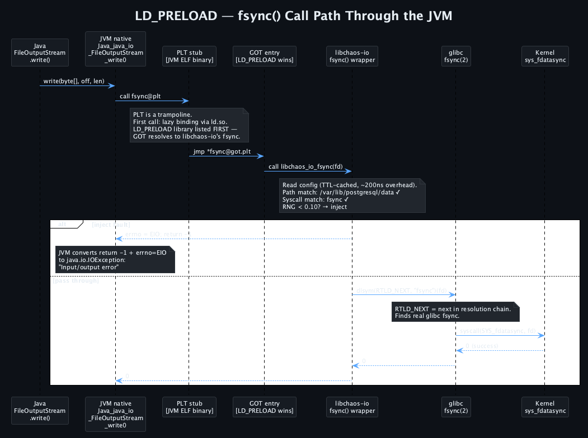
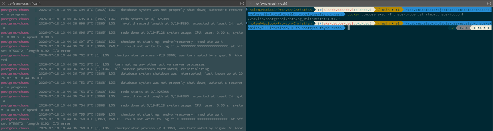
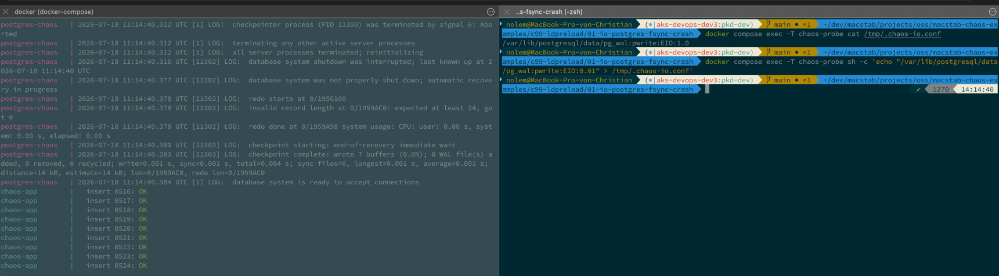
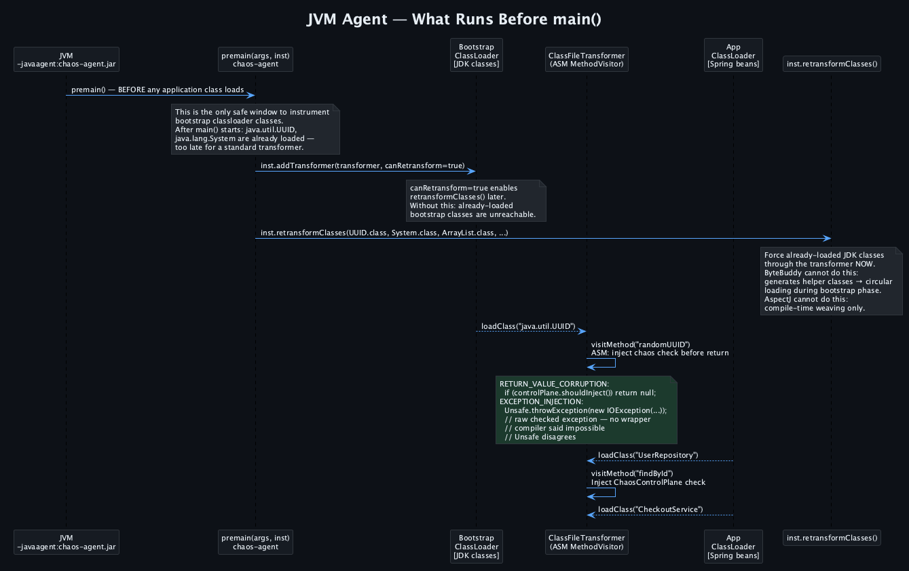
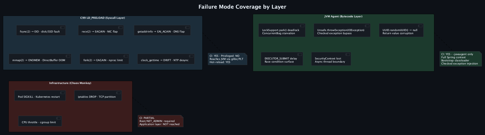
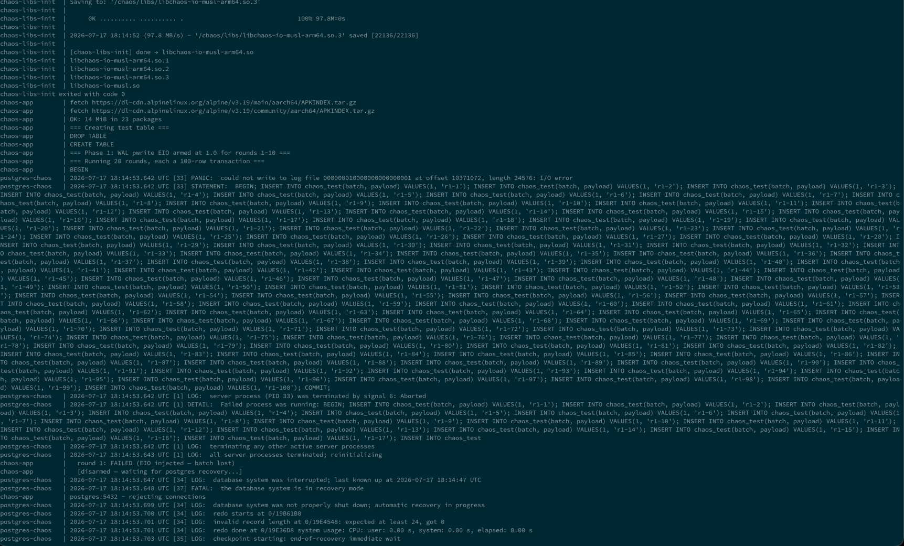
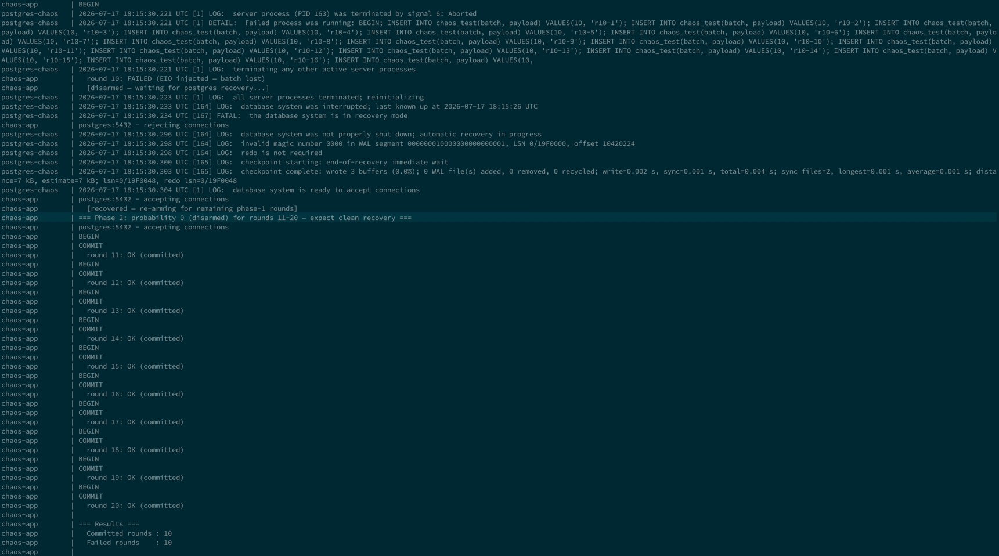
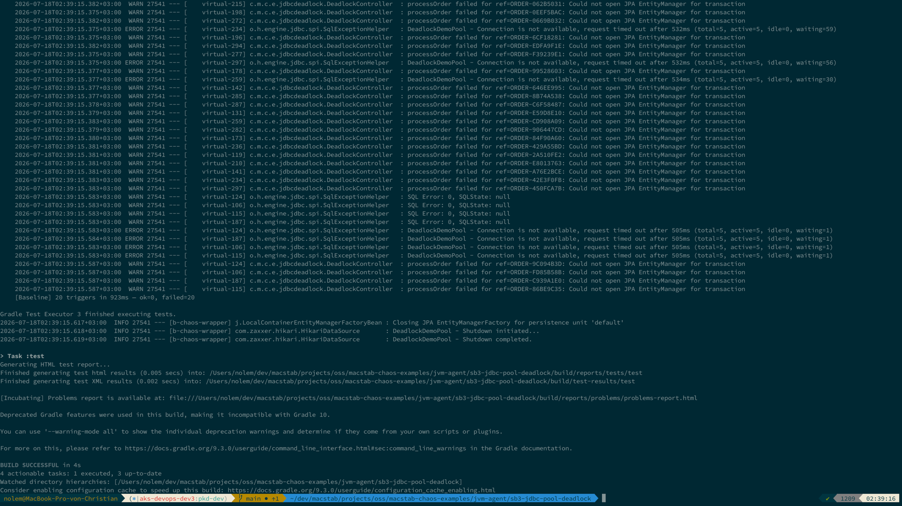

# The Macstab Chaos Stack: Testing the Vertical From Syscall to CI Pipeline

**Target — one Markdown master, cross-posted in priority order:**
**EN:** Medium *(primary — submit to Towards Dev / Better Programming / Java in Plain English)* → DZone → Dev.to →
Baeldung → Hashnode → The New Stack → InfoQ → JavaWorld/InfoWorld → LinkedIn Article → GitHub README.
**DE:** Heise/iX → Java Magazin (Entwickler.de) → Xing → JAX blog → t3n.
**SEO primary:** chaos engineering CI pipeline syscall bytecode Java
**SEO secondary:** LD_PRELOAD chaos testing · JVM agent fault injection · chaos engineering vs chaos testing
**Tags:** chaos-engineering · java · spring-boot · ci-cd · testing · linux · syscall · ld-preload

> ▶ **Companion video** — the full syscall→CI walkthrough on the *
*[Macstab Engineering](https://www.youtube.com/@MacstabEngineering)** channel.
> *Publishing note: on Medium / Dev.to, paste the direct Episode-00 video URL on its own line to auto-embed the player;
keep this channel link as the fallback.*

---



## The Failure Modes Chaos Monkey Cannot Reach

[Chaos Monkey](https://netflix.github.io/chaosmonkey/) kills your pod. The Linux kernel sends SIGKILL. The process
exits. The kernel closes every open file descriptor. Its TCP connections disappear as a whole — callers and downstream
peers observe an EOF, a reset, or a timeout depending on socket state, surfacing as a `SocketException`. Kubernetes
observes the terminated container and restarts or replaces it according to the workload policy. The callers' circuit
breakers open. Their retry logic fires. Your runbook says this scenario is covered.

It is covered. For this failure mode.

Here is what happened in a production incident: a storage controller under load caused WAL-path `pwrite(2)` and
`fdatasync(2)` calls to return `EIO`. Not all writes. Not all connections. Just WAL segment writes, just under load,
just sometimes. PostgreSQL reported an I/O failure on the WAL path, raised a PANIC-level error, and entered crash
recovery — taking the data directory down. The application continued accepting HTTP requests. The pool had not yet
marked every connection unusable. The health/liveness endpoint still returned 200 because it did not check database
writability. Kubernetes saw nothing to restart. Four hours of debugging before anyone ran `dmesg` and saw the storage
errors.

Chaos Monkey, [Toxiproxy](https://github.com/Shopify/toxiproxy), and [
`iptables`](https://man7.org/linux/man-pages/man8/iptables.8.html) operate at the process, proxy, or network level; they
cannot reproduce the exact `pwrite()`/`fdatasync()` call semantics described here. The kernel's own disk-fault
primitive — the [`dm-flakey`](https://docs.kernel.org/admin-guide/device-mapper/dm-flakey.html) device-mapper target —
comes closest, but it needs a dedicated device-mapper device and root, not a per-path, per-syscall probability you flip
live in a CI job. Broader platforms such as [Chaos Mesh](https://chaos-mesh.org/) also provide filesystem- and JVM-level
fault injection, but through a different control plane and deployment model. The Macstab stack focuses on call-specific
libc interposition and JVM fault tests that run directly as PR regression gates.

---

## The Taxonomy Gap Nobody Talks About

Many common chaos experiments focus on infrastructure-level behavior: pod termination, network partitions, resource
pressure, and whole-component failure. Full platforms can reach beyond that boundary — for example, Chaos Mesh provides
filesystem, JVM, DNS, time, and kernel experiments — but their execution model is different from a test-scoped PR
regression gate with seeded JVM sampling.

**Infrastructure-layer failures** are binary and abrupt:

- Pod kill → SIGKILL → kernel closes file descriptors → connection dropped → `SocketException` → handled
- Network partition → `iptables -j DROP` → TCP keepalive fires after timeout → connection declared dead → handled
- CPU throttle → cgroup `cpu.cfs_quota_us` reduction → slow but running
- Disk fill → `fallocate` → `ENOSPC` on next write → handled

These produce clean, detectable signals. Your circuit breaker, retry logic, and service mesh all respond as designed.
This is genuinely useful testing — it validates that your resilience infrastructure works.

Those experiments validate important resilience properties, but they do not by themselves cover every call-specific or
JVM-internal failure path that appears in production.

**Syscall-layer failures** are partial and probabilistic:

`recv(2)` returning `EAGAIN` on a nonblocking ESTABLISHED socket after the application expected readiness: the socket is
alive and the next call might succeed. Your application's retry logic may not handle this correctly — it was written
assuming `EAGAIN` only appears during non-blocking I/O setup, not during data reads on a live connection.
`iptables -j DROP` causes TCP keepalive to eventually declare the connection dead — a clean `SocketException`. These are
different failure semantics. You cannot reproduce one by simulating the other.

`getaddrinfo(3)` returning `EAI_AGAIN`: pointing DNS at a broken resolver gives you `EAI_NONAME` (NXDOMAIN — permanent
failure) or a timeout. `EAI_AGAIN` represents a temporary resolver failure and normally belongs on a retryable error
path. Different error path. Different handler. Different production behavior.

**JVM-internal failures** are in a third category — the OS cannot see them, and the JVM's own tooling often cannot
either:

`ThreadMXBean.findDeadlockedThreads()` returns null during a
live [HikariCP](https://github.com/brettwooldridge/HikariCP) connection-pool exhaustion. In the runnable example, five
outer transactions each hold one connection while nested `REQUIRES_NEW` work requests another. Every pool entry is held
by work that cannot complete until an additional entry becomes available. HikariCP's waiting path eventually uses
`LockSupport.parkNanos()`, but the JVM deadlock detector only reports cycles involving object monitors or ownable
synchronizers. There is no such ownership cycle to report. Threads remain parked until HikariCP logs
`Connection is not available, request timed out`, while `ThreadMXBean` still returns null.

Source-level proxies and interceptors often have to wrap an undeclared checked exception before propagating it through
an API that does not declare that type. Different wrapper, different handler. The JVM agent injects the configured
throwable into transformed bytecode at method entry, allowing the original exception type to reach the calling frame.

These are not edge cases. These are the failure modes behind multi-hour production incidents where every diagnostic tool
gives you a null or a false negative.

---

## Three Layers, One CI Pipeline

The Macstab Chaos Stack has three components, each operating at one of these fault planes.


*Three fault planes — the CI/testing layer activates the JVM agent, which is coordinated with the syscall layer; each
catches what the others cannot.*

### Layer 1: C99 LD_PRELOAD Libraries

The Linux dynamic linker resolves symbol references by walking the `DT_NEEDED` entries in the binary's dynamic section
and the `LD_PRELOAD` list, in priority order. The first matching symbol wins.

Six shared libraries preloaded via `LD_PRELOAD`. Each intercepts a group of related syscalls at the Procedure Linkage
Table (PLT) boundary, deciding per-call whether to inject a fault or call `dlsym(RTLD_NEXT, "symbol_name")` — the next
implementation in the resolution chain — to pass through:

| Library            | Representative intercepted calls                             | Fault types                             |
|--------------------|--------------------------------------------------------------|-----------------------------------------|
| `libchaos-io`      | `open`, `write`, `read`, `fsync`, `fdatasync`, `close`       | EIO, ENOSPC, EAGAIN, latency            |
| `libchaos-net`     | `connect`, `accept`, `recv`, `recvfrom`, `send`, `sendto`    | ECONNREFUSED, EAGAIN, ECONNRESET, EPIPE |
| `libchaos-dns`     | `getaddrinfo`                                                | EAI_AGAIN, EAI_NONAME, latency          |
| `libchaos-time`    | `clock_gettime`                                              | OFFSET ±ms, per clock_id                |
| `libchaos-memory`  | `mmap`, `munmap`, `mprotect`, `madvise`                      | ENOMEM, EINVAL                          |
| `libchaos-process` | `pthread_create`, `fork`, `posix_spawn`, `execve`, `waitpid` | EAGAIN, EACCES                          |

Releases for all variants (musl, glibc, amd64, arm64) are on GitHub:
→ **[github.com/macstab/macstab-chaos-testing-libraries](https://github.com/macstab/macstab-chaos-testing-libraries)**

On Linux, the JVM launcher and native runtime participate in the ELF dynamic-linking model. Native I/O that reaches libc
through interposable symbols can therefore pass through an `LD_PRELOAD` wrapper. Statically linked binaries and code
that issues direct syscalls bypass this mechanism. When Java file I/O reaches libc, the path is:

```
Java bytecode
  → JNI native: Java_java_io_FileOutputStream_write / writeBytes
    → glibc write(2) via PLT stub
      → libchaos-io's write() wrapper  ← intercept here
        → dlsym(RTLD_NEXT, "write") → glibc → kernel
```


*Where `LD_PRELOAD` wins: the `GOT` entry resolves `fsync` to libchaos-io's wrapper before glibc — the interception
point — then `dlsym(RTLD_NEXT)` chains through to the real glibc call on pass-through.*

**Configuration:**

```
# .chaos-io.conf — per-path, per-syscall, per-probability
/var/lib/postgresql/data:fsync:EIO:0.10
/var/log/app:write:ENOSPC:0.05

# .chaos-net.conf — selectors are socket endpoints (ipv4-or-* : port),
# not container DNS names; libchaos-net normalizes the sockaddr to an endpoint.
tcp4://*:6379:recv:EAGAIN:0.10
tcp4://*:5432:recv:ECONNRESET:0.05

# .chaos-dns.conf — DNS selectors DO take names; LATENCY takes <ms>@<probability>
dns://downstream-service:EAI_AGAIN:0.30
dns://kafka:LATENCY:500@0.20
```

**Hot-reload:** every intercepted call runs `stat()` on the config file. When the file's mtime changes, the library
atomically swaps to a fresh config snapshot — no TTL, no signal, no API call. The change takes effect on the next
intercepted call after the write.

```bash
# Docker example: update the config in the shared volume that the process reads.
docker compose exec -T chaos-probe sh -c \
  "printf '/var/lib/postgresql/data/pg_wal:fdatasync:EIO:0.80\n' \
   > /tmp/.chaos-io.conf"
# The next matching fdatasync observes the new snapshot; no process restart.
```


*Armed: with the rule in the shared config, every commit fails at the WAL write — PostgreSQL is crash-looping, and no
process was restarted.*


*Delete the rule → the next intercepted WAL write succeeds → PostgreSQL crash-recovers and commits go green again.
Config-only, no restart, no redeploy.*

**No root. No kernel module. No `--privileged`.** Runs on standard GitHub Actions, GitLab CI, Jenkins runners.

### Layer 2: JVM Bytecode Agent

The agent loads one of two ways. Through `premain(String agentArgs, Instrumentation inst)` before application startup —
the earliest instrumentation point, so bootstrap classloader classes (`java.lang.*`, `java.util.*`, `java.io.*`,
`java.util.UUID`) are transformed before they are first accessed. Or through dynamic self-attach via `agentmain`, which
retransforms already-loaded, modifiable target classes at runtime — this is how `@ChaosTest` installs the agent into a
running test JVM with no `-javaagent` flag.

We register a `ClassFileTransformer`. Every class load from every classloader passes through it. For already-loaded JDK
classes we call `inst.retransformClasses()` explicitly with `canRetransform=true`. The agent currently wires 62 of 67
operation types through 57 bootstrap interception handles, using [ByteBuddy](https://bytebuddy.net/) `@Advice` with
inline advice copy — the advice code is woven directly into the target method bytecode, generating no helper classes. A
`BootstrapDispatcher` class is resident in the bootstrap classloader and bridges to the agent logic via a
`MethodHandle`. This eliminates circular classloading at the bootstrap level while using ByteBuddy throughout.
Source-level weaving and proxy interception operate under different exception-propagation constraints. The agent instead
injects the configured throwable into transformed bytecode at method entry.


*`premain()` is the only safe window to instrument bootstrap-classloader classes; `retransformClasses()` forces
already-loaded JDK classes back through the transformer — something ByteBuddy's helper-class generation and AspectJ's
compile-time weaving cannot do at this phase.*

**Two families of effects.** *Inline (interceptor) effects* run on the calling thread the moment a matched method fires;
*background stressor effects* apply sustained JVM-resource pressure. Effects compose across matching scenarios — delays
accumulate, terminal actions (`reject` / `suppress` / `injectException` / `corruptReturnValue`) resolve by precedence.

*Inline (interceptor) effects — 9:*

| Effect                                              | What it does                                                                               |
|-----------------------------------------------------|--------------------------------------------------------------------------------------------|
| `delay(Duration)` · `delay(min, max)`               | Fixed or uniform-random pause before the operation — widens race windows deterministically |
| `gate(Duration maxBlock)`                           | Block until `handle.release()` is called (or `maxBlock` elapses) — a hung downstream       |
| `reject(String)`                                    | Throw a semantically correct exception for the operation type                              |
| `suppress()`                                        | Silently discard; return `null` / `false` per the operation contract                       |
| `exceptionalCompletion(FailureKind, String)`        | Complete a `CompletableFuture` with a failure                                              |
| `injectException(String className, String message)` | Inject an arbitrary exception at method entry                                              |
| `corruptReturnValue(ReturnValueStrategy)`           | Corrupt the return value: `NULL`, `ZERO`, `EMPTY`, `BOUNDARY_MAX`, `BOUNDARY_MIN`          |
| `skewClock(Duration, ClockSkewMode)`                | Skew `currentTimeMillis()` / `nanoTime()`: `FIXED`, `DRIFT`, `FREEZE`                      |
| `spuriousWakeup()`                                  | Force `Selector.select()` to return 0 immediately                                          |

*Background stressor effects — 14:*

| Effect                                           | What it does                                                            |
|--------------------------------------------------|-------------------------------------------------------------------------|
| `heapPressure(bytes, chunkSize)`                 | Retain `byte[]` allocations on the heap                                 |
| `keepAlive(name, daemon, heartbeat)`             | Spawn an idle keep-alive thread                                         |
| `metaspacePressure(classCount, fieldsPerClass)`  | Define synthetic classes into an isolated classloader                   |
| `directBufferPressure(totalBytes, bufferSize)`   | Allocate off-heap `ByteBuffer.allocateDirect`                           |
| `gcPressure(bytesPerSecond, duration)`           | Continuously allocate short-lived objects                               |
| `finalizerBacklog(objectCount, delay)`           | Flood the finalizer queue                                               |
| `deadlock(participantCount)` ¹                   | Create a real JVM monitor deadlock between N threads                    |
| `threadLeak(count, prefix, daemon)` ¹            | Start permanently-parked threads that are never joined                  |
| `threadLocalLeak(entriesPerThread, valueSize)`   | Leak `ThreadLocal` entries on a background thread                       |
| `monitorContention(…)`                           | Saturate a shared lock with background contenders                       |
| `codeCachePressure(classCount, methodsPerClass)` | Generate classes to fill the JIT code cache                             |
| `safepointStorm(gcInterval)`                     | Periodic `System.gc()` + `retransformClasses()` → stop-the-world pauses |
| `stringInternPressure(internCount, length)`      | Intern unique strings into the JVM string pool                          |
| `referenceQueueFlood(referenceCount, interval)`  | Flood the reference queue with phantom references                       |

¹ `deadlock()` and `threadLeak(daemon=false)` are **non-recoverable** within the JVM process and require
`ActivationPolicy.withDestructiveEffects()` at registration. Closing the activation handle interrupts the participating
threads and releases the locks; use only in controlled test environments.

`injectException(...)` places an arbitrary exception — including a *checked* one — at method entry, and it reaches the
calling frame as that exception type, not wrapped away as an `UndeclaredThrowableException`. The compiler said this
method cannot throw `IOException`. The instrumented path says otherwise. This is what makes testing real production
exception propagation accurate — the same raw checked exception that reaches the frame when storage actually fails.

The agent source is on GitHub:
→ **[github.com/macstab/macstab-chaos-jvm-agent](https://github.com/macstab/macstab-chaos-jvm-agent)**

```kotlin
// Spring Boot 4
testImplementation("com.macstab.chaos.jvm:chaos-agent-spring-boot4-test-starter:1.0.0")

// Spring Boot 3
testImplementation("com.macstab.chaos.jvm:chaos-agent-spring-boot3-test-starter:1.0.0")
```

### Layer 3: Testing Library

```java

@ChaosTest(classes = MyApplication.class, webEnvironment = RANDOM_PORT)
class CheckoutServiceIT {

    @Autowired
    TestRestTemplate testRestTemplate;
    private final CheckoutRequest request = new CheckoutRequest(/* … abridged */);

    @Test
    void checkout_handles_uuid_null_from_corrupted_generator(
            ChaosControlPlane controlPlane) throws Exception {

        try (var handle = controlPlane.activate(
                ChaosScenario.builder("uuid-null")
                        .selector(ChaosSelector.method("java.util.UUID", "randomUUID"))
                        .effect(ChaosEffect.returnValue(null))
                        // ActivationPolicy is a record: (startMode, probability,
                        // activateAfterMatches, maxApplications, activeFor, rateLimit,
                        // randomSeed, allowDestructiveEffects)
                        .activationPolicy(new ActivationPolicy(
                                ActivationPolicy.StartMode.AUTOMATIC, 0.50,
                                0L, 3L, null, null, 42L, false))
                        .build())) {

            ResponseEntity<String> response =
                    testRestTemplate.postForEntity("/checkout", request, String.class);
            // Must not 500 — must handle null UUID gracefully
            assertThat(response.getStatusCode()).isNotEqualTo(HttpStatus.INTERNAL_SERVER_ERROR);
        }
    }
}
```

One annotation. `@ChaosTest` is meta-annotated with `@SpringBootTest` and registers `ChaosAgentExtension`. At test
startup: JVM agent attaches, `ChaosControlPlane` registers in the Spring context, everything else — Testcontainers,
WireMock, your database containers — is unchanged.

`new ActivationPolicy(AUTOMATIC, 0.50, 0L, 3L, null, null, 42L, false)`:

- `randomSeed = 42L` — reproducible probability sampling for the same scenario and the same ordered stream of matching
  calls. Different thread scheduling can reorder those calls, so the seed removes one source of randomness rather than
  making arbitrary concurrent executions identical.
- `maxApplications = 3L` — at most three fault applications; after the third successful application the scenario stops
  injecting. Bounded. No flakiness from excessive injection.

**Container-level C99 coordination.** The public Testcontainers API marks the target container with `@AppContainer` and
declares the libc domain through `@SyscallLevelChaos`. `ChaosTestingExtension` copies the architecture/libc-matched
`.so` from the test module JAR into the container through the Docker API, appends `LD_PRELOAD`, and manages the
in-container rule file:

```java

@Testcontainers
@ExtendWith(ChaosTestingExtension.class)
@SyscallLevelChaos(LibchaosLib.IO)
class FullStackChaosIT {

    @Container
    @AppContainer
    static GenericContainer<?> app =
            new GenericContainer<>("my-app:latest");

    @Test
    void application_handles_partial_write_failure() {
        // Apply the chosen L1/L2/L3 I/O annotation or transport rule,
        // then assert the real container's behavior under libc-level EIO.
    }
}
```

Additional domains are enabled with the supported `@SyscallLevelChaos` composition and their corresponding L1, L2, or L3
annotations.

**Real infrastructure topologies.** Redis Sentinel with real promotion semantics — not embedded Redis stubs. Embedded
stubs do not implement Sentinel failover correctly. Distributed lock split-brain tests require real Sentinel promotion.
The testing library provisions it automatically via Testcontainers.

---

## Coverage Comparison


*Which failure mode each layer can reach. (On Medium, where tables don't render, use this image in place of the table
below.)*

| Failure mode                                                     | C99 LD_PRELOAD | JVM Agent | Pod/network-only tools |
|------------------------------------------------------------------|:--------------:|:---------:|:----------------------:|
| `fsync(2)` → EIO (disk/SSD fault)                                |       ✅        |     ❌     |           ❌            |
| `recv(2)` → EAGAIN on ESTABLISHED                                |       ✅        |     ❌     |           ❌            |
| `getaddrinfo(3)` → EAI_AGAIN                                     |       ✅        |     ❌     |           ❌            |
| `mmap(2)` → ENOMEM (DirectBuffer OOM)                            |       ✅        |     ❌     |           ❌            |
| `fork(2)` → EAGAIN (nproc limit)                                 |       ✅        |     ❌     |           ❌            |
| libc `clock_gettime(2)` drift                                    |       ✅        |     ❌     |           ❌            |
| JVM clock skew via `skewClock` (FIXED/DRIFT/FREEZE)              |       ❌        |     ✅     |           ❌            |
| Transparent system-clock interception after JIT                  |       ❌        |     ❌     |           ❌            |
| HikariCP pool exhaustion invisible to JVM deadlock detection     |       ❌        |     ✅     |           ❌            |
| `UUID.randomUUID()` → null                                       |       ❌        |     ✅     |           ❌            |
| Raw checked IOException injection                                |       ❌        |     ✅     |           ❌            |
| Pod kill / Kubernetes restart                                    |       ❌        |     ❌     |           ✅            |
| Runs as a normal test without a privileged cluster control plane |       ✅        |     ✅     |         varies         |
| Probability-based injection                                      |       ✅        |     ✅     |         varies         |
| User-controlled deterministic seed                               |       ❌        |     ✅     |         varies         |

Pod- and network-level experiments remain essential. Filesystem- and JVM-aware platforms can cover additional rows. The
comparison highlights the Macstab stack's specific execution model: call-scoped libc faults and JVM-internal effects
packaged as test-scoped PR regression gates. These layers complement rather than replace broader chaos platforms.

---

## Getting Started: Layer 1 in 3 Minutes

Clone the examples repo and run the PostgreSQL WAL crash example:

```bash
git clone https://github.com/macstab/macstab-chaos-examples
cd macstab-chaos-examples/c99-ldpreload/01-io-postgres-fsync-crash
CHAOS_LIBS_VERSION=1.0.0 docker compose up
```

The `docker-compose.yml` has a `chaos-libs-init` service (plain `alpine`) that downloads the architecture-matched `.so`
from GitHub Releases into a shared volume, and a `postgres` service that sets `LD_PRELOAD` in its entrypoint. The config
lives in the shared `chaos-conf` volume at `/tmp/.chaos-io.conf` — there is no host file bind-mount:

```yaml
services:
  chaos-libs-init: # downloads libchaos-io-musl-<arch>.so → chaos-libs
    image: alpine:3.19
    volumes: [ "chaos-libs:/chaos/libs" ]

  postgres:
    image: postgres:16-alpine
    environment: { POSTGRES_USER: chaos, POSTGRES_PASSWORD: chaos, POSTGRES_DB: chaosdb }
    volumes:
      - chaos-libs:/chaos/libs:ro
      - chaos-conf:/tmp                # /tmp/.chaos-io.conf is read on every intercepted call
    entrypoint:
      - sh
      - -c
      - 'export LD_PRELOAD=/chaos/libs/libchaos-io-musl.so;
         exec su-exec postgres docker-entrypoint.sh postgres'
```

The bundled `app` container arms chaos on PostgreSQL's WAL directory and runs the INSERT workload for you — you'll watch
batches fail as WAL `pwrite`/`fdatasync` return EIO. To drive the rate yourself, write the config **inside** the
volume (postgres reads it there) and change it live — no restart:

```bash
# 80% EIO on WAL sync — PostgreSQL PANICs and halts (WAL integrity is non-negotiable)
docker compose exec -T chaos-probe sh -c 'cat > /tmp/.chaos-io.conf <<EOF
/var/lib/postgresql/data/pg_wal:pwrite:EIO:0.80
/var/lib/postgresql/data/pg_wal:fdatasync:EIO:0.80
EOF'

# Remove the fault before restart/recovery.
docker compose exec -T chaos-probe rm -f /tmp/.chaos-io.conf
docker compose restart postgres
docker compose exec postgres sh -c \
  'until pg_isready -U chaos -d chaosdb -q; do sleep 0.2; done'
# Re-arm a low rate only after recovery has completed, when the next test needs it.
```


*`fsync`/`pwrite` returning EIO at the glibc boundary → PostgreSQL raises a PANIC and enters crash recovery. Not
reproducible with `iptables` or a pod kill.*


*Remove the fault and restart → PostgreSQL completes crash recovery and accepts connections again. Only committed data
survives.*

**→ [All C99 examples](https://github.com/macstab/macstab-chaos-examples/tree/main/c99-ldpreload)**

---

## Getting Started: Layers 2 and 3 in 2 Minutes

Add the starter to your `build.gradle.kts`:

```kotlin
testImplementation("com.macstab.chaos.jvm:chaos-agent-spring-boot4-test-starter:1.0.0")
```

The runnable `JdbcPoolDeadlockIT` keeps two claims separate: the baseline pool-exhaustion behavior and the seeded
fail-fast injection. The following snippets are abridged;
the [full source](https://github.com/macstab/macstab-chaos-examples/blob/main/jvm-agent/sb3-jdbc-pool-deadlock/src/test/java/com/macstab/chaos/examples/jdbcdeadlock/JdbcPoolDeadlockIT.java)
contains the application setup and helper methods.

### A. Prove pool exhaustion is invisible to the JVM deadlock detector

```java

@ChaosTest(
        classes = MyApplication.class,
        webEnvironment = RANDOM_PORT,
        properties = {
                "spring.datasource.hikari.maximum-pool-size=5",
                "spring.datasource.hikari.connection-timeout=500"
        }
)
class JdbcPoolDeadlockIT {

    @Autowired
    TestRestTemplate rest;

    @Test
    void twentyConcurrentRequestsExhaustPoolWhileThreadMxBeanReturnsNull()
            throws Exception {

        AtomicInteger failed = new AtomicInteger();
        ExecutorService executor = Executors.newVirtualThreadPerTaskExecutor();

        for (int i = 0; i < 20; i++) {
            executor.submit(() -> {
                Map<?, ?> result = rest.getForObject("/trigger", Map.class);
                if (result == null || ((Number) result.get("failure_count")).intValue() > 0) {
                    failed.incrementAndGet();
                }
            });
        }

        Thread.sleep(300); // active pool-exhaustion window
        assertThat(ManagementFactory.getThreadMXBean().findDeadlockedThreads())
                .isNull();

        executor.shutdown();
        assertThat(executor.awaitTermination(10, TimeUnit.SECONDS)).isTrue();
        assertThat(failed.get()).isEqualTo(20);
    }
}
```

Five outer transactions hold the five available connections while nested `REQUIRES_NEW` work requests another. The
application is resource-deadlocked, but no monitor/ownable-synchronizer cycle exists for `ThreadMXBean` to return.


*Both assertions green at once: `ThreadMXBean.findDeadlockedThreads()` returns `null` while all 20 requests observe
HikariCP pool exhaustion. The JVM's own deadlock detector is blind to it — and the whole Macstab stack proves it, then
the app recovers, on every PR.*

### B. Prove seeded JDBC injection fails fast and repeats its sampling decisions

```java

@Test
void seededJdbcFaultsExposeTheFailureBeforeTheNormalPoolTimeout(
        ChaosControlPlane plane) throws Exception {

    AtomicInteger injectedFailures = new AtomicInteger();
    long started = System.nanoTime();

    try (var scenario = plane.activate(
            ChaosScenario.builder("seeded-jdbc-fault")
                    .selector(ChaosSelector.jdbc())
                    .effect(ChaosEffect.reject("seeded JDBC fault"))
                    .activationPolicy(new ActivationPolicy(
                            ActivationPolicy.StartMode.AUTOMATIC,
                            0.20, 0L, null, null, null, 42L, false))
                    .build())) {

        runConcurrentTriggers(injectedFailures);
    }

    assertThat(Duration.ofNanos(System.nanoTime() - started))
            .isLessThan(Duration.ofSeconds(5));
    assertThat(injectedFailures.get()).isPositive();
}
```

The fixed seed reproduces probability decisions when the same ordered stream of matching JDBC calls is reached. It does
not freeze operating-system thread scheduling.

```bash
./gradlew test
```

No staging environment. The tests run as part of the normal build and catch future changes to pool sizing, transaction
propagation, asynchronous wrapping, and exception handling.

**→ [macstab-chaos-jvm-agent](https://github.com/macstab/macstab-chaos-jvm-agent)** · *
*[JVM agent examples](https://github.com/macstab/macstab-chaos-examples/tree/main/jvm-agent)**

---

## Manual Test vs CI Test

Manual chaos testing — running tools against staging, triggering faults, observing behavior — produces real insights. It
also has a structural problem: it is a point-in-time validation.

A manual test performed today tells you that today's build handles fault X on today's configuration. It tells you
nothing about next sprint's build, when an engineer adds a new `@Async` wrapper, adjusts the HikariCP pool size, or adds
a dependency that changes the exception propagation path.

A CI chaos test is a regression gate. Seeded sampling makes the agent's probability decisions repeatable for a fixed
ordered stream of matching calls, removing one important source of flakiness. Normal concurrency, timing, and
environment differences still need ordinary test engineering. The failure report identifies the active scenario, and the
same execution path can be reproduced locally with one command.

**Manual test validates once. CI test prevents forever.**

---

## The Series

**00-1 — C99 LD_PRELOAD Libraries:** PLT/GOT interception internals. `dlsym(RTLD_NEXT)` chaining under multiple
preloaded libraries. All 6 libraries, all config options, all injectable error codes. musl vs glibc. Hot-reload
implementation.
→ [github.com/macstab/macstab-chaos-testing-libraries](https://github.com/macstab/macstab-chaos-testing-libraries)

**00-2 — JVM Chaos Agent:** `premain()` vs `agentmain()` — the timing window difference and why it matters for bootstrap
instrumentation. `ClassFileTransformer` and `inst.retransformClasses()`. ByteBuddy `@Advice` inline copy +
`BootstrapDispatcher` + `MethodHandle` bridge — why this structure is necessary at the bootstrap classloader level. All
effects — 9 inline interceptor effects + 14 background stressor effects. Exception injection at JVM bytecode level.
→ [github.com/macstab/macstab-chaos-jvm-agent](https://github.com/macstab/macstab-chaos-jvm-agent)

**00-3 — Testing Library:** `@ChaosTest` internals. `ChaosControlPlane` activation API. Seeded probability sampling.
Real Redis Sentinel topology provisioning. `@SyscallLevelChaos`, `@AppContainer`, and full-stack coordination.
→ [github.com/macstab/chaos-testing](https://github.com/macstab/chaos-testing)

**Series 1 — Production Incidents:** Ten failure modes, each a reproduction of a real incident. HikariCP pool exhaustion
invisible to JVM deadlock detection. PostgreSQL WAL fsync failure. Redis TCP pool poisoning. DNS ndots:5 amplification.
Distributed lock clock split-brain. fork EAGAIN under nproc limits. DirectBuffer OOM. Raw checked-exception injection at
method entry. Return value corruption. Six simultaneous syscall faults.

---

## Repositories

| Repo                                                                                                  | What's in it                                                                                                                                                              |
|-------------------------------------------------------------------------------------------------------|---------------------------------------------------------------------------------------------------------------------------------------------------------------------------|
| [macstab/macstab-chaos-jvm-agent](https://github.com/macstab/macstab-chaos-jvm-agent)                 | JVM bytecode agent — `premain`/`agentmain`, ByteBuddy `@Advice` inline copy + `BootstrapDispatcher` + `MethodHandle` bridge, 9 inline + 14 stressor effects, 19 selectors |
| [macstab/chaos-testing](https://github.com/macstab/chaos-testing)                                     | Testing library — `@ChaosTest`, `ChaosControlPlane`, session isolation, Redis topologies                                                                                  |
| [macstab/macstab-chaos-testing-libraries](https://github.com/macstab/macstab-chaos-testing-libraries) | C99 LD_PRELOAD libraries — sources + GitHub Releases (musl/glibc, amd64/arm64)                                                                                            |
| [macstab/macstab-chaos-examples](https://github.com/macstab/macstab-chaos-examples)                   | Runnable examples — JVM agent, C99 LD_PRELOAD, full-stack combinations                                                                                                    |
| `com.macstab.chaos.jvm:chaos-agent-spring-boot4-test-starter`                                         | Spring Boot 4 test starter — Maven Central (1.0.0)                                                                                                                        |
| `com.macstab.chaos.jvm:chaos-agent-spring-boot3-test-starter`                                         | Spring Boot 3 test starter — Maven Central (1.0.0)                                                                                                                        |

---

## About the Author

**Christian Schnapka** is a principal+ backend engineer with 30 years of experience in Java, C++, cloud, and hardcore
backend architecture. He has been the technical lead in nearly every team he has joined — from embedded systems to
large-scale distributed platforms.

He built the Macstab Chaos Stack because the combination he needed — call-specific libc faults, JVM-internal effects,
real container topologies, and test-scoped PR regression gates — was not available in one coherent workflow. Manual
reproduction is possible but difficult to repeat, while infrastructure chaos validates a different and complementary set
of resilience properties.

He publishes under **[Macstab](https://macstab.com)**, his own company. In the demo scene he went by **Per!**, **nolem
**, and **chaos**.

Current work: authorization platforms (OAuth2, Spring Authorization Server) and energy management systems (Spring Boot,
React). Principal embedded developer. Lives in Wentorf bei Hamburg, Germany.

Follow along:

- **Website:** [macstab.com](https://macstab.com)
- **YouTube:** [Macstab Engineering](https://www.youtube.com/@MacstabEngineering) — the chaos engineering series
- **GitHub:** [github.com/macstab](https://github.com/macstab)
- **LinkedIn:** Christian Schnapka

*If any of this fails on your system — open an issue. The examples are meant to run.*