# Six C99 Libraries That Rewrite the libc/Kernel Contract of a Process You Never Recompiled

*Macstab Chaos Stack, Layer 1 — LD_PRELOAD fault injection for the failures you cannot rehearse today.*

> 🎥 **Video walkthrough coming soon** — subscribe on **[Macstab Engineering](https://www.youtube.com/@MacstabEngineering)**.

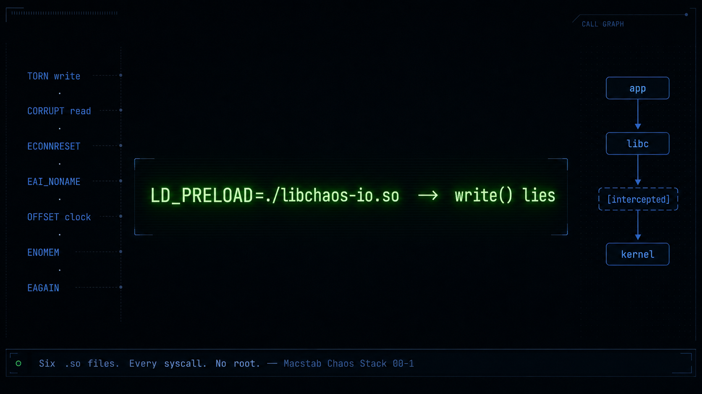
*Six shared objects, one point of interposition: the libc call your program makes and trusts.*

---

**Your retry, timeout, and failover code has never run under a real failure** — its first execution is the outage it was built to prevent, because a fault like a disk error or a mid-stream reset can't be scheduled. These six libraries make each one a single deterministic line you run in CI.

The reason is simple: you cannot summon the fault. Not a disk that returns `EIO` on one write in ten, not a `getaddrinfo` that fails one call in twenty, not a connection that resets mid-request while the pool still calls it healthy, not a clock that steps backward across a live migration — none of it on command, none of it the same way twice. So teams reach for infrastructure chaos instead: kill a pod, sever a link. The scheduler replaces the pod, the dashboard goes green, and all you proved is that your orchestrator can count to one. And it is *flaky* — it degrades differently every run; the liveness probe stays green because it watches the process, not whether the database can still commit; nothing restarts; four hours later someone reads `dmesg`. A test that never behaves the same way twice cannot gate a pull request, so it never becomes a test at all.

This is what did not exist: **stable, deterministic chaos you can automate.** These six C99 libraries — Layer 1 of the Macstab Chaos Stack — turn each of those failures into one line of text, injected where the fault is actually real: the libc call your program makes and trusts. `EIO` on the third write to the write-ahead log. `ECONNRESET` on 3% of sends. A wall clock forty seconds fast. Same config, same failure, every run — on an *unmodified* binary, in any language, with no recompile, no root, no kernel module, and fast enough to run on every commit instead of once a quarter. The failure you could never stage now fires in milliseconds, identically, a thousand times over, red or green, inside CI. One shared object on `LD_PRELOAD`, one text file you rewrite while the process runs — that is the entire apparatus.

Read this at whatever depth you work at: ship from the config lines this afternoon, or follow the six fault sections all the way down — sector atomicity, the retransmission timer, the vDSO, `clone` flags — to where the behaviour is actually decided.

## How the interposition works

When a dynamically-linked program calls `write()`, it does not jump into glibc. It jumps to a stub in the executable's **Procedure Linkage Table (`.plt`)**, whose `.got.plt` slot points back into the PLT header. That first call hands off to the dynamic linker's [lazy-binding](https://man7.org/linux/man-pages/man8/ld.so.8.html) resolver, `_dl_runtime_resolve` — reached through the reserved `GOT[1]`/`GOT[2]` entries (the `link_map` pointer and the resolver address). It reads the `R_X86_64_JUMP_SLOT` relocation from `.rela.plt` (`DT_JMPREL`), walks the process **link map** in a fixed order, takes the *first* definition of the symbol it finds, and patches that address into the GOT slot. Every later call is then a bare indirect jump through the GOT — two to five nanoseconds, and the resolver never runs again. `LD_BIND_NOW`/`DT_BIND_NOW` resolves every slot eagerly at load; **RELRO** (`-z relro`, the `PT_GNU_RELRO` segment) then `mprotect`s the GOT read-only. The interposition survives either mode, because it lands at *resolution* time — before the lock-down.

One fact turns this into a fault injector: **`ld.so` places `LD_PRELOAD` objects at the front of the link map — ahead of the executable's own `DT_NEEDED` entries, ahead of glibc.** Export a symbol named `write`, and the resolver finds *yours* first; from that instant, every `write()` anywhere in the process — the runtime's, the framework's, a third-party `.so`'s — routes through your code. To reach the real one, you call [`dlsym(RTLD_NEXT, "write")`](https://man7.org/linux/man-pages/man3/dlsym.3.html) — *resolve `write` starting at the object after me* in link-map order — exactly **once**, inside an `__attribute__((constructor))`, and cache the pointer. From there, every wrapper is the same five steps, each a deliberate decision:

```c
ssize_t write(int fd, const void *buf, size_t n) {
    if (tls_guard) return real_write(fd, buf, n);   // 1. per-thread reentrancy guard
    tls_guard = 1;
    const cfg_t *cfg = ACQUIRE(g_snapshot);          // 2. lock-free RCU config read (acquire)
    maybe_sleep(cfg);                                // 3. LATENCY, before the real call
    if (fire(tls_prng(), cfg->p)) {                  // 4. per-thread PRNG probability gate
        errno = cfg->err; tls_guard = 0; return -1;  //    short-circuit BEFORE the syscall
    }
    ssize_t r = real_write(fd, buf, n);              // 5. the genuine glibc write
    tls_guard = 0;
    return maybe_tear_or_corrupt(r, cfg);            //    post-call data-plane mutation
}
```

This is not [`ptrace(2)`](https://man7.org/linux/man-pages/man2/ptrace.2.html) (which traps the tracee on every syscall and costs microseconds per crossing), not [`seccomp`-BPF](https://man7.org/linux/man-pages/man2/seccomp.2.html) (which can *fail* a syscall with a fixed errno via `SECCOMP_RET_ERRNO`, but cannot fake a *successful* return, mutate the bytes it carried — no torn write, no corrupt read — or gate on per-call probability), and not a syscall-table hook (which needs a kernel module and root). It is pure userspace, at the cost of one indirect call.

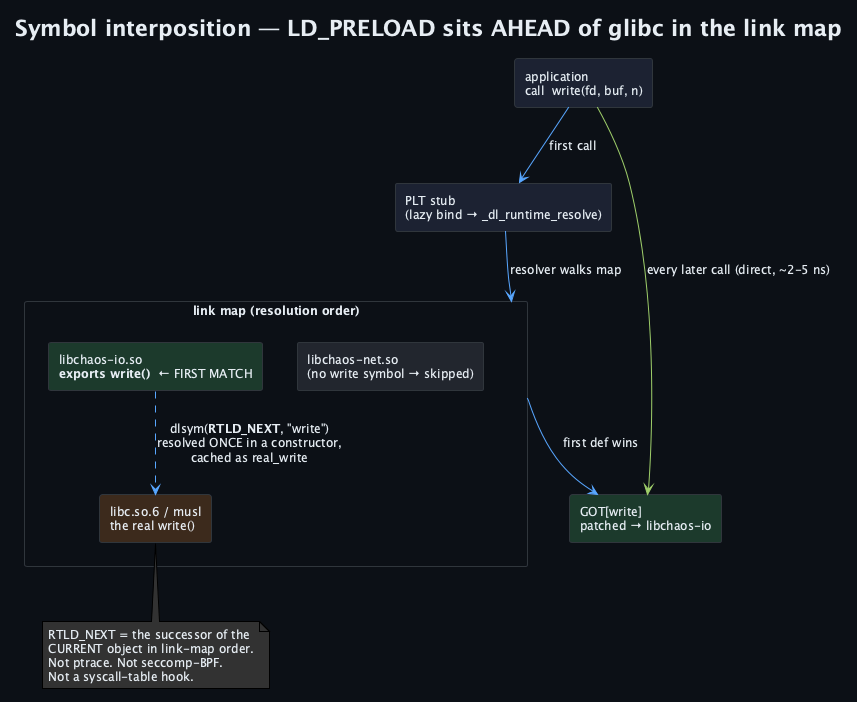

*The loader places your object at the front of the link map — ahead of glibc — so the GOT binds `write` to yours; `dlsym(RTLD_NEXT)` reaches the real one.*

## What you cannot interpose — and why it is fail-open

Knowing which symbols you *cannot* touch is the whole discipline. Before glibc 2.33, `stat`/`fstat` were inline header wrappers that called `__xstat(_STAT_VER, …)` — the program emitted no `stat` relocation at all, so interposing `stat` caught nothing (2.33 finally exported real `stat` under a fresh symbol version). `memcpy`, `memmove`, and `strlen` are [`STT_GNU_IFUNC`](https://sourceware.org/glibc/wiki/GNU_IFUNC) indirect functions: their GOT slot holds a *resolver* (an `R_*_IRELATIVE` reloc) that picks an AVX-512, AVX2, or SSE2 variant at load by CPUID — there is no single implementation to shadow. [`_FORTIFY_SOURCE`](https://man7.org/linux/man-pages/man7/feature_test_macros.7.html) rewrites `read` to `__read_chk` and `memcpy` to `__memcpy_chk`. And [`RTLD_DEEPBIND`](https://man7.org/linux/man-pages/man3/dlopen.3.html) — like `-Bsymbolic` (`DF_SYMBOLIC`) — makes a library bind its own symbols *ahead* of the preload, defeating interposition outright. So the six libraries touch only the thin, un-versioned **libc syscall wrappers** — `read`, `write`, `connect`, `getaddrinfo`, `clock_gettime`, `mmap`, `pthread_create` — never the string, stdio, or math surface. It is an interposable surface *by construction*.

The hot path holds **zero global locks**. The reentrancy guard is a `__thread` flag — allocation-free only because a preloaded object is assigned the **initial-exec** [TLS model](https://www.akkadia.org/drepper/tls.pdf): a single `%fs`-relative load, no `__tls_get_addr`, no first-touch `malloc` that would recurse straight back through the allocator you may be interposing (general-dynamic TLS would). The probability gate reads a **per-thread [`xorshift64*`](https://prng.di.unimi.it/)** PRNG, seeded once from [`getrandom(2)`](https://man7.org/linux/man-pages/man2/getrandom.2.html) — no shared-RNG mutex, no cache-line false sharing across cores. Config is read through a **lock-free [RCU](https://docs.kernel.org/RCU/whatisRCU.html)-style snapshot**: an atomic pointer published with [`memory_order_release`](https://en.cppreference.com/w/c/atomic/memory_order) and read with `memory_order_acquire`, because on a weakly-ordered architecture (aarch64) a plain store can be observed before the writes that filled the object it points to. The retired snapshot is parked in a bounded ring, never freed under a live reader.

The control plane is one text file on tmpfs. Every intercepted call [`stat(2)`](https://man7.org/linux/man-pages/man2/stat.2.html)s `/tmp/.chaos-<lib>.conf`, compares `st_mtim`, and on a change parses a fresh snapshot and swaps the pointer — a page-cache hit, ~150–300 ns. No [`inotify`](https://man7.org/linux/man-pages/man7/inotify.7.html) thread (it would have to be async-signal-safe and survive `fork`); no `SIGHUP` handler (applications hijack that for their own reloads). `sed -i` is the dashboard; `rm` is the off switch. And it is **fail-open** by construction: a missing file, a malformed line, an fd it cannot `readlink`, an allocation failure in the parser — every one falls through to the real call. It never invents a failure you did not write down, which is exactly what makes it safe to leave preloaded under an entire test suite.

Because it binds to the libc ABI and not a language runtime, one object reaches every dynamically-linked caller: the JVM's `FileOutputStream.write0()` (JNI into glibc `write`), CPython's `socket.send()` (into `send`), a cgo Go binary, Rust, Node, Ruby. The honest exception: a **statically-linked** pure-Go binary issues the `SYSCALL` instruction directly — no [`PT_INTERP`](https://man7.org/linux/man-pages/man8/ld.so.8.html), `ld.so` never runs, `LD_PRELOAD` is meaningless — and is immune by construction. The build ships **twenty-four objects** — six libraries × `{glibc, musl}` × `{amd64, arm64}` — because the two libcs diverge where interposers live: `dlsym(RTLD_NEXT)` link-map ordering differs for an object that both imports and exports the same symbol, and glibc's `getaddrinfo` dispatches through [**NSS**](https://man7.org/linux/man-pages/man5/nsswitch.conf.5.html) (`dlopen`-ing `libnss_dns.so`) while musl's is one self-contained resolver with a built-in stub.

---

## The six libraries

Six objects, one per slice of the boundary, each exporting only its own symbols and reading only its own file. **libchaos-io** owns filesystem I/O and is the only one that mutates *data* — `TORN` short writes, `CORRUPT` bit-flips — alongside `EIO ENOSPC EDQUOT EROFS EACCES EMFILE ENOENT`. **libchaos-net** owns the socket surface (`send`/`recv`/`poll`) and fails an individual call inside a live session rather than the connection. **libchaos-dns** owns [`getaddrinfo`](https://man7.org/linux/man-pages/man3/getaddrinfo.3.html)/`getnameinfo` and performs surgery on the *successful* answer (`REWRITE OVERRIDE FILTER_FAMILY SHUFFLE LIMIT`) as well as failing it. **libchaos-time** owns [`clock_gettime`](https://man7.org/linux/man-pages/man2/clock_gettime.2.html)/`nanosleep` and skews the clock per id with a signed-millisecond `OFFSET`. **libchaos-memory** owns [`mmap`](https://man7.org/linux/man-pages/man2/mmap.2.html)/`munmap`/`mprotect` and selects by call shape on the `MAP_ANONYMOUS` bit. **libchaos-process** owns the lifecycle — [`pthread_create`](https://man7.org/linux/man-pages/man3/pthread_create.3.html) `fork` `posix_spawn` `execve` — with the stateful `FAIL_AFTER:<errno>,<N>`. One grammar rule governs all six and is where people slip: io/net/dns put the concrete errno in the *effect* slot (`connect:ECONNREFUSED:1.0`), while time/memory/process use the literal token `ERRNO` with the errno as the *value* (`execve:ERRNO:EACCES`); net alone is four-field (`endpoint:op:effect:value`); any rule may carry an `@probability`.

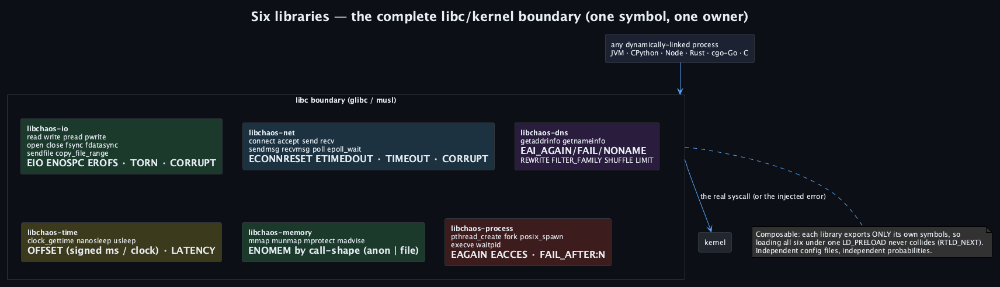

*One object per slice of the boundary — one symbol, one owner, no collision — composed with a single `LD_PRELOAD`.*

---

## Six faults you cannot rehearse today — and how we do them in seconds

Every one of these gets demanded in a design review and tested by almost nobody — because reproducing it honestly takes infrastructure most teams will never build. One fault per library. Each section names it, dissects the error at the lowest level it exists, then reproduces it in a single line — with the exact command to run.

**Run any fault below yourself.** Clone the repo; each fault is a single `docker compose` command that builds the six `.so` from source into a volume and runs a probe under `LD_PRELOAD` — nothing but Docker required, no local toolchain:

```sh
git clone https://github.com/macstab/macstab-chaos-testing-libraries chaos && cd chaos
docker compose -f demo/docker-compose.yml run --rm io3     # ← fault 1, for example
```

The service names are `io3 net3 dns3 time1 mem1 proc1` (the six faults here) plus their siblings `io1 io2 net1 net2 dns1 dns2 time2 mem2 proc2`. Every output quoted below is captured from actually running them.

### 1. Torn writes to a write-ahead log — libchaos-io

**Why it is murder.** Proving a durable system survives a partial write means simulating power loss between the `write` and the platter. Your options: a power-cycle rig, or the kernel's `dm-flakey` target — which needs *root*, a *dedicated block device*, and hands you a whole-device fault window, not the per-path, per-syscall probability you can flip live.

**The error, at the bottom.** [`write(2)`](https://man7.org/linux/man-pages/man2/write.2.html) returns the number of bytes accepted into the page cache; [POSIX](https://pubs.opengroup.org/onlinepubs/9699919799/functions/write.html) guarantees *nothing* about crash atomicity — only pipe writes up to `PIPE_BUF` are atomic. An 8 KiB database page in one `pwrite` straddles two 4 KiB page-cache pages; writeback flushes them as independent `bio`s down the block layer, and on power loss the device may have persisted some 512-byte or 4 KiB sectors and not others — a *torn page*. Sector atomicity is itself device-specific (512n; 512e, logical-over-physical, which can tear under an internal read-modify-write; 4Kn), and the drive's volatile write cache reorders freely until a [`REQ_PREFLUSH|REQ_FUA`](https://docs.kernel.org/block/writeback_cache_control.html) barrier — [`fsync(2)`](https://man7.org/linux/man-pages/man2/fsync.2.html) bottoms out in `blkdev_issue_flush`. This is exactly why PostgreSQL emits [`full_page_writes`](https://www.postgresql.org/docs/current/runtime-config-wal.html) — a whole page image into the WAL after each checkpoint, replayed over any torn copy during recovery — and stamps each page with a `pd_checksum` to *detect* the tear at all (InnoDB solves the same hazard with its doublewrite buffer). [`fdatasync(2)`](https://man7.org/linux/man-pages/man2/fdatasync.2.html) flushes data and the size field but skips other inode metadata (cheaper — the barrier under `wal_sync_method=fdatasync`), while [`sync_file_range(2)`](https://man7.org/linux/man-pages/man2/sync_file_range.2.html) *looks* like a targeted flush but issues **no** barrier and is unsafe for durability. A torn write that returns success, then `EIO` on the next `fdatasync` — the failure behind the 2018 "fsyncgate" — trips a Postgres `PANIC` and drops the cluster into crash recovery.

**In seconds.** A short write on the WAL path, plus a sync failure:

```
/var/lib/postgresql/data/pg_wal:write:TORN:0.1
/var/lib/postgresql/data/pg_wal:fdatasync:EIO:0.05
```

**Run it:**

```sh
docker compose -f demo/docker-compose.yml run --rm io3
# → write(4096) returned 1317 — TORN short write (the exact short count is random)
```

`TORN` returns a short count; `EIO` fails the sync — data-plane corruption a connection-level proxy sits a layer removed from and physically cannot inject.

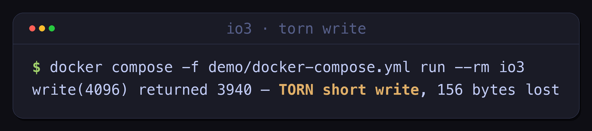

*`--profile io3`: `write(4096)` reports success, but only part of the buffer reached the page cache — the rest is silently lost.*

### 2. A connection that resets mid-stream and poisons the pool — libchaos-net

**Why it is murder.** The failure that strands a pool is not a dead peer — it is *one* `send()` on a healthy, established session coming back `ECONNRESET`, leaving a half-written frame and a socket the pool still believes is alive. To reproduce it you need Toxiproxy plus topology surgery and `NET_ADMIN`, or a genuinely flaky network you cannot schedule.

**The error, at the bottom.** `ECONNRESET` means the TCP state machine took an **RST**. [RFC 9293](https://www.rfc-editor.org/rfc/rfc9293)'s abortive release (successor to RFC 793) discards both send and receive buffers immediately and leaves `ESTABLISHED` with no four-way `FIN` — no `TIME_WAIT`, no drain — and [RFC 5961](https://www.rfc-editor.org/rfc/rfc5961) bounds when a peer will honour a reset (the *challenge-ACK*, rate-limited by `net.ipv4.tcp_challenge_ack_limit`) to blunt blind in-window reset attacks. A peer emits RST when it receives a segment for a socket it already closed (the classic "connection reset by peer" after the far end's [`close(2)`](https://man7.org/linux/man-pages/man2/close.2.html) with data still queued), when its accept backlog overflows ([`somaxconn`](https://man7.org/linux/man-pages/man2/listen.2.html), `tcp_abort_on_overflow`), or deliberately via [`SO_LINGER`](https://man7.org/linux/man-pages/man7/socket.7.html) set to `{l_onoff=1, l_linger=0}`, which turns `close()` into an abortive reset. A *second* write after the RST raises `EPIPE` and — unless masked with [`send(MSG_NOSIGNAL)`](https://man7.org/linux/man-pages/man2/send.2.html) or a `SIGPIPE` handler — kills the process by default. A pool without validate-on-borrow hands out a descriptor rotting in `CLOSE_WAIT`, and the next `send` on it is the `ECONNRESET` your caller was never written to expect. And `send` can itself return a *short count* against a full `SO_SNDBUF` — a partial write at the transport layer, the network twin of the torn disk write, which any framed protocol must reassemble.

**In seconds.**

```
tcp4://*:9092:send:ECONNRESET:0.03
```

**Run it:**

```sh
docker compose -f demo/docker-compose.yml run --rm net3
# → send -> [errno 104] Connection reset by peer
```

Per-endpoint, inside the live session — a ~1 µs wrapper versus a proxy's ~50–200 µs hop, and no `NET_ADMIN`.

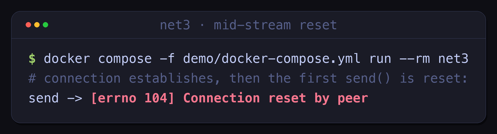
*`--profile net3`: the connection establishes, then the first `send()` returns `[errno 104] Connection reset by peer`.*

### 3. DNS that reroutes — a canary cutover or a poisoning drill — libchaos-dns

**Why it is murder.** Rerouting a single service name — for a blue/green rehearsal, a canary, or a poisoning drill — normally means standing up split-horizon DNS or editing zone files under change control, for one name, for one test.

**The error, at the bottom.** [`getaddrinfo(3)`](https://man7.org/linux/man-pages/man3/getaddrinfo.3.html) is not a DNS query — it is a resolution *pipeline*. It reads the `hosts:` line of [`nsswitch.conf(5)`](https://man7.org/linux/man-pages/man5/nsswitch.conf.5.html), which on glibc `dlopen`s NSS modules in order (`files` for `/etc/hosts`, `dns` for the stub resolver, often `resolve`/`myhostname`), honours [`resolv.conf`](https://man7.org/linux/man-pages/man5/resolv.conf.5.html)'s `search` list and `ndots:` (the notorious `ndots:5` that fires several negative queries before an absolute name), applies `AI_ADDRCONFIG`/`AI_V4MAPPED`, and returns a `struct addrinfo` list **already sorted by [RFC 6724](https://www.rfc-editor.org/rfc/rfc6724)** destination-address selection against the [`gai.conf`](https://man7.org/linux/man-pages/man5/gai.conf.5.html) precedence table — which is why a client that just iterates the list is silently leaning on that sort. Underneath, the stub resolver speaks UDP with EDNS0 ([RFC 6891](https://www.rfc-editor.org/rfc/rfc6891)), retries over TCP on a truncated (`TC`-bit) reply, and may be short-circuited by a local cache (`nscd`, or `systemd-resolved` via `nss-resolve`). A real cache-poisoning attack ([Kaminsky](https://www.rfc-editor.org/rfc/rfc5452)) races the resolver with forged UDP inside the query window — countered by source-port and 0x20-bit randomization and DNSSEC's `AD` bit; rewriting the *answer* at the `getaddrinfo` boundary reaches the same observable state **hermetically** — no packet on the wire, no nameserver in the loop — and because it sits *above* NSS, `/etc/hosts` still resolves normally.

**In seconds.**

```
dns://payments.example.com:REWRITE:payments-canary.internal
dns://auth.example.com:OVERRIDE:127.0.0.1,[::1]
```

**Run it:**

```sh
docker compose -f demo/docker-compose.yml run --rm dns3
# → getent ahosts example.com  →  127.0.0.1   (answer overridden above NSS, no packet on the wire)
```

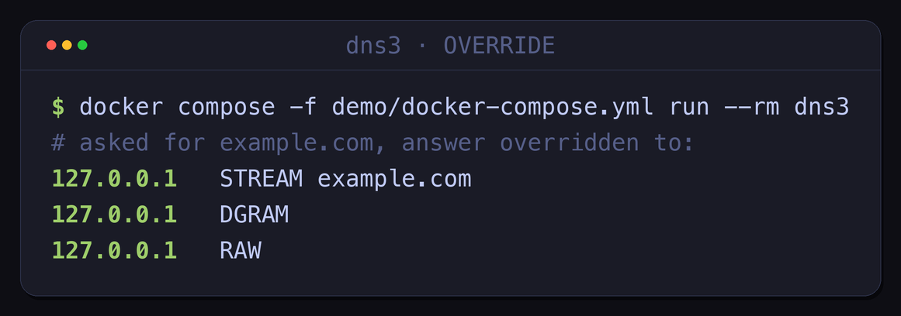
*`--profile dns3`: `getent ahosts example.com` returns `127.0.0.1` — the answer rewritten above the NSS layer, no packet on the wire.*

### 4. Wall-clock skew — JWT, mTLS, and the JVM-agent moat — libchaos-time

**Why it is murder.** Auth teams demand clock-skew certification and can't get it. The usual route — a time-warping VM or a lying NTP server — poisons the entire host: every log line, every other tenant, every process that reads the clock, not just the one under test.

**The error, at the bottom.** `CLOCK_REALTIME` is the settable, NTP-disciplined wall clock, and it is what a JWT's `exp`/`nbf` ([RFC 7519](https://www.rfc-editor.org/rfc/rfc7519)) and an X.509 certificate's `notBefore`/`notAfter` ([RFC 5280](https://www.rfc-editor.org/rfc/rfc5280), ASN.1 `UTCTime`/`GeneralizedTime`) are compared against, modulo the validator's `leeway`. The kernel keeps it as a base plus a scaled hardware counter — the clocksource is the TSC when the CPU advertises `constant_tsc` and `nonstop_tsc`, else HPET or `acpi_pm` — and [`clock_gettime(CLOCK_REALTIME)`](https://man7.org/linux/man-pages/man2/clock_gettime.2.html) is served from the [**vDSO**](https://man7.org/linux/man-pages/man7/vdso.7.html): `__vdso_clock_gettime` reads the shared `vvar` page (its `mult`/`shift` fields) and does the counter-to-nanoseconds multiply-shift in userspace — no syscall, ~60 ns. NTP disciplines it through [`adjtimex(2)`](https://man7.org/linux/man-pages/man2/adjtimex.2.html) — *slewing* small errors so monotonicity holds, *stepping* large ones — and a leap second is one more discontinuity every comparison must tolerate. The moat against a JVM agent is right here: `System.currentTimeMillis()` is [`@IntrinsicCandidate`](https://github.com/openjdk/jdk/blob/master/src/java.base/share/classes/jdk/internal/vm/annotation/IntrinsicCandidate.java), the JIT inlines it to that same vDSO/counter path, and no Java call frame survives to rewrite — the libc interposer sits *beneath* the intrinsic. (Its sibling: `CLOCK_MONOTONIC` is non-decreasing only in theory; a live migration under `kvm-clock` can step it *backward* between two reads, underflowing any token-bucket that computes `elapsed × rate` — and because a *constant* offset preserves deltas, the fault is the offset *changing between reads*.)

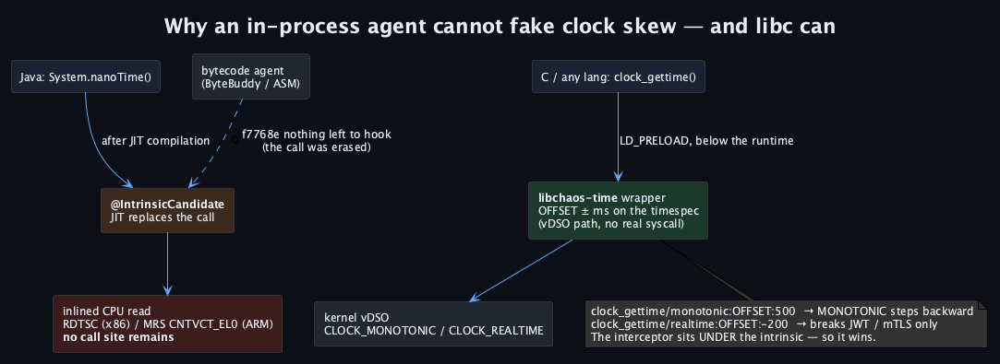
*`System.currentTimeMillis()` is a JIT intrinsic inlined to the vDSO/counter path; no Java frame survives to rewrite. The libc interposer sits underneath it.*

**In seconds.**

```
clock_gettime/realtime:OFFSET:3600000
```

**Run it:**

```sh
docker compose -f demo/docker-compose.yml run --rm time1
# → realtime baseline=…  skewed=…  delta=3600s
```

`+3,600,000 ms` = +1 h on `CLOCK_REALTIME`; a token minted five minutes ago now reads as expired, while monotonic-based timeouts are untouched.

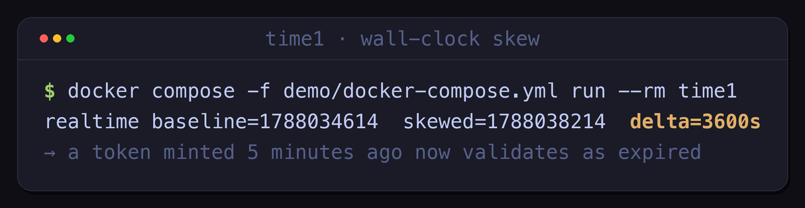
*`--profile time1`: baseline vs. skewed `CLOCK_REALTIME`, `delta=3600s` — a fresh token now validates as expired.*

### 5. Off-heap OOM — the failure `-Xmx` cannot cause — libchaos-memory

**Why it is murder.** Netty's `OutOfMemoryError: Direct buffer memory` and Kafka's `Map failed` come from the *anonymous* arena — heap growth, thread stacks, direct buffers — the one region `-Xmx` cannot bound. So there is no knob to trip it: you reproduce it by exhausting real RAM, and hope the OOM killer takes the right process.

**The error, at the bottom.** [`mmap(2)`](https://man7.org/linux/man-pages/man2/mmap.2.html) returning `ENOMEM` is a refusal to *create the virtual mapping*, and *when* it fires is decided by the kernel's [overcommit accounting](https://docs.kernel.org/mm/overcommit-accounting.html): `vm.overcommit_memory` = 0 (`OVERCOMMIT_GUESS`, heuristic), 1 (`OVERCOMMIT_ALWAYS`), or 2 (`OVERCOMMIT_NEVER`, strict against `CommitLimit = swap + RAM·overcommit_ratio`). Under the default heuristic an `MAP_PRIVATE|MAP_ANONYMOUS` region is *demand-paged* — zero-fill-on-demand, reserving address space (`VSZ`) for the price of one VMA and faulting physical frames in *lazily* on first touch — so the call can *succeed* and the [OOM killer](https://docs.kernel.org/admin-guide/mm/concepts.html) reap you at a later `#PF`, choosing its victim by `oom_score` (biased by `oom_score_adj`); or a cgroup-v2 [`memory.max`](https://docs.kernel.org/admin-guide/cgroup-v2.html) breach invokes the memcg OOM first. `MAP_NORESERVE`, `MAP_POPULATE`, [`RLIMIT_AS`](https://man7.org/linux/man-pages/man2/getrlimit.2.html), and the `vm.max_map_count` VMA ceiling (default 65530) each move a *different* wall. Above them, glibc's **ptmalloc2** routes any request past the *dynamic* [`M_MMAP_THRESHOLD`](https://man7.org/linux/man-pages/man3/mallopt.3.html) (128 KiB, ratcheting toward 32 MiB as large chunks are freed) straight to `mmap` rather than `brk`, and shards the remainder across `MALLOC_ARENA_MAX` per-thread arenas (default 8×`nproc`); the JVM's `Unsafe.allocateMemory` behind a `DirectByteBuffer` bottoms out in exactly that path — reclaimed only when a phantom-referenced `Cleaner` runs, and capped by `-XX:MaxDirectMemorySize`, an arena wholly *separate* from the `-Xmx` GC heap. Selecting on the *shape* of the syscall — the `MAP_ANONYMOUS` bit — is the only way to fail that arena surgically: deterministic, file-backed mappings left untouched, no OOM killer in the loop.

**In seconds.**

```
mmap/anon:ERRNO:ENOMEM
```

**Run it:**

```sh
docker compose -f demo/docker-compose.yml run --rm mem1
# → mmap(anon) FAILED: [errno 12] Cannot allocate memory
```

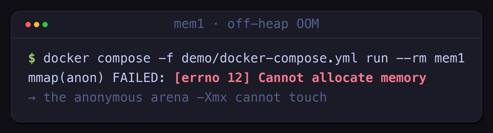
*`--profile mem1`: `mmap(anon)` fails with `[errno 12] Cannot allocate memory` — the arena `-Xmx` cannot touch.*

### 6. Thread-pool exhaustion under load — libchaos-process

**Why it is murder.** Everything is fine in staging — until the Nth thread fails under real concurrency and the pool wedges. To reproduce it you have to exhaust `RLIMIT_NPROC` for real: slow, flaky, and one wrong number takes the whole box down with it.

**The error, at the bottom.** A pthread *is* a kernel task — the [NPTL](https://man7.org/linux/man-pages/man7/pthreads.7.html) 1:1 model — spawned by [`clone(2)`](https://man7.org/linux/man-pages/man2/clone.2.html) with `CLONE_VM|CLONE_FS|CLONE_FILES|CLONE_SIGHAND|CLONE_THREAD|CLONE_SETTLS|CLONE_PARENT_SETTID|CLONE_CHILD_CLEARTID`. That last flag is the machinery behind [`pthread_join(3)`](https://man7.org/linux/man-pages/man3/pthread_join.3.html): on exit the kernel zeroes the child's TID word (registered via `set_tid_address`) and issues a [`futex(2)`](https://man7.org/linux/man-pages/man2/futex.2.html) `FUTEX_WAKE` on it. The kernel denies the `clone` with `EAGAIN` at *three* independent ceilings — [`RLIMIT_NPROC`](https://man7.org/linux/man-pages/man2/getrlimit.2.html) (`ulimit -u`, live tasks per real UID), the [`pids` cgroup](https://docs.kernel.org/admin-guide/cgroup-v2.html) controller's `pids.max`, and the global `kernel.threads-max` — plus a fourth, subtler one: `vm.max_map_count`, since each thread stack is its own VMA flanked by a `PROT_NONE` guard page, so tens of thousands of threads exhaust the VMA table before any rlimit bites. The delivery is the trap: [`pthread_create(3)`](https://man7.org/linux/man-pages/man3/pthread_create.3.html) **returns** the error code directly and leaves the global `errno` untouched — unlike [`fork(2)`](https://man7.org/linux/man-pages/man2/fork.2.html), which returns `-1` and *sets* `errno` — a distinction that silently defeats half the error-handling ever written against it. Modeling the fault as `FAIL_AFTER:EAGAIN,N` reproduces the *under-load onset* deterministically, which a flat probability cannot; on the JVM this is the exact path to `java.lang.OutOfMemoryError: unable to create native thread`.

**In seconds.**

```
pthread_create:FAIL_AFTER:EAGAIN,128
```

**Run it:**

```sh
docker compose -f demo/docker-compose.yml run --rm proc1
# → pthread_create FAILED once the ceiling is hit: Resource temporarily unavailable (EAGAIN)
```

Succeed N times, then `EAGAIN` forever — the stateful counter resets on config reload.

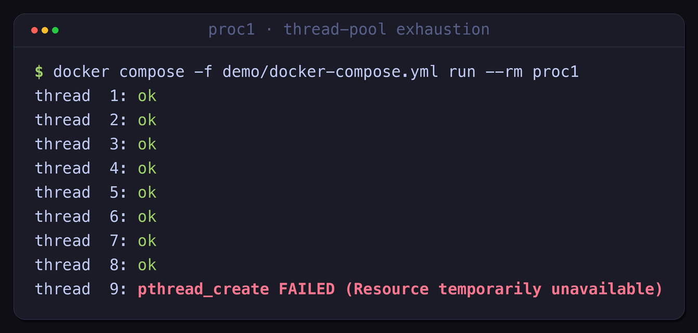
*`--profile proc1`: threads succeed until the ceiling, then `pthread_create` fails with `EAGAIN` — the JVM's "unable to create native thread".*

---

## Getting it, and wiring it in

Every fault above is a runnable `docker compose` profile in [`demo/`](./demo/) — `io3` (torn WAL), `net3` (mid-stream reset), `dns3` (OVERRIDE), `time1` (clock skew), `mem1` (off-heap OOM), `proc1` (thread exhaustion). Each one builds the six `.so` from source into a shared volume and runs a probe under `LD_PRELOAD`, so it works on any Docker host with no published release. Every output quoted above is captured from a real run:

```sh
export CHAOS_REPO=/path/to/chaos-testing-libraries
docker compose -f demo/docker-compose.yml run --rm net3
# net3 → "send -> [errno 104] Connection reset by peer"
# every profile: io1 io2 io3 net1 net2 net3 dns1 dns2 dns3 time1 time2 mem1 mem2 proc1 proc2
```

That is the fast path. The production path — release artifacts, scoping, orchestration — follows.

**Download and verify — fail-closed.** Every release ships the 24 objects plus `SHA256SUMS`; select arch from `uname`, libc from your base image, and verify before use:

```sh
VER=${CHAOS_VERSION:-1.0.0}
ARCH=$(uname -m | sed 's/x86_64/amd64/;s/aarch64/arm64/')
B="https://github.com/macstab/macstab-chaos-testing-libraries/releases/download/$VER"
wget -q "$B/libchaos-io-glibc-$ARCH.so" "$B/SHA256SUMS"
sha256sum -c SHA256SUMS --ignore-missing | grep "libchaos-io-glibc-$ARCH.so: OK"   # no OK line → stop
```

**Scope the preload — a wrapper, never an export.** Never [`export LD_PRELOAD`](https://man7.org/linux/man-pages/man8/ld.so.8.html) in a shell — it is inherited by every child, poisoning `git`, `ssh`, and `cron` alike. Set it per-`exec`:

```sh
#!/bin/sh
libc(){ ldd --version 2>&1 | grep -qi musl && echo musl || echo glibc; }
arch(){ case "$(uname -m)" in x86_64) echo amd64;; aarch64) echo arm64;; esac; }
exec env LD_PRELOAD="/chaos/libs/libchaos-io-$(libc)-$(arch).so" "$@"
```

**Docker / docker-compose — zero image modification.** Populate the `chaoslibs` volume with the verified `.so` (the fetch-and-verify step above, or an init sidecar), then have the service preload it and write its config to `/tmp`:

```yaml
services:
  postgres:
    image: postgres:16-bookworm
    volumes: [ "chaoslibs:/libs:ro", "chaosconf:/tmp" ]
    entrypoint:
      - bash
      - -c
      - |
        printf '/var/lib/postgresql/data/pg_wal:fdatasync:EIO:0.05\n' > /tmp/.chaos-io.conf
        export LD_PRELOAD=/libs/libchaos-io.so
        exec setpriv --reuid=postgres --regid=postgres --init-groups docker-entrypoint.sh postgres
volumes: { chaoslibs: {}, chaosconf: {} }
```

Two traps that each cost an afternoon. First, in a Compose `command` a literal shell `$` must be doubled to `$$`, or Compose's [variable interpolation](https://docs.docker.com/reference/compose-file/interpolation/) consumes it before the shell ever sees it. Second — and this one fails *silently* — the stock Postgres/Redis entrypoints drop root through the **setuid** [`gosu`](https://github.com/tianon/gosu), and any setuid/setgid transition drops the process into [`ld.so`'s *secure-execution mode*](https://man7.org/linux/man-pages/man8/ld.so.8.html): the kernel raises `AT_SECURE=1` in the [ELF auxiliary vector](https://man7.org/linux/man-pages/man3/getauxval.3.html), and the loader **purges `LD_PRELOAD`** — along with `LD_LIBRARY_PATH`, `GCONV_PATH`, `MALLOC_*`, and every other trust-sensitive variable. Drop privilege with the capability-based [`setpriv(1)`](https://man7.org/linux/man-pages/man1/setpriv.1.html) (Debian) or `su-exec` (Alpine) instead — neither is setuid, so `AT_SECURE` stays clear and the preload survives the `exec`. (`AT_SECURE` also latches whenever real ≠ effective uid/gid or a file capability is present; read it straight from the auxv with `getauxval(AT_SECURE)`.)

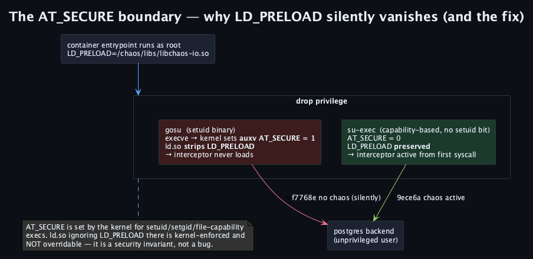
*Drop privilege with a setuid binary and the kernel sets `AT_SECURE=1`, so `ld.so` discards `LD_PRELOAD`. Capability-based `setpriv`/`su-exec` keep it.*

**Kubernetes — initContainer + ConfigMap as the live control plane.** An initContainer drops the object into a shared `emptyDir`; the app preloads it; a ConfigMap mounted at `/tmp` is the dial you ramp without a restart:

```sh
kubectl create configmap chaos-io --from-literal=.chaos-io.conf='/data:write:EIO:0.1'   # mount at /tmp
kubectl exec deploy/app -- sh -c "sed -i 's/EIO:0.1/EIO:0.9/' /tmp/.chaos-io.conf"        # next syscall reloads
```

Run the app `runAsNonRoot` with `allowPrivilegeEscalation: false` so no setuid transition clears the preload.

**The config lines, in one place.** `io` — `path:op:concrete-errno|TORN|CORRUPT|LATENCY:value`. `net` — `endpoint:op:concrete-errno|CORRUPT|TIMEOUT|LATENCY:value` (four fields). `dns` — `dns://name:EAI_*|REWRITE|OVERRIDE|FILTER_FAMILY|SHUFFLE|LIMIT:value`. `time` — `clock_gettime/<id>:ERRNO|OFFSET|LATENCY:value`. `memory` — `mmap[/anon|/file]:ERRNO|LATENCY:value`. `process` — `symbol:ERRNO|LATENCY|FAIL_AFTER:value`. Any rule may carry `@probability`; delete the file to disable.

---

## Benefits, and the numbers

Because it runs beneath the runtime, the framework, the pool, and the retry logic, it tests the *exact* artifact you ship — controlled to the millisecond from a text file, composable, fail-open by construction. Put it in front of the tests you already run, and a torn write or a mid-stream reset stops being a postmortem and becomes a red build.

The numbers — shared CI runner, `glibc`+`musl` × `amd64`+`arm64`, median-of-medians with Mann-Whitney U and bootstrap CIs, comparative rather than bare-metal absolutes: the hot path is a single tmpfs `stat` plus a lock-free snapshot read — a few hundred nanoseconds by design, measuring as a **near-constant ~0.6–3 µs per intercepted call** on that runner (`write` +0.9 µs, `send`/`recv` +1.2 µs). Against a TCP fault-injection proxy at **~50–200 µs per hop**, that is one to two orders of magnitude cheaper per operation, with no `NET_ADMIN`. Because the cost is a per-call floor, its *percentage* is set by the denominator: on the glibc/amd64 cell real workloads pay low tens of percent — `pthread_create` +11 %, `execve` +10 %, `fork`+`wait` +17 % — with the musl and arm64 cells somewhat higher. Injecting a failure can even be *faster* than the real call, because a synthetic `EAI_*` short-circuits before the resolver runs: `getaddrinfo` errno injection measured **−75 % to −90 %** across the four cells. This is also why you never preload `time` on a hot `clock_gettime` path — the wrapper floor (~2.7 µs here) dwarfs a ~60 ns vDSO read. Quality is gated, not asserted: 100 % source-line coverage on io, net, time, memory, and process, DNS at an enforced 85 % floor on `chaos_dns_config.c` and `chaos_dns_lookup.c`, runtime-validated in Docker across all four libc×arch cells as a release gate, with property-based and libFuzzer targets. The objects are 30–80 KiB stripped.

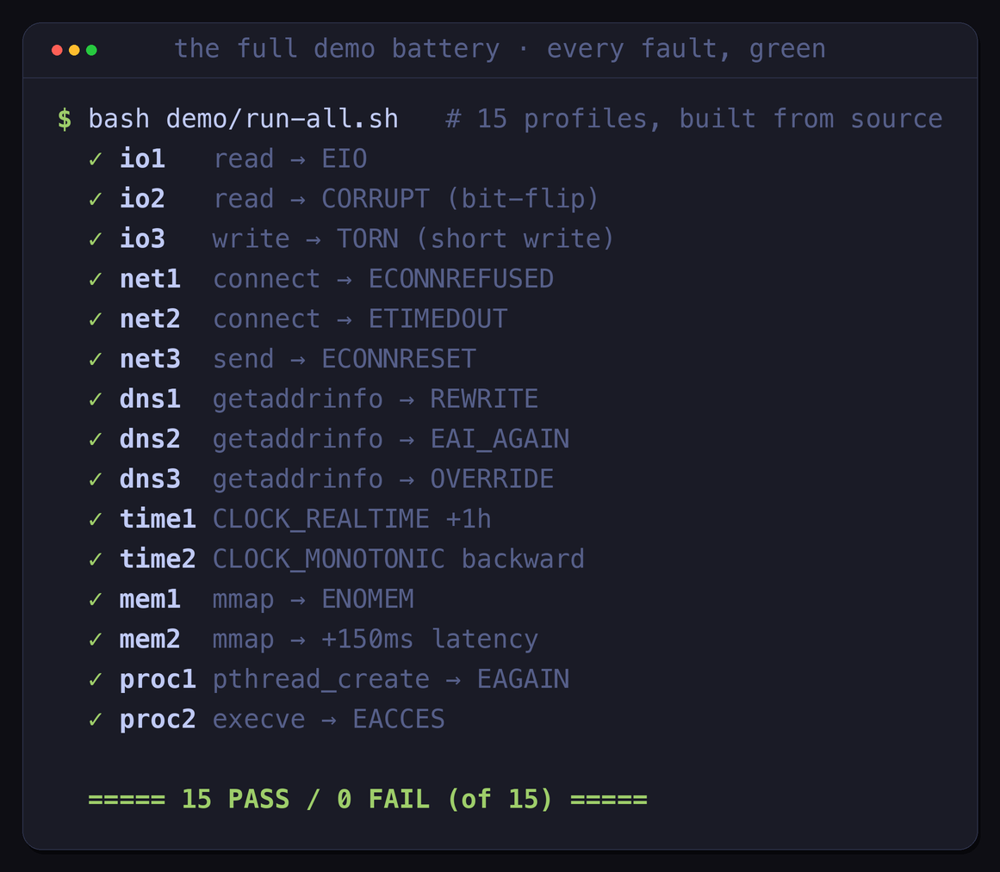
*All fifteen `docker compose` profiles run from source and pass: `15 PASS / 0 FAIL`. Nothing in this article is asserted; it is executed.*

Honest scope: static Go and raw-syscall code bypass libc and so bypass this; setuid/setcap binaries never load it (`AT_SECURE`); the config lives in world-writable `/tmp`, so this is a **test and staging** tool — isolate `/tmp` per container; and [eBPF](https://docs.kernel.org/bpf/) (`kprobe`/`tracepoint`/LSM) observes at the kernel boundary — a complementary class, not a competitor, and one that can *watch* a syscall but not *fabricate* its userspace return. This is one layer of three: above the syscall boundary sits a JVM bytecode agent injecting at the Java method level across 62 JDK call sites behind a JUnit 5 `@ChaosTest`, and above that a Testcontainers orchestrator — all three sharing one *selector × effect × policy* DSL.

`SIGKILL` tells you **if** your system dies. These six libraries tell you the **semantics of the syscall it trusted** — I/O that corrupts, connections that fray mid-stream, DNS that reroutes, clocks that run backward, memory that says no, threads that run out — all from a text file, on the exact binary you ship, in any language, without root.

**Repo:** [github.com/macstab/macstab-chaos-testing-libraries](https://github.com/macstab/macstab-chaos-testing-libraries) · Apache 2.0 · musl + glibc · amd64 + arm64 · v1.0.0

---

## Read next, and watch

- 🧱 **Start with the overview (00-0)** — *The Macstab Chaos Stack: Testing the Vertical From Syscall to CI Pipeline*, where all three layers fit together: [read it on Medium](https://medium.com/@schnapka.christian/the-macstab-chaos-stack-testing-the-vertical-from-syscall-to-ci-pipeline-03d96522a3a4) · [watch it on YouTube](https://youtu.be/jxdcB84Q3bk) · [on LinkedIn](https://www.linkedin.com/in/christian-schnapka/).
- 📺 **This episode (00-1) on video:** the C99 `LD_PRELOAD` walkthrough on [**Macstab Engineering**](https://www.youtube.com/@MacstabEngineering) — every terminal session in this article, on camera.
- ✍️ **On Medium:** [medium.com/@macstab](https://medium.com/@macstab) — the full series.
- ⏭️ **Next — Layer 2 (00-2):** the JVM bytecode agent, which goes *above* the syscall boundary and injects faults at the Java method level — 62 JDK call sites, a JUnit 5 `@ChaosTest`, and checked exceptions the JVM's normal `throw` pathway cannot reach.

---

## About the Author

**Christian Schnapka** is a principal+ backend engineer with 30 years of experience in Java, C++, cloud, and hardcore backend architecture. He has been the technical lead in nearly every team he has joined — from embedded systems to large-scale distributed platforms.

He built the Macstab Chaos Stack because the combination he needed — call-specific libc faults, JVM-internal effects, real container topologies, and test-scoped PR regression gates — was not available in one coherent workflow. Manual reproduction is possible but difficult to repeat, while infrastructure chaos validates a different and complementary set of resilience properties.

He publishes under **[Macstab](https://macstab.com)**, the company he works for.

Current work: authorization platforms (OAuth2, Spring Authorization Server) and energy management systems (Spring Boot, React). Principal embedded developer. Lives in Wentorf bei Hamburg, Germany.

Follow along:

- **Website:** [macstab.com](https://macstab.com)
- **YouTube:** [Macstab Engineering](https://www.youtube.com/@MacstabEngineering) — the chaos engineering series
- **GitHub:** [github.com/macstab](https://github.com/macstab)
- **Aether (security framework):** [*A NOP did not break my YARA rule — one encoding change did*](https://medium.com/@schnapka.christian/a-nop-did-not-break-my-yara-rule-one-encoding-change-did-f95c6ec3c26c) · [watch on YouTube](https://youtu.be/7TAAwTselJc)
- **LinkedIn:** [Christian Schnapka](https://www.linkedin.com/in/christian-schnapka/)
- **Twitter:** [Per!](https://twitter.com/nolem2008)
- **Security contact:** security@macstab.com and info@macstab.com

*If any of this fails on your system — open an issue. The examples are meant to run.*
