# Six Containers, One Annotation: A Real Redis Sentinel Cluster Inside a JUnit Test — and a Failover You Can Assert On

*Macstab Chaos Stack, Layer 3 — annotation-driven Redis topologies for the failure modes your cache code has never actually survived.*

> 🎥 **Video walkthrough coming soon** — subscribe on **[Macstab Engineering](https://www.youtube.com/@MacstabEngineering)**.

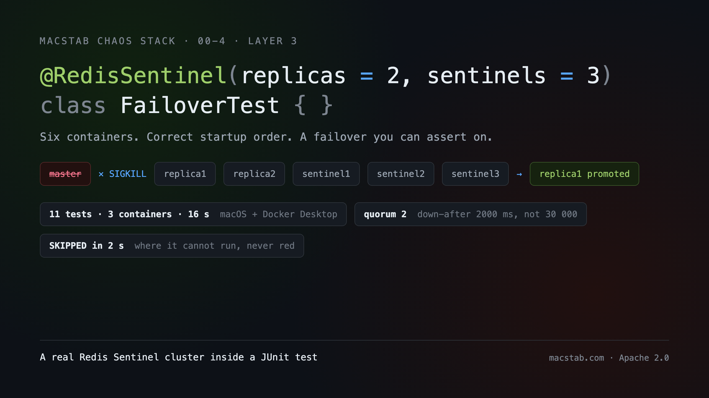
*One annotation, six containers, and a promotion clock you can put an assertion around.*

---

**Your Redis is up. It answers `PING`. Its replicas are in sync, every dashboard is green — and it has refused every single write for the last forty minutes.**

One background snapshot failed, and that was enough. `stop-writes-on-bgsave-error` ships set to `yes`, so from that moment Redis turns away anything capable of modifying the data set. Reads are unaffected and continue to look perfect. The master answers `PING` — which happens to be the only thing Sentinel's health check consults — so no Sentinel marks it subjectively down, nothing escalates to ODOWN, and no election is ever called. **There is no failover here. There never will be.** The cluster simply sits in that state, healthy against every signal you are monitoring, until some human being finally opens the logs.

Infrastructure chaos cannot produce that, because nothing died. A mocked `RedisTemplate` cannot produce it either, because a mock has no disk. And the code you wrote for the *other* failure — the one where a node genuinely dies — has never run at all. Not once, not in CI, not on your laptop, because rehearsing it honestly means one master, two replicas, three Sentinels, a correct quorum, replication actually converged, and a kill at exactly the right instant. So it never gets written. The cache gets mocked, an embedded single-node Redis stands in for a highly-available cluster, and the first time your client library ever observes a `+switch-master` is at 03:14 in production, in front of an audience.

The layer described below exists to take that excuse away. It costs one annotation on the class:

```java
@RedisSentinel                       // 1 master + 2 replicas + 3 sentinels, quorum 2
class FailoverTest { }
```

Behind that line: six containers on their own private Docker network, brought up in an order that actually works, running a Sentinel configuration tuned so a failover finishes within a CI budget instead of a coffee break — and a `Duration triggerFailover()` that hands you back a number to wrap in `assertThat(...).isLessThan(...)`. The same annotation family covers the cheap end too:

```java
@RedisStandalone                     // one real Redis 7.4, random port, auto-torn-down
class CacheTest { }
```

Nothing else is required. There is no `@Testcontainers` on the class, no `static GenericContainer<?> redis = ...` field to declare, no `@DynamicPropertySource` to wire, no `@BeforeAll` to write — and no `stop()` sitting in an `@AfterAll` that you meant to add and never did.

What you are looking at is the third layer of the Macstab Chaos Stack. Two layers sit under it: [six C99 `LD_PRELOAD` libraries](https://github.com/macstab/macstab-chaos-testing-libraries) that rewrite the libc and kernel contract beneath a running process, and a JVM bytecode agent that injects faults at the level of individual Java methods. Neither of those can supply what this layer does — *a production-shaped topology worth injecting them into*.

Take it at whatever depth suits you. §1 alone puts a Redis container inside a test in ninety seconds, and shows the ninety lines of Testcontainers plumbing that one annotation absorbs. Past that it descends: how Sentinel's discovery protocol collides with Docker port mapping, why quorum and election majority are different numbers, what separates SDOWN from ODOWN, what TILT mode does to your HA layer, how to reproduce the snapshot failure above in about ten seconds — and every place where this module's abstraction turns out to be thinner than its Javadoc implies.

---

## 1. The easy part — and the ninety lines it replaces

Start with the dependency. It lives under the `com.macstab.chaos` group, published from [`github.com/macstab/chaos-testing`](https://github.com/macstab/chaos-testing):

```groovy
// Gradle
testImplementation 'com.macstab.chaos:macstab-chaos-redis:1.0.0'
```

```xml
<!-- Maven -->
<dependency>
    <groupId>com.macstab.chaos</groupId>
    <artifactId>macstab-chaos-redis</artifactId>
    <version>1.0.0</version>
    <scope>test</scope>
</dependency>
```

From there, the whole API is one annotation and one method parameter:

```java
@RedisStandalone
class CacheTest {

    @Test
    void redisAnswers(StandaloneRedis redis) {
        RedisClient client = RedisClient.create(
                RedisURI.builder().withHost(redis.host()).withPort(redis.port()).build());
        try (var conn = client.connect()) {
            assertThat(conn.sync().ping()).isEqualTo("PONG");
            conn.sync().set("k", "v");
            assertThat(conn.sync().get("k")).isEqualTo("v");
        } finally {
            client.shutdown();
        }
    }
}
```

Two components make up that `StandaloneRedis` [record](https://openjdk.org/jeps/395) — a host and a port — and JUnit hands it to you as a method parameter. What sits behind it is not a stub: a genuine `redis:7.4` image, bound to a random host port, started once ahead of the class and shut down when it finishes. Everything else you might expect to write is absent. No `@Testcontainers` on the class. No static field. No `@ExtendWith`. No lifecycle code of your own anywhere.

### 1.1 What that one line replaces

Claims about ease are meaningless in isolation. So put the alternative next to it — the hand-rolled Testcontainers version of that same standalone test, which most Java teams have written at least once:

```java
@Testcontainers
class CacheTest {

  @Container
  static final GenericContainer<?> REDIS =
      new GenericContainer<>(DockerImageName.parse("redis:7.4"))
          .withExposedPorts(6379)
          .waitingFor(Wait.forLogMessage(".*Ready to accept connections.*\\n", 1));

  static String host() { return REDIS.getHost(); }
  static int    port() { return REDIS.getMappedPort(6379); }

  @DynamicPropertySource
  static void props(DynamicPropertyRegistry r) {
    r.add("spring.data.redis.host", CacheTest::host);
    r.add("spring.data.redis.port", CacheTest::port);
  }

  @Test void redisAnswers() { /* … build a client from host()/port() … */ }
}
```

Count what that costs you. Twenty lines, duplicated into every test class that touches Redis, with each copy drifting independently: one picks up a different image tag, another loses its wait strategy in a refactor, a third has a `@Container` that somebody made non-static, so it now restarts per method and triples the runtime of the suite. Nobody notices until CI slows down. Against that:

```java
@RedisStandalone
class CacheTest {
  @Test void redisAnswers(StandaloneRedis redis) { /* … */ }
}
```

The Sentinel cluster is where the gap stops being a matter of taste. Below is what `@RedisSentinel` replaces — already condensed, and already missing everything that would make it production-grade: **no** error handling, **no** parallel startup, **no** cleanup when startup fails half-way, **no** role detection, **no** failover helper.

```java
Network net = Network.newNetwork();

GenericContainer<?> master = new GenericContainer<>("redis:7-alpine")
    .withNetwork(net).withNetworkAliases("redis-master")
    .withExposedPorts(6379)
    .withCommand("redis-server", "--protected-mode", "no")
    .waitingFor(Wait.forLogMessage(".*Ready to accept connections.*\\n", 1));
master.start();

List<GenericContainer<?>> replicas = new ArrayList<>();
for (int i = 1; i <= 2; i++) {
  GenericContainer<?> r = new GenericContainer<>("redis:7-alpine")
      .withNetwork(net).withNetworkAliases("redis-replica" + i)
      .withExposedPorts(6379)
      .withCommand("redis-server", "--protected-mode", "no",
                   "--replicaof", "redis-master", "6379")
      // NOT "port is open" and NOT PING — a loading replica answers both
      .waitingFor(Wait.forLogMessage(".*MASTER <-> REPLICA sync: Finished with success.*\\n", 1));
  r.start();
  replicas.add(r);
}

// Sentinels must be told an address that every OTHER participant can also use,
// because that address is gossiped and handed to clients — so: the internal IP,
// not the alias, not the mapped port.
String masterIp = master.getContainerInfo().getNetworkSettings()
    .getNetworks().values().iterator().next().getIpAddress();

int quorum = (3 / 2) + 1;
String conf = "printf \"port 26379\\n"
    + "sentinel monitor mymaster " + masterIp + " 6379 " + quorum + "\\n"
    + "sentinel down-after-milliseconds mymaster 2000\\n"   // NOT the 30000 default,
    + "sentinel parallel-syncs mymaster 1\\n"               // or no test can assert
    + "sentinel failover-timeout mymaster 5000\\n"          // a failover in CI time
    + "\" > /tmp/sentinel.conf && redis-server /tmp/sentinel.conf --sentinel";

List<GenericContainer<?>> sentinels = new ArrayList<>();
for (int i = 1; i <= 3; i++) {
  GenericContainer<?> s = new GenericContainer<>("redis:7-alpine")
      .withNetwork(net).withNetworkAliases("sentinel" + i)
      .withExposedPorts(26379)
      .withCommand("sh", "-c", conf)
      .waitingFor(Wait.forSuccessfulCommand("redis-cli -p 26379 SENTINEL master mymaster"));
  s.start();
  sentinels.add(s);
}

Thread.sleep(2000);   // __sentinel__:hello convergence — see §6.2

// … and now write the teardown, in reverse order, in an @AfterAll that must run
// even when startup threw half-way through. Then write role detection. Then write
// the failover helper. Then discover, on macOS, that none of it connects (§6.5).
```

Ninety lines, give or take — and now they are yours to maintain. Worse, they are load-bearing in ways the code never states. Three separate pieces of Redis operational knowledge are buried in there: that one specific log line is the only proof a replica has finished syncing, that Sentinel must be handed an IP rather than an alias, that 2 000 has to replace the 30 000 default or no assertion can ever finish. Delete any one of them and the tests still compile. They just start lying. And the first engineer to copy-paste this into the next test class inherits all three without knowing they exist. Against that:

```java
@RedisSentinel
class FailoverTest { }
```

You get the same six containers in the same order with the same tuned configuration, and on top of it parallel startup, failure isolation, budget validation, automatic teardown, role detection and a failover clock. But brevity is not the argument here. The argument is where the knowledge now lives: **inside the framework**, written once, covered by tests, and under version control — rather than re-derived from scratch in every test class, by whoever happened to be on that ticket, from whichever Stack Overflow answer surfaced first.

### 1.2 It runs

None of the output in this article is illustrative. Every command was run while writing it, on a macOS host with Docker Desktop 28.3.2 and Java 25, against `macstab-chaos-redis` `1.0.0`:

```sh
./gradlew :macstab-chaos-redis:test \
  --tests "*StandaloneExtensionLifecycleTest*" \
  --tests "*MultiInstanceStandaloneExtensionTest*"
```

```
RedisContainerExtension — Standalone Lifecycle Integration > Container is actually running Redis > should accept connections on mapped port PASSED
RedisContainerExtension — Standalone Lifecycle Integration > Container is actually running Redis > should support basic SET and GET PASSED
RedisContainerExtension — Standalone Lifecycle Integration > StandaloneRedis parameter injection > should inject StandaloneRedis parameter PASSED
RedisContainerExtension — Standalone Lifecycle Integration > StandaloneRedis parameter injection > should inject List<StandaloneRedis> parameter (single element) PASSED
RedisContainerExtension — Standalone Lifecycle Integration > INSTANCE programmatic access > RedisStandalone.INSTANCE.get(id) should return connection info PASSED
StandaloneStartupOrchestrator — Multi-Instance Integration > Parallel startup > should start all instances and return correct count PASSED
StandaloneStartupOrchestrator — Multi-Instance Integration > Parallel startup > should preserve annotation declaration order PASSED
StandaloneStartupOrchestrator — Multi-Instance Integration > Data isolation > should isolate data between instances PASSED
...
BUILD SUCCESSFUL in 16s
```

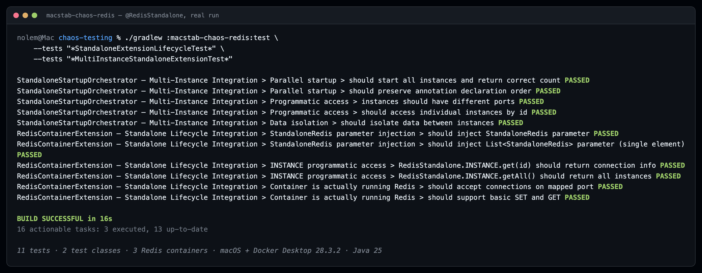

*Captured output, not a mock-up: eleven tests, two test classes, three Redis containers.*

Read the numbers carefully, because they are less impressive than they look and that is the point: sixteen seconds covers eleven tests, two test classes and three Redis containers, *plus* compilation and the JaCoCo report — on a laptop, through a Docker Desktop VM, which is the slowest environment this module runs in.

---

## 2. What the annotation actually is

Strip `@RedisStandalone` down and there is nothing clever inside it. Thirty seconds spent on its declaration pays for the rest of the article, because every other annotation in the module is assembled from these same pieces:

```java
@ChaosTest                                   // meta: registers ChaosTestingExtension
@ExtendWith(RedisContainerExtension.class)   // the container lifecycle owner
@Repeatable(RedisStandalones.class)          // JLS §9.6.3 repeating annotation
@Target(ElementType.TYPE)
@Retention(RetentionPolicy.RUNTIME)
public @interface RedisStandalone { ... }
```

Four decisions there, and none of them is decoration.

**`@ExtendWith` on the annotation, not on your class.** JUnit 5 resolves `@ExtendWith` as a [meta-annotation](https://junit.org/junit5/docs/current/user-guide/#extensions-registration-declarative), so declaring `@RedisStandalone` registers `RedisContainerExtension` transitively. It is worth knowing *why* that is a framework feature rather than a language one, because Java offers no annotation inheritance in this direction at all. [`@Inherited`](https://docs.oracle.com/javase/specs/jls/se21/html/jls-9.html#jls-9.6.4.3) (JLS §9.6.4.3) propagates an annotation from a superclass to its subclasses, and that is the entire extent of it; it says nothing about annotations *on* annotations. So JUnit walks the annotation graph of the test class itself, with cycle detection. Spring does the same for `@SpringBootTest`. So does Micronaut. So does Quarkus. Every composed annotation you have ever used is a framework working around that one gap in the JLS.

The payoff is the [Extension Object pattern](https://junit.org/junit5/docs/current/user-guide/#extensions) working as designed. Your test class states *what it needs* and stays silent about *how that is wired*. And because the annotation carries both the registration and the configuration, there is no way to end up with one without the other — a whole category of misconfiguration simply cannot be expressed.

**`@ChaosTest` is the framework's single registration point.** This one is internal plumbing: it drags in `ChaosTestingExtension`, the orchestrator that every chaos annotation in the stack shares — `@RedisStandalone`, `@RedisSentinel`, the L3 incident packs, the resource controls. Two things follow. Adding an eleventh container annotation is a one-line change instead of an eleventh duplicated `@ExtendWith`. And, more importantly, the Redis annotations end up inside the *same* lifecycle as syscall-level and JVM-level fault injection — which is what lets you switch on the layers underneath in the same test class without two lifecycles competing over the same containers.

**`@Target(ElementType.TYPE)` — class scope, deliberately.** Provisioning a container means a Docker API call of roughly 200 ms plus process startup. Do that per test method and you have multiplied it by your entire test count, which is how a suite quietly becomes a coffee break. So the container is built once in `beforeAll` and shared across the class. That buys speed and hands you the usual Testcontainers obligation in exchange: state now survives between methods, so you clean it yourself — `FLUSHALL` in `@AfterEach`, or namespace your keys per test. The module could do that automatically and deliberately does not, because a framework that silently wipes a database your test might be asserting against is a far nastier surprise than one line you wrote on purpose.

**`@Repeatable`.** Write the annotation twice and the *compiler* synthesizes the `@RedisStandalones` **containing annotation type** around both: [JLS §9.6.3](https://docs.oracle.com/javase/specs/jls/se21/html/jls-9.html#jls-9.6.3) defines the repeatable type, and [JLS §9.7.5](https://docs.oracle.com/javase/specs/jls/se21/html/jls-9.html#jls-9.7.5) defines the rewrite of multiple annotations of the same type into that container. The spec imposes constraints the module has to satisfy. The containing type's `value()` must be an array of the repeatable type. Its retention must be **at least as long** as the repeatable type's — both `RUNTIME` here, or the whole declaration vanishes before the extension can read it. Its `@Target` must be a subset. Get any of those wrong and you get a compile error rather than a runtime surprise, which is the good case.

That rewrite has a consequence anyone reading annotations reflectively has to handle: the same declaration now arrives in one of two shapes, and reflection will not normalise them for you. Writing `@RedisStandalones` by hand is never necessary — the extension simply checks for both:

```java
private RedisStandalone[] extractAnnotations(final ExtensionContext context) {
  final Class<?> testClass = context.getRequiredTestClass();
  final RedisStandalones container = testClass.getAnnotation(RedisStandalones.class);
  if (container != null) {
    return container.value();          // 2..n annotations → compiler-synthesized container
  }
  final RedisStandalone single = testClass.getAnnotation(RedisStandalone.class);
  return single != null ? new RedisStandalone[] {single} : new RedisStandalone[0];
}
```

### The lifecycle, and the one part that is not where you'd expect

```
beforeAll(context)
  ├─ CURRENT_CONTEXT.set(context)                  ← ThreadLocal for static accessors
  ├─ extractAnnotations(context)                   ← 1..n @RedisStandalone
  ├─ ResourceBudget.validateStandaloneBudget(...)  ← fail fast, before any Docker call
  ├─ DependencyVerifier.requireCacheModule()       ← only if enableNetworkChaos=true
  ├─ DependencyVerifier.requireConnectionModule()  ← only if enableConnectionChaos=true
  ├─ StandaloneStartupOrchestrator.start(...)      ← parallel start, failure isolation
  └─ Store.put(CONTAINER_MAP_KEY, …)               ← CloseableStoreMap (CloseableResource)

afterAll(context)
  └─ CURRENT_CONTEXT.remove()                      ← that is ALL it does
```

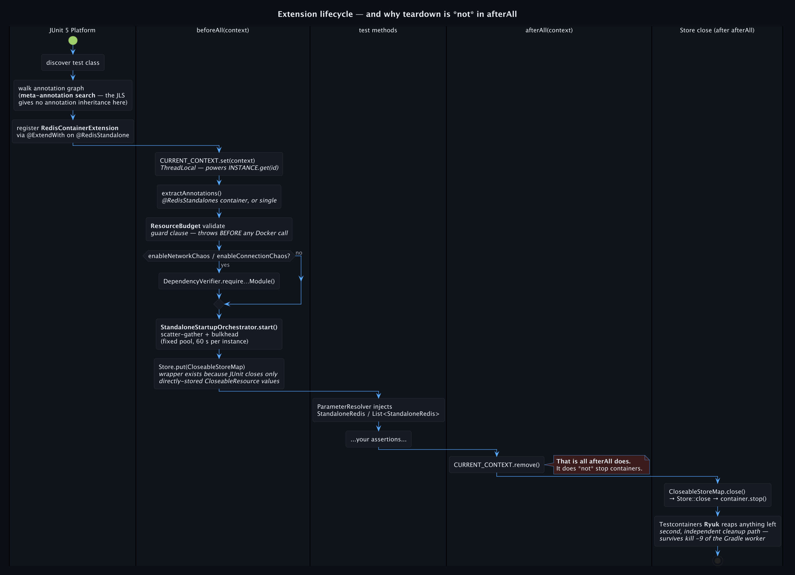

*The meta-annotation search, the guard clause that runs before Docker is touched, and the two independent cleanup paths.*

Look at what is missing from `afterAll`: it never stops a container. Teardown happens somewhere else entirely — on JUnit's [`ExtensionContext.Store.CloseableResource`](https://junit.org/junit5/docs/current/api/org.junit.jupiter.api/org/junit/jupiter/api/extension/ExtensionContext.Store.CloseableResource.html) contract, where the store closes everything it holds as its scope ends, in reverse insertion order, and only *after* the last `afterAll` callback has finished. One wrinkle forces a wrapper class into the middle of that, and the source says so outright: JUnit invokes `close()` only on values stored *directly* in the store, so a plain `Map<String, Store>` full of containers would sit there and never be closed. `CloseableStoreMap` exists purely to spread the call across the map:

```java
private static final class CloseableStoreMap implements ExtensionContext.Store.CloseableResource {
  @Override public void close() {
    log.info("Cleaning up {} standalone Redis container(s)", stores.size());
    stores.values().forEach(Store::close);       // → container.stop()
  }
}
```

One more safety net sits underneath: Testcontainers' [Ryuk resource reaper](https://java.testcontainers.org/features/garbage_collector/), a sidecar that keeps a socket open to your JVM and destroys every labelled container the instant that socket drops. Between the two mechanisms, containers go away when the class finishes normally — and also when you `kill -9` the Gradle worker, and when your IDE murders the run half-way through. For something billed by the CI minute, two independent paths to cleanup is exactly the right number.

---

## 3. Getting a handle: parameter injection, and the static back door

Because the extension implements [`ParameterResolver`](https://junit.org/junit5/docs/current/user-guide/#extensions-parameter-resolution), you ask for what you want in the method signature and JUnit supplies it. Four shapes work, on `@Test`, `@BeforeAll`, `@BeforeEach` and `@AfterEach` alike:

| Parameter type | Resolves to |
|---|---|
| `StandaloneRedis` | the single instance (or the one with `id="default"`) |
| `List<StandaloneRedis>` | every instance, **in annotation declaration order** |
| `RedisConnectionInfo` | the same thing in the extension's internal type |
| `List<RedisConnectionInfo>` | same, all instances |

The Sentinel side mirrors it exactly — `SentinelCluster`, `List<SentinelCluster>`, `SentinelRedis`, `List<SentinelRedis>` — but the two types are not interchangeable. Reach for `SentinelCluster` when you need the live handle: the containers themselves, the control facade, the failover trigger. Reach for `SentinelRedis` when you need an immutable record of addresses to hand to a client factory.

One property of those lists is worth relying on deliberately, because it did not happen by luck. A `LinkedHashMap` holds the order inside the orchestrator, and the read path re-derives it from the annotation array rather than from the map:

```java
for (final RedisStandalone annotation : annotations) {   // annotation order, not map order
  final RedisConnectionInfo instance = instances.get(annotation.id());
  if (instance != null) { ordered.add(instance); }
}
```

Which means `all.get(0)` is always the annotation you wrote first — a guarantee the module's own integration test pins down, and one that passed in the run shown above.

Sometimes there is no method signature to inject into: a `@BeforeAll` helper, a Spring `@DynamicPropertySource`, a fixture builder three stack frames away. For those, a static accessor:

```java
StandaloneRedis cache   = RedisStandalone.INSTANCE.get("cache");
SentinelRedis   session = RedisSentinel.INSTANCE.get("session");
List<Redis>     all     = Redis.getAll();   // sealed interface over both topologies
```

Because `Redis` is declared `sealed ... permits StandaloneRedis, SentinelRedis`, the compiler knows the complete set of topologies — so a switch across them needs no default branch to be exhaustive:

```java
String describe(Redis redis) {
  return switch (redis) {
    case StandaloneRedis s -> "standalone " + s.host() + ":" + s.port();
    case SentinelRedis   s -> "sentinel master " + s.masterName() + " via " + s.sentinels();
  };
}
```

**How the static accessor works, and what that costs.** Those two routes are not stylistic alternatives; they are the two canonical answers to one question, and shipping both was a decision. Parameter injection is **dependency injection** — the dependency is declared in the signature, handed to you by the framework, and unresolvable when the framework is not running. `INSTANCE.get(id)` is a **service locator** — you reach into a global and pull. Fowler [argues against the locator](https://martinfowler.com/articles/injection.html) for production wiring, and his reason is precisely the one that bites here: the dependency becomes invisible, and the failure moves from compile time to run time.

So why ship it? Because a test fixture is not production wiring, and sometimes the seam does not exist. Spring's `@DynamicPropertySource` is `static` and receives a `DynamicPropertyRegistry` — there is nowhere to inject anything, so it is the locator or nothing at all. The mechanism behind it is a `ContainerManager` delegating to `RedisContainerExtension.getContainer(id)`, which reads a `ThreadLocal<ExtensionContext>` planted in `beforeAll`. That makes it a **thread-confined ambient context** — architecturally the same animal as `SecurityContextHolder` or `TransactionSynchronizationManager`, and heir to the same failure modes. Those are worth spelling out, because each one costs an afternoon the first time:

- Call it from outside a `@RedisStandalone` class and it raises `IllegalStateException: Called outside @RedisStandalone test context`. That wording is deliberate — a `NullPointerException` would have told you nothing.
- Call it from any thread other than the JUnit worker — an executor you started, a reactive scheduler — and the `ThreadLocal` is empty, producing the same exception. The fix is to resolve the handle on the test thread and pass the value across yourself.
- Two separate mechanisms clear that `ThreadLocal`: `afterAll`, and a `ThreadLocalCleanup` `CloseableResource` behind it. Belt and braces, because JUnit pools its worker threads, and a context left behind is an entire `ExtensionContext` graph left behind with it.
- Only one kind of leniency is built into `get("default")`. Where a single instance exists it returns that instance whatever id you gave it. Where several exist and none is called `"default"`, it refuses — and the exception *lists the ids that are actually available*.

---

## 4. Several Redises, started in parallel, with failure isolation

Stack the annotation and each copy becomes a fully independent instance:

```java
@RedisStandalone(id = "cache",        version = "7.4")
@RedisStandalone(id = "session",      version = "7.2")
@RedisStandalone(id = "rate-limiter")
class MultiStoreTest {

  @Test
  void storesAreIsolated() {
    var cache   = RedisStandalone.INSTANCE.get("cache");
    var session = RedisStandalone.INSTANCE.get("session");
    // same key, two Redises, two answers
  }
}
```

Those three do not start one after another — they start together, and the orchestrator behind that is compact enough to show in full intent:

```java
final ExecutorService executor = Executors.newFixedThreadPool(annotations.length);
final List<Future<StartupResult>> futures = submitStartupTasks(executor, annotations);
// … collect with a per-instance timeout, then:
if (!failures.isEmpty()) {
  final List<String> cleanupActions = cleanupInstances(toCleanup);   // stop the ones that DID start
  throw new ClusterStartupException(failures, cleanupActions);
}
```

Structurally that is **scatter–gather** wrapped in a **bulkhead**: work fans out, every outcome is collected on its own terms, and no single failure is allowed to take down its neighbours or the report you need to debug them. Four consequences follow, and each one corresponds to a CI failure somebody has already lost a day to.

**Waiting is bounded.** Every standalone instance gets `future.get(60, SECONDS)`; every Sentinel cluster gets 120. When a Docker daemon wedges mid image-pull, the result is a named, timestamped failure that says `Instance 'cache' startup timed out`. The alternative — and this is what you get without the bound — is a job frozen at 0 % until the CI platform's global timeout kills it an hour later, leaving nothing behind to diagnose.

**Isolation encoded in the type system.** Rather than a status flag, `StartupResult` is a **sum type** — an algebraic data type in the ML tradition, written in Java as a [sealed interface](https://openjdk.org/jeps/409) (JEP 409) that permits exactly two [records](https://openjdk.org/jeps/395) (JEP 395) and is consumed through [pattern matching for `switch`](https://openjdk.org/jeps/441) (JEP 441):

```java
public sealed interface StartupResult permits StartupResult.Success, StartupResult.Failure {
  String instanceId();
  record Success(String instanceId, RedisConnectionInfo connectionInfo, Store store)
      implements StartupResult {}
  record Failure(String instanceId, String errorMessage, Exception error)
      implements StartupResult {}
}
```

```java
switch (result) {
  case StartupResult.Success s -> { successful.put(s.instanceId(), s.connectionInfo()); … }
  case StartupResult.Failure f -> failures.add(new ClusterStartupFailure(f.instanceId(), …));
}
```

The `sealed` keyword is doing real work in that snippet. Because the compiler can enumerate every permitted subtype, the `switch` is **exhaustive with no `default` branch** — and the day somebody adds a third outcome, say `Skipped`, every consumer stops compiling instead of quietly falling through to a default that does the wrong thing. That is the case for algebraic data types over the `boolean success` plus nullable-fields struct this replaced, and it is a correctness guarantee rather than a matter of taste. The runtime behaviour matches: one failing instance never aborts collection of the rest, and all failures are reported together — so three broken configurations surface on one run, not across three pushes.

**Partial failure still cleans up.** Picture instance 3 of 5 failing: by then 1 and 2 are up and would linger until Ryuk got around to them. Instead they are stopped there and then, and the list of *what was stopped* travels inside the thrown `ClusterStartupException` next to the failures that caused it.

**Concurrency does not scramble the order.** Collection walks the futures in annotation order, so however the containers race each other to start, `List<StandaloneRedis>` comes back in the sequence you declared.

In the run captured earlier this is measurable rather than theoretical: the two-instance class brought both containers up together, and everything it does — five tests, two Redis instances, data-isolation assertions crossing between them — fitted inside the same sixteen-second build.

---

## 5. The budget that stops you before Docker does

`ResourceBudget` runs first, before anything reaches the Docker API at all:

```java
public static final int MAX_SENTINEL_CLUSTERS    = 3;
public static final int MAX_STANDALONE_INSTANCES = 5;
public static final int MAX_TOTAL_CONTAINERS     = 20;
public static final int MAX_MEMORY_MB            = 100;
private static final int MEMORY_PER_CONTAINER_MB = 4;   // redis:7-alpine baseline
```

Ask for a sixth `@RedisStandalone` on one class, or a fourth `@RedisSentinel`, and `beforeAll` refuses — with a message that names the limit and tells you the way out:

```
ResourceBudgetExceededException: Too many Sentinel clusters: 4 (max: 3).
  Each cluster uses 1 master + N replicas + M sentinels.
  Consider reducing cluster count or using standalone Redis for non-HA tests.
```

Mixing topologies counts exactly as you would expect: `1 + replicas + sentinels` for every cluster, one for every standalone. So `@RedisSentinel(replicas=2, sentinels=3)` sitting beside two `@RedisStandalone` declarations occupies 8 of the 20 slots.

Two things about this deserve honesty rather than salesmanship. The memory number is *nominal* — an accounting constant of 4 MB per container against a 100 MB ceiling. It measures nothing about your host, and it imposes no cgroup limit on anything. Reality for an empty `redis:7-alpine` process plus container overhead is closer to 15–30 MB. So use the budget for what it actually is, a guard rail against the loop or the copy-paste that asks for forty containers, and never as a capacity planner. The second point is scope. All of this is enforced *per test class*, which means ten classes running five instances each under Gradle `--parallel` is fifty live containers, and nothing in this module has any idea. Your daemon's `pids` ceiling, its memory, and its per-bridge network limits are still entirely your problem.

---

## 6. `@RedisSentinel`: what is actually hard here

Everything so far has been convenience — pleasant, but not why anyone would build this. The hard part starts here, and it is the reason the module exists.

```java
@RedisSentinel(replicas = 2, sentinels = 3)
class FailoverTest { }
```

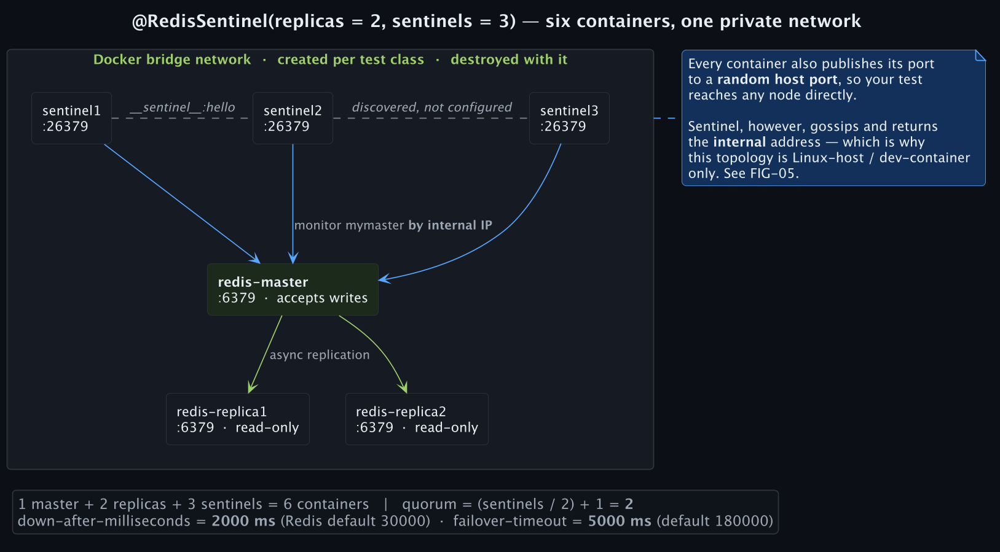

*A master, two replicas and three Sentinels sharing one private bridge network that is born with the test class and dies with it. Every Sentinel receives just two things — the master's **internal** address and a quorum — and works out the rest of the topology, its peers and all the replicas, unaided.*

### 6.1 The startup order is not negotiable

[Sentinel](https://redis.io/docs/latest/operate/oss_and_stack/management/sentinel/) tracks a master by address, and that single fact dictates the entire startup sequence. Bring the Sentinels up first and they have nothing to monitor. Bring them up before replication has converged and their first observation is a master with no healthy replicas behind it — in other words, a cluster incapable of failing over. Four phases therefore run in strict order, and every one waits on a *semantic* signal instead of a sleep:

| Phase | Command | Ready when |
|---|---|---|
| master | `redis-server --protected-mode no` | log matches `Ready to accept connections` |
| replicas | `redis-server --protected-mode no --replicaof redis-master 6379` | log matches `MASTER <-> REPLICA sync: Finished with success` |
| sentinels | `redis-server /tmp/sentinel.conf --sentinel` | `redis-cli -p 26379 SENTINEL master mymaster` exits 0 |
| stabilisation | — | fixed 2 s |

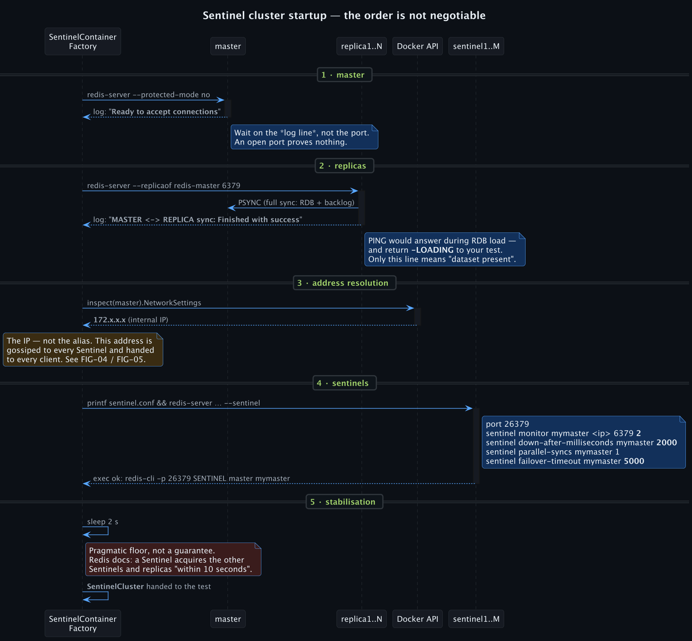

*Four phases, each gated on a semantic signal rather than a sleep — and the one honest `Thread.sleep` at the end.*

If you take one thing from this section, take the replica wait strategy. `MASTER <-> REPLICA sync: Finished with success` is emitted only when the [full synchronisation](https://redis.io/docs/latest/operate/oss_and_stack/management/replication/) handshake has completed end to end — `PSYNC`, RDB snapshot transfer, backlog catch-up. Now consider the obvious alternatives. Waiting for the port to open succeeds while the replica is still loading the RDB into memory. Waiting for `PING` succeeds for the same reason, because a loading replica answers it — and then answers your test's first real command with `-LOADING Redis is loading the dataset in memory`. That log line is the only signal that actually means the data has arrived and the backlog is streaming.

Sentinels get `Wait.forSuccessfulCommand(...)` wrapped around `SENTINEL master mymaster`, which happens to prove three separate things in one call: the process started, it parsed its configuration, and it resolved the master it was told to watch. After that comes a flat 2 000 ms sleep, labelled as exactly that in the source, because `+monitor` firing does not mean the Sentinels have found one another yet. Understanding why they need that moment means understanding how they find each other at all.

### 6.2 Why each Sentinel is told only about the master

Here is every line of configuration each Sentinel receives, assembled by `RedisCommandBuilder.buildSentinelStartCommand()` and `printf`'d into the container as it launches:

```
port 26379
sentinel monitor mymaster 172.18.0.2 6379 2
sentinel down-after-milliseconds mymaster 2000
sentinel parallel-syncs mymaster 1
sentinel failover-timeout mymaster 5000
```

Count what is in that file, then count what is missing. Three Sentinels are about to run, and none of them is told that the other two exist. Nor are the replicas mentioned anywhere. That is not an oversight — the topology is *discovered*, through a **publish–subscribe rendezvous** held on the very thing being monitored. The mechanism is [documented](https://redis.io/docs/latest/operate/oss_and_stack/management/sentinel/#adding-or-removing-sentinels) and elegant: every two seconds each Sentinel publishes a hello message to the `__sentinel__:hello` channel *on the master and on every replica*, announcing its address, run-id, epoch and current view of the master — and every Sentinel is subscribed to that same channel. The master, in other words, is the meeting point. Three processes that each know one address converge on a complete picture of each other within a couple of publish intervals. The replicas fall out of the master's `INFO replication` output, which is why nobody ever has to configure those either.

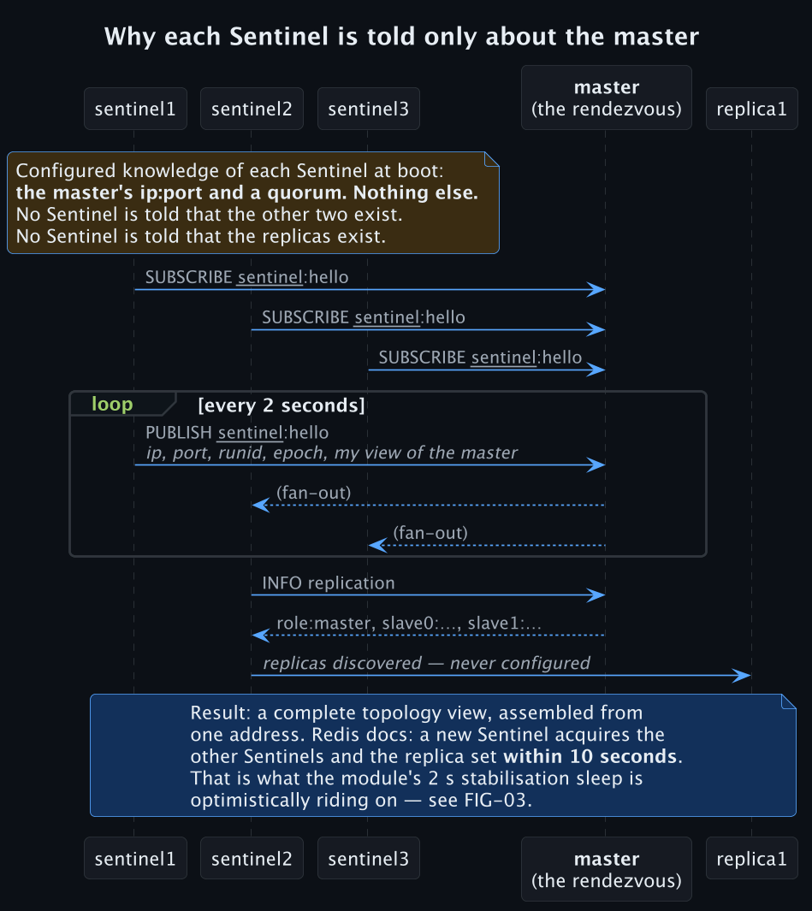

*Each Sentinel boots knowing one address. The master is the rendezvous: everything else — the other Sentinels, every replica — is discovered over `__sentinel__:hello` and `INFO replication`.*

Now the 2-second wait makes sense — and so does its limitation, which is worth stating rather than hiding. Redis's own documentation puts full discovery at "within 10 seconds" for a newly started Sentinel. Two seconds is therefore a pragmatic floor sitting on top of the per-Sentinel readiness probe, not proof that the gossip has settled. What the module can promise when it hands you the cluster is narrow and true: every Sentinel is verifiably monitoring the master. Whether all three have seen each other yet is a race. So write assertions against the cluster's *behaviour* — that a failover actually completes — and not against `num-other-sentinels` at t=0.

The same mechanism explains a choice that otherwise looks arbitrary: the module hands Sentinel the master's **internal Docker IP** instead of the alias `redis-master`. That address is not merely something to connect to. It is the identity that gets gossiped onward to every other Sentinel and returned to every client that asks. An alias resolvable only inside one container's DNS view would propagate as an address nobody else can reach.

```java
static String getMasterIpAddress(final GenericContainer<?> master) {
  return master.getContainerInfo().getNetworkSettings().getNetworks().values().stream()
      .findFirst()
      .orElseThrow(() -> new RuntimeException("Master container has no network"))
      .getIpAddress();
}
```

### 6.3 The timing constants are the interesting part

Set the values the module writes beside the ones Redis ships with:

| Directive | Redis default | This module | Why |
|---|---|---|---|
| `down-after-milliseconds` | 30 000 | **2 000** | time to SDOWN; dominates failover latency |
| `failover-timeout` | 180 000 | **5 000** | bounds each failover state, and the retry interval |
| `parallel-syncs` | 1 | 1 | replicas allowed to resync with the new master *simultaneously* — 1 means one at a time, so the rest keep serving (stale) reads instead of all blocking on a full sync at once |
| `quorum` | — | `(sentinels / 2) + 1` | 3 → 2, 5 → 3 |

That "Redis default" column is not quoted from memory. It was read back out of a live Redis 7.4.8 Sentinel that had been handed a single `sentinel monitor` line and nothing else:

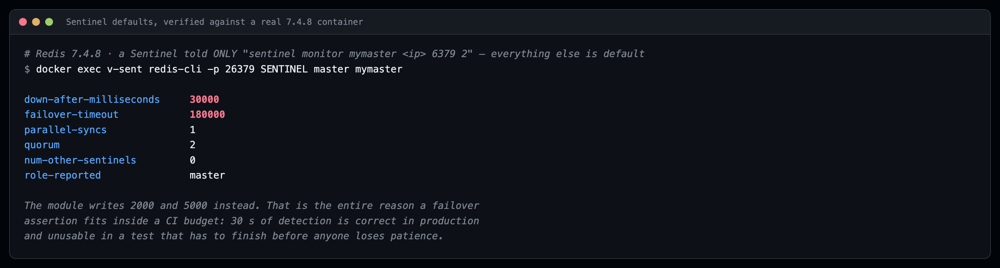

*`SENTINEL master mymaster` on an otherwise-unconfigured Sentinel. 30 000 ms to detection, 180 000 ms failover timeout.*

Do not read the 30 000 default as a mistake Redis made. It is the right number in production, where it stands between you and a real failover — with real write loss — every time a GC pause, a slow disk or a two-second network blip makes a healthy master look briefly unreachable. The trouble is that the same number makes the assertion unwritable: no failover test can finish inside a sane CI budget, so the test never gets written and the code path stays unexercised. Dropping to 2 000 is what puts it back within reach, and it is exactly the sort of judgement that belongs *once, in a framework*, made by somebody who understands why the production default is set where it is. A test that takes 35 seconds to watch one promotion will be deleted by the third engineer who runs the suite, and they will be right to.

That number is not free, though: two seconds is a *tight* detection window. A Docker Desktop VM under load, a laptop that just swapped, a CI runner with noisy neighbours — each can stall a Redis process past the threshold and produce a `+sdown` nobody asked for. When the test's whole point is a failover, that costs nothing; the cluster behaves correctly either way. When the test asserts that *no* failover occurred, it is a flake waiting for a busy afternoon. Widen the window for that class instead of hoping.

### 6.4 Quorum is not the election majority — and mixing them up loses data

No parameter in Redis HA is misread as often as this one, and the cost of misreading it is measured in lost writes — so precision matters more than brevity here.

Start with what `quorum` counts. It is the number of Sentinels that must *independently* conclude the master is unreachable — each one reaching **SDOWN**, its own private verdict after `down-after-milliseconds` passes without a valid reply — before that verdict is promoted to **ODOWN**, the agreed one. ODOWN applies to masters and to nothing else; replicas never get one. And ODOWN is what *authorises* a failover attempt.

What it does **not** do is carry out that failover. On this point the [Sentinel documentation](https://redis.io/docs/latest/operate/oss_and_stack/management/sentinel/#quorum) leaves no room for interpretation, so it is worth quoting rather than paraphrasing:

> However **the quorum is only used to detect the failure**. In order to actually perform a failover, one of the Sentinels need to be elected leader for the failover and be authorized to proceed. This only happens with the vote of the **majority of the Sentinel processes**.

Two independent conditions must hold, then, before anything is promoted: quorum Sentinels agreeing the master is down, *and* a majority of all known Sentinels electing one of them to run the failover — or more than a majority, should you configure quorum above it. Whoever wins that election receives a unique **configuration epoch**, which versions the configuration it produces and makes it impossible for two Sentinels to circulate conflicting claims about who the master is. Readers who know Raft will recognise the machinery — epoch behaving as term, one leader per epoch, each vote spent once. Redis documents this in its own vocabulary rather than naming the algorithm, and so does this article.

Follow that through and the popular misconfiguration falls apart. Setting `quorum = 1` across five Sentinels does *not* produce a cluster that fails over whenever a single Sentinel feels lonely. It produces fast ODOWN and nothing else: if only two of the five can still see each other, no leader can be elected, no failover runs, and you are left with a cluster that has correctly concluded its master is dead and is powerless to act. The inverse case is where that majority rule earns its keep. When a partition strands the master with a minority of Sentinels, the majority requirement is the only thing preventing that minority from promoting a second master and leaving you with two datasets that disagree.

Hence the module's formula, `quorum = (sentinels / 2) + 1` — 3 becomes 2, 5 becomes 3 — which lines ODOWN up exactly with the election majority. Unless you are deliberately engineering a split-brain scenario, that is the configuration you want.

**One sharp edge, stated before you hit it.** As the module stands today, `quorum()` on `@RedisSentinel` never reaches the container configuration at all — the factory computes the majority formula from `sentinels` and uses that instead. With the defaults, 3 sentinels and quorum 2, both routes produce the same number and nothing is observable. Ask for `quorum = 1` expecting fast ODOWN, however, and you will not get it. Two neighbouring attributes have the same gap. `version()` on `@RedisSentinel` never reaches the nodes, which are pinned to `redis:7-alpine` regardless — note that `version()` on `@RedisStandalone` *is* honoured, which makes the inconsistency easy to trip over. And `masterName()` is faithfully stored in the `SentinelCluster` and `SentinelRedis` records while the generated config monitors **`mymaster`** no matter what you passed. The result compiles, runs, and then fails to connect:

```java
@RedisSentinel(masterName = "ha-master")            // ← record says "ha-master" …
class Wrong {
  @Test void t(SentinelRedis c) {
    var pool = new JedisSentinelPool(c.masterName(), sentinelAddrs(c));   // … Sentinel knows "mymaster"
  }
}
```

So until that attribute is wired through, pass `"mymaster"` — or read the name off the cluster and keep it in exactly one place in your test. The fix itself is about five lines in `RedisCommandBuilder`. Its interest lies in the category: this is the class of defect no amount of Javadoc-reading will ever reveal to you.

### 6.5 The address problem: why this is Linux-only, and why that is not laziness

Everything above works. This is the part that decides whether it works *on your machine* — and it is why Sentinel under Testcontainers is something almost nobody ships.

The root of it is a single architectural fact: Sentinel is a **discovery protocol**, not a proxy. Traffic never flows through it. A Sentinel-aware client asks `SENTINEL get-master-addr-by-name mymaster`, takes the address it gets back, and opens its own *direct* connection to that address — subscribing to `+switch-master` on the way, so that a later failover updates it.

Which is fine, until two address spaces disagree. Inside the test's Docker network the master lives at `172.18.0.2:6379`; that is what Sentinel stores, gossips onward, and returns to callers. Your JVM is not inside that network. It sits on the host and speaks to Redis through a *mapped* port — `localhost:54321`, say. Trace one lookup through both worlds:

```
JVM  ──▶ sentinel (localhost:54873)   "where is mymaster?"
JVM  ◀──                              "172.18.0.2:6379"
JVM  ──▶ 172.18.0.2:6379              ← routable from a Linux host. Not from a Docker Desktop VM.
```

Whether that third step succeeds depends entirely on where your daemon runs. Give it a **native Linux host** and the container bridge is a genuine interface on that machine, so `172.18.0.2:6379` routes and everything behaves. Run inside a **dev container or CI container** sharing the daemon's network and you get the same result. Move to **macOS or Windows**, though, and Docker Desktop puts the daemon inside a lightweight Linux VM — the bridge subnet lives in there, your host holds no route to it, and every Sentinel-aware client dies on that second hop. The cruelty is in the ordering: the handshake with Sentinel succeeds first, so the failure arrives *after* the part that looked difficult.

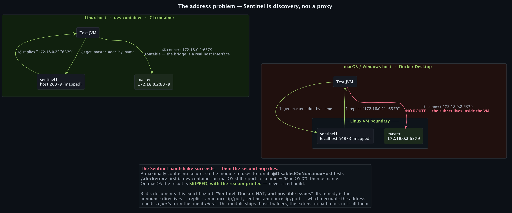

*The Sentinel handshake succeeds on both platforms. Only the third step — the direct connection to the address Sentinel returned — depends on whether the container bridge is a real host interface.*

None of this is a Testcontainers quirk — Redis documents it directly, under the heading [*Sentinel, Docker, NAT, and possible issues*](https://redis.io/docs/latest/operate/oss_and_stack/management/sentinel/#sentinel-docker-nat-and-possible-issues): "Docker uses a technique called port mapping: programs running inside Docker containers may be exposed with a different port compared to the one the program believes to be using… Remapping ports and addresses creates issues with Sentinel."

Redis solves this with the announce directives: `replica-announce-ip` and `replica-announce-port` on data nodes, `sentinel announce-ip` and `announce-port` on the Sentinels themselves. All four exist to break the assumption that the address a node *reports* is the address it *binds*. The module already contains builders for them — `SentinelCommandBuilder.configureMasterAnnouncement`, `configureReplicaAnnouncement`, `configureSentinelAnnouncement` — and every node carries the `host.testcontainers.internal:host-gateway` extra host for Docker-in-Docker reachability. What it does not do is call them: **the announce builders are not invoked on the current extension path.** That leaves a Linux host or a container as the supported configuration, and rather than letting you find that out through a nine-minute connection timeout, the module refuses up front:

```java
@DisabledOnNonLinuxHost(
    "Redis Sentinel tests require native Docker networking (Linux host or dev container)")
public @interface RedisSentinel { … }
```

JUnit ships `@EnabledOnOs(LINUX)` and it would be the wrong tool here, for one concrete reason: a dev container running *on* macOS still reports `os.name` as `Mac OS X`, and that environment works perfectly. Checking the OS alone would refuse to run tests that would have passed. So the condition looks for `/.dockerenv` first — inside a container you are on Linux by construction, whatever the JVM believes — and consults `os.name` only when that file is absent.

Run the Sentinel suite on a macOS laptop and the result is not a failure, not a hang, and not a mysterious timeout:

```sh
./gradlew :macstab-chaos-redis:test --tests "*SentinelFailoverTest*"
```

```
FailoverHelper — Sentinel Failover Integration > Failover simulation > triggerFailover() should complete and elect new master SKIPPED
FailoverHelper — Sentinel Failover Integration > Role detection > getMaster() should return a running container SKIPPED
FailoverHelper — Sentinel Failover Integration > Role detection > getReplicas() should return at least 1 replica container SKIPPED
FailoverHelper — Sentinel Failover Integration > Role detection > getContainer(MASTER) should return running master SKIPPED
BUILD SUCCESSFUL in 2s
```

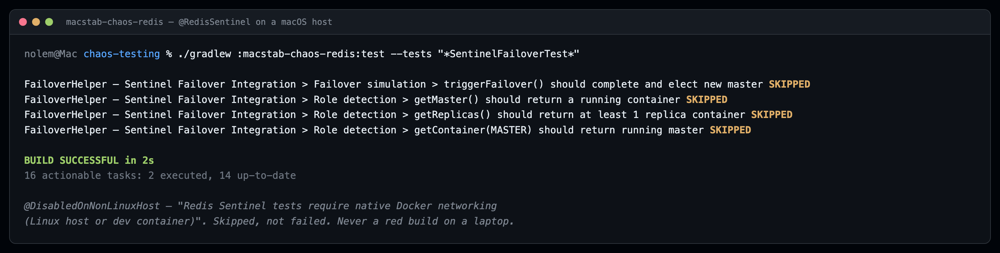

*The same test class that runs a six-container failover in CI, on a macOS laptop.*

That distinction decides whether the tests survive contact with a team. Hand somebody a red build caused by an environment they cannot change locally and they will learn to ignore red builds — all of them, including the ones that matter. Hand them a skip with the reason printed next to it and the suite stays trustworthy. So write your Sentinel tests once, let CI run them on Linux, and watch them quietly stand down on the macOS laptop: same annotation, same code, and not a single `if` anywhere in the test.

---

## 7. Failover as an assertion

Here is what all of that machinery was for. A week of plumbing, reduced to a test method:

```java
@RedisSentinel(replicas = 2, sentinels = 3)
class FailoverTest {

  @Test
  void promotesWithinSlo(SentinelCluster cluster) {
    Duration elapsed = cluster.getControl().triggerFailover(Duration.ofSeconds(30));

    assertThat(elapsed).isLessThan(Duration.ofSeconds(15));
    assertThat(cluster.getControl().getMaster().isRunning()).isTrue();
  }
}
```

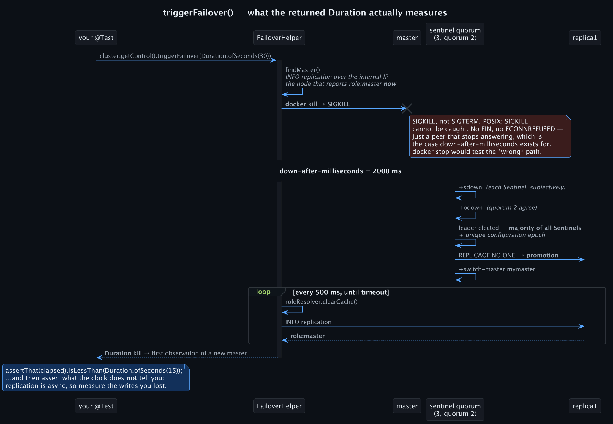

*SIGKILL → detection window → quorum → majority vote → promotion → the first poll that observes a new master.*

Step through what that single call actually performs:

1. **Locate whichever container is master at this instant.** Not the one that started life as master — the one *reporting* `role:master` right now. Run a second failover inside the same class and those two are no longer the same container.
2. **Kill it rather than stopping it.** `TestcontainerController.kill()` issues `killContainerCmd`, which delivers SIGKILL, and [`signal(7)`](https://man7.org/linux/man-pages/man7/signal.7.html) explains why that choice is load-bearing: `SIGTERM` can be caught, while `SIGKILL` is one of only two signals POSIX guarantees a process **cannot** catch, block or ignore. Send SIGTERM via `docker stop` and Redis's handler runs an orderly shutdown, closing its sockets — so the Sentinels see FINs followed by a refused reconnect, and take a *different*, usually faster detection path than the one your production incident actually took. SIGKILL reproduces a node death instead: no FIN, no `ECONNREFUSED`, just a peer that stops replying, which is the exact condition `down-after-milliseconds` was written to time out. Pick the wrong signal and your failover test goes green having never exercised failure detection at all.
3. **Poll every 500 ms until the timeout expires**, discarding the role cache on each pass — since roles shifting underneath you is the entire phenomenon being measured.
4. **Hand back the elapsed `Duration`**, spanning the kill to the first sighting of a *different* container reporting `role:master`.
5. **Or raise `FailoverException`**, carrying the timeout, the elapsed time and the retry count — not a bare `AssertionError` that tells you nothing about why.

The role detection underneath deserves its own look, because "which of these containers is currently the master" is a question Docker fundamentally cannot answer:

```java
try (RedisClient client = RedisClient.create(uri);
     StatefulRedisConnection<String, String> conn = client.connect()) {
  final String info = conn.sync().info("replication");
  if (info.contains("role:master"))      return ContainerRole.MASTER;
  else if (info.contains("role:slave"))  return resolveReplicaRole(container);   // → REPLICA_n
  else                                   return ContainerRole.UNKNOWN;
}
```

Notice that it asks Redis rather than Docker, over the wire, through the same `INFO replication` field an operator greps at three in the morning. Three implementation details keep that honest across the environments this has to survive. Sentinels are recognised structurally — they expose 26379 — so nobody ever asks them for a replication role they do not have. Connections target the container's **internal** Docker IP and fall back to `host:mappedPort`, which is what makes it work under Docker-in-Docker, where containers genuinely cannot reach one another via the host. And while results are cached in a `ConcurrentHashMap`, that cache is cleared explicitly, because a role cached across a failover is the precise mechanism by which a test passes for entirely the wrong reason.

What comes back is a semantic enum rather than an index: `MASTER`, `REPLICA_0` through `REPLICA_8`, `SENTINEL_0` through `SENTINEL_8`, and `UNKNOWN`. Which means a test can state its intent directly:

```java
cluster.getControl().network().injectLatency(
    cluster.getContainer(ContainerRole.REPLICA_1), Duration.ofMillis(80));   // "the EU replica"
```

Measuring the promotion is only half of what matters, though, and the other half is less comfortable. Redis replicates **asynchronously**: your write is acknowledged before any replica holds a copy of it, which means a promotion can quietly discard the tail of the write stream. Neither Redis nor this module is misbehaving there. It is a deliberate choice of position in the [PACELC](https://en.wikipedia.org/wiki/PACELC_design_principle) space — *else, latency over consistency* — in which a Sentinel-managed Redis, absent any partition, prefers to acknowledge fast rather than wait for replicas. Your application code is already relying on that trade, almost certainly without having examined it. A real cluster in a test finally lets you put a number on it: write a monotonic sequence, trigger the failover, read the sequence back from the newly promoted master, and assert the loss you can actually tolerate. Should that answer turn out to be "none", the next conversation is about [`WAIT`](https://redis.io/docs/latest/commands/wait/), `min-replicas-to-write` and `min-replicas-max-lag` — and every one of those settings is testable by exactly the same method.

---

## 8. Now inject faults into it — two orthogonal layers

With a real topology underneath, the lower layers of the stack become usable as instruments. Two flags turn them on, and both annotations accept them:

```java
@RedisSentinel(replicas = 2, enableNetworkChaos = true, enableConnectionChaos = true)
```

**`enableNetworkChaos = true` reaches the kernel packet path.** Setting it grants `NET_ADMIN` to every node in the cluster — never `--privileged`, which would be a different and much larger promise — and then installs `iproute2` and `iptables` through a package installer that identifies the distribution first. One code path resolves `apt-get`, `apk`, `dnf`, `yum`, `pacman` or `zypper` by reading `/etc/os-release`, so a Debian-based `redis:7.4` and an Alpine-based `redis:7.4-alpine` both work without you choosing. Once that is in place `control.network()` offers per-container [`tc`/`netem`](https://man7.org/linux/man-pages/man8/tc-netem.8.html) latency, jitter and packet loss, plus partitions built on `iptables`. The capability itself stays confined to each container's own network namespace — it reaches neither the host, nor your VPN, nor any container beside it.

```java
// one replica is "in another region"
control.network().injectLatency(cluster.getContainer(ContainerRole.REPLICA_0), Duration.ofMillis(80));
// … and now the split-brain question, with a real answer
control.network().partitionFrom(replica, master);
```

**`enableConnectionChaos = true` works one level lower, at the libc socket layer.** It arranges `libchaos-net` on each container *before* `container.start()` runs, and the ordering is not stylistic: the dynamic loader reads `LD_PRELOAD` at process launch and never again. What that unlocks is errno injection on individual syscalls — `connect`, `bind`, `accept`, `send`, `recv`, `poll` — together with a set of faults no TCP proxy can structurally reach: UDP traffic, unix sockets, DNS resolution, corruption of `recv` buffers, exhaustion of file descriptors. The one verb it cannot express is bandwidth shaping, and that falls through on its own to a Toxiproxy sidecar which `CompositeConnectionChaos` spawns lazily when first needed.

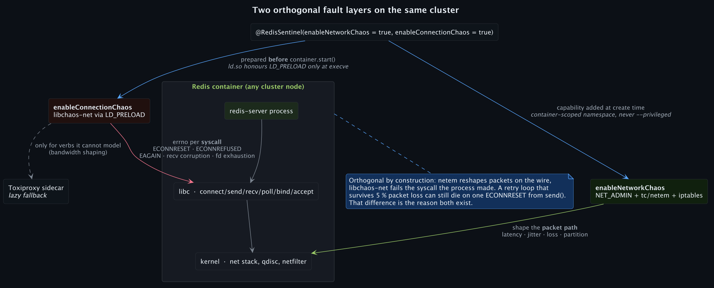

*One flag shapes the kernel packet path; the other fails the libc socket call the process made. Different layers, different failures, both on the same cluster.*

Those two are not alternatives, and they compose freely, because they operate on different things: `netem` reshapes packets already on the wire, while `libchaos-net` breaks the syscall the process just issued. The difference is not academic. A retry loop can shrug off 5 % packet loss all day and still fall over on one `ECONNRESET` returned from `send()`. Finding out which of those describes your code is the entire reason both exist.

Spend a paragraph on how that provider gets resolved, because three patterns are stacked inside it and the failure mode is baffling without knowing them. Calling `control.connection()` triggers a two-step lookup: `CompositeConnectionChaos.standard()` reflectively first, and failing that [`ServiceLoader`](https://docs.oracle.com/en/java/javase/21/docs/api/java.base/java/util/ServiceLoader.html) — the **service provider interface** defined by the [JAR file specification](https://docs.oracle.com/en/java/javase/21/docs/specs/jar/jar.html#service-provider), where `META-INF/services/<fully.qualified.Interface>` lists one implementation per line. This module ships precisely such a file for `ChaosPlugin`, which is how `RedisPlugin` gets discovered although nothing imports it.

The object that comes back is a **Composite** wrapping a **Chain of Responsibility**: each verb is offered to the `libchaos-net` layer first, and only what the syscall layer genuinely cannot model falls through to Toxiproxy. Guarding the whole lookup is **double-checked locking** over a `volatile` field — an idiom that was [outright broken before JSR-133](https://www.cs.umd.edu/~pugh/java/memoryModel/DoubleCheckedLocking.html) and became correct afterwards, because the Java Memory Model ([JLS §17.4](https://docs.oracle.com/javase/specs/jls/se21/html/jls-17.html#jls-17.4)) establishes a happens-before edge from a `volatile` write to the read that follows it. No thread can catch the provider half-built:

```java
private volatile ConnectionChaos connectionChaos;      // volatile is load-bearing, not decoration

public ConnectionChaos connection() {
  ConnectionChaos local = connectionChaos;             // one volatile read on the hot path
  if (local == null) {
    synchronized (this) {
      local = connectionChaos;
      if (local == null) { local = resolveConnectionChaos(); connectionChaos = local; }
    }
  }
  return local;
}
```

Should both routes come up empty, the resulting `IllegalStateException` spells out both remedies: set `enableConnectionChaos = true`, or put `macstab-chaos-connection` on the classpath. One design choice underpins that message. For syscall-level verbs there is deliberately **no Null Object fallback** — hand it a container that was never prepared before start and you get `LibchaosNotPreparedException` at the call site, loudly. The alternative would be a framework that quietly does nothing when misconfigured, and a chaos suite that no-ops produces green builds proving precisely nothing, which is a worse outcome than any red one.

### The incident packs: compound faults, one annotation

One level up from those primitives sits `macstab-chaos-testpacks-l3-redis`, whose method-level annotations bundle several fault domains into a single named incident. The distinction matters: these are not convenience wrappers around one toxic. Each reproduces the multi-domain shape an actual outage has:

```java
@Test
@IncidentChaosRedisNetworkFlap
void sentinelSurvivesResetStorm(SentinelCluster cluster) { … }
```

| Annotation | What it actually applies |
|---|---|
| `@IncidentChaosRedisNetworkFlap` | `ECONNRESET` on **both** `CONNECT` and `RECV` at the configured toxicity — rapid TCP reset cycling, which is what drives an election storm rather than a clean failover |
| `@IncidentChaosRedisFailoverStorm` | `ECONNREFUSED` on `CONNECT` **+** `EAI_AGAIN` on every forward DNS lookup **+** a `CLOCK_REALTIME` offset — connectivity loss during the election window, concurrent with an NTP correction |
| `@IncidentChaosRedisOomEviction` | memory pressure driving aggressive key eviction |
| `@IncidentChaosRedisClockDrift` | inter-node clock skew — TTL expiry races and Sentinel timeout miscalculation |
| `@IncidentChaosRedisCacheAvalanche` | synchronised expiry storm under read concurrency |
| `@IncidentChaosRedisSlowlog` | injected latency that pushes operations into `SLOWLOG` territory |

Pause on the clock-drift entries, because they reach a corner of Sentinel most engineers never encounter: **[TILT mode](https://redis.io/docs/latest/operate/oss_and_stack/management/sentinel/#tilt-mode)**. Sentinel's timer fires ten times a second, so roughly 100 ms should separate any two invocations; it records the previous timestamp and compares on every pass. Quoting the documentation, "if the time difference is negative or unexpectedly big (2 seconds or more) the TILT mode is entered". What happens next is the interesting part. A tilted Sentinel "will continue to monitor everything, but: it stops acting at all", and it "starts to reply negatively to `SENTINEL is-master-down-by-addr` requests as the ability to detect a failure is no longer trusted" — meaning it withdraws not only its own action but its help in getting *anyone else* to ODOWN. Thirty seconds of normality bring it back. The whole mechanism exists so a suspended VM or an NTP step cannot trigger a phantom failover across the cluster.

None of which would be worth much if you could not observe it — but `INFO` on a Sentinel reports `sentinel_tilt` alongside `sentinel_tilt_since_seconds`, the latter reading `-1` whenever it is not tilted. So the whole thing becomes a test rather than a lecture: skew `CLOCK_REALTIME` past two seconds inside a Sentinel container, assert that your HA layer has entered its protective coma, and then assert the behaviour that actually concerns you — what your application does across the thirty seconds during which nothing will be promoted regardless of what dies. VM live-migration produces this. So does an NTP correction after a long drift, or a container resumed from a pause. And short of waiting for one of them in production, there is essentially no other way to rehearse it.

It is also why `libchaos-time` sits *below* the JVM. `System.currentTimeMillis()` is a JIT intrinsic inlined to the vDSO, and Redis's own `mstime()` bottoms out in the same place. You cannot fake this from inside the JVM. You can from underneath libc.

---

### The failure your Sentinel cluster will never fail over for

All of which returns us to the failure this article started on. Everything between that opening and this paragraph has quietly assumed the interesting failure is a node *dying*. The one that cost me a night does not involve anything dying at all.

The setting responsible is `stop-writes-on-bgsave-error`, and it defaults to `yes`. Let a background snapshot fail — a full disk, a read-only mount, or a single `libchaos-io` rule returning `EIO` on `write` — and Redis begins refusing every command capable of modifying the data set. The connection stays up. The process stays up. Only writes stop. Reproducing it takes about ten seconds against a real Redis 7.4.8:

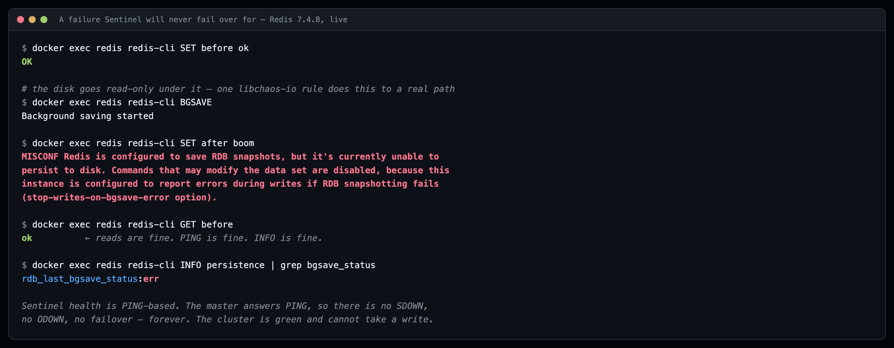

*The disk went read-only under a running master. `GET` still answers. `SET` does not. `rdb_last_bgsave_status:err`.*

Now trace that state through the topology, because the conclusion is worse than it first appears. By every definition Sentinel uses, the master is **not** down: it accepts connections, answers `PING`, serves reads, and keeps streaming replication. And `PING` is precisely what Sentinel's health check watches — the documentation describes it as remembering "the time of the latest successful reply to the `PING` command". No SDOWN follows. Without SDOWN there is no ODOWN, without ODOWN no election, and without an election **no failover — not now, not in an hour, not ever**. Meanwhile your liveness probe reports green, your replicas remain in sync, your dashboard stays flat, and every write in the system has been failing since the moment the disk filled up.

Ask which of your existing tools could have caught that. Infrastructure chaos cannot, because nothing died for it to notice. A mocked `RedisTemplate` cannot either, for the simpler reason that a mock has no disk to fail. Producing this state requires a real Redis, running a real durability configuration, meeting a fault injected at the syscall layer — which is exactly the three layers this article sits on top of. And having reproduced it, the assertion you write is one line long: with the fault active, your write path must raise a specific, actionable error, rather than dropping writes on the floor or retrying until the end of time.

---

## 9. Proving what your client library actually did

Getting the topology running is the easy half. Extracting evidence about what happened inside it is the half that upgrades "we have a Redis integration test" into "we can prove what our client did".

### `MONITOR`, wired into assertions

Watching, not participating, is the whole design of `RedisCommandTracker` — the **Observer** pattern with nothing added. It alters no behaviour in the system under test. What it does is attach to a container's [`MONITOR`](https://redis.io/docs/latest/commands/monitor/) output: a [RESP](https://redis.io/docs/latest/develop/reference/protocol-spec/) stream of simple status replies, one per command executed, each carrying a timestamp, the client address, the database index and the command with all its arguments. A daemon thread consumes that frame by frame:

```java
var tracker = new RedisCommandTracker(cluster.getReplicaContainers().get(0));
tracker.start();
service.loadUserProfiles(1_000);      // the code under test
tracker.stop();

tracker.assertThat()
    .hasCommand("GET").atLeast(900)   // reads really did land on the replica
    .hasNoDangerousCommands();        // and nothing issued KEYS / FLUSHALL
```

Consider the question that snippet settles, and how you would answer it otherwise. **Did the read/write splitting actually send reads to the replica** — or is the `ReadFrom.REPLICA_PREFERRED` line in your configuration doing nothing at all, because of how the connection ended up being constructed? No mock can tell you; it will happily confirm whatever you programmed it to confirm. Attach one tracker to the master, another to a replica, count `GET` on each, and belief turns into arithmetic.

Built around that core are the queries you end up wanting next: counts by command; counts by key pattern, via `countCommandsMatchingKeyPattern("GET", "user:*")`; rollups by category across READ, WRITE, ADMIN, PUBSUB, TRANSACTION, SCRIPTING and STREAM, with a read/write ratio on top; hot-key detection by top-N access count, which is how you find the tenant about to hotspot a shard; per-command inter-arrival timing; and a static `measureReplicationLag(master, replica)`.

Three caveats belong with it, all of them structural rather than incidental. First, the capture buffer is a `CopyOnWriteArrayList`. That makes concurrent reads from your assertion code free, and it copies the entire backing array on **every single captured line** — perfectly fine for the few hundred commands a focused test emits, and quadratic the instant somebody aims it at a load generator. Keep the observation window narrow, or hand it a tighter filter.

Second, `MONITOR` is expensive in a way that is easy to underestimate: [Redis's own documentation](https://redis.io/docs/latest/commands/monitor/) benchmarks a single `MONITOR` client cutting throughput by **more than 50 %**, and additional clients cost more again. Use it on the one node you are making a claim about, in the one test making that claim — never across a suite, and never as a measurement instrument for performance. Third, the default line filter drops replication traffic by asking whether "the line contains `:6379]`", which is a pragmatic string match on the MONITOR client-address field and not a protocol-level distinction; if your topology makes that ambiguous, pass your own `Predicate<String>` to the constructor. One last detail, because it is the kind that builds trust: `getAverageLatency()` was deprecated in favour of `getAverageCommandGap()`, since MONITOR timestamps record *when a command arrived* and say nothing about how long it took. An awkward accurate name beats a comfortable wrong number.

### The inspector set

Four narrower tools sit alongside the tracker. Each runs in one of two modes — shell-backed through `redis-cli` inside the container, which needs no client dependency at all, or Lettuce-backed, which is typed and faster:

- **`SlowCommandDetector`** turns `SLOWLOG GET` and `RESET` into typed calls. Its Lettuce backend unpacks the raw wire shape — `[id, unix-seconds, duration-µs, [command, args…], client-addr, client-name]` — so that "no command exceeded 10 ms while this fault was active" becomes an assertion instead of something you squint at in a log.
- **`ConnectionLeakTracker`** diffs `CLIENT LIST` across a boundary. Snapshot first, compare afterwards, and the connection-pool leak that only manifests after a reconnect storm stops being a production discovery and starts being a CI failure.
- **`MemorySnapshotAnalyzer`** holds an `INFO memory` baseline against the current reading — aimed squarely at the write-then-delete cycle that ought to return to its starting footprint and occasionally does not.
- **`ReplicationConsistencyVerifier`** writes N unique keys to the master and polls the replica until either all of them land or the timeout wins, reporting how many matched and how many are missing. One line, `verifier.verify(50).assertFullConsistency()`, answers "how far behind does this replica fall under 80 ms of injected latency".

### Which node is this connection actually on?

`ControlFacade.inspect(connection)` answers that by mapping a live Lettuce connection back to the container actually serving it, and it does so in three tiers. Auto-detection pulls the endpoint out of the connection, matches it against the containers it knows, and resolves the role. An explicit container hint takes over when auto-detection cannot see through whatever you have built. Manual construction covers the rest. Either way you receive a `ConnectionInfo` carrying role, container and health flag — which is what lets you assert, after a failover, that your client genuinely *followed* the promotion instead of reconnecting politely to a demoted replica and serving stale reads for the next four minutes. That first tier necessarily depends on the shape of Lettuce's `toString()`, which is why the other two exist at all; and when it cannot parse, it throws with the string that defeated it rather than guessing.

---

## 10. The recipes

**Testing eviction for real.** Bound the memory and the `allkeys-lru` policy sitting in your production config finally gets exercised rather than assumed:

```java
@RedisStandalone(version = "7.4",
    args = {"--maxmemory", "32mb", "--maxmemory-policy", "allkeys-lru"})
class EvictionTest { }
```

**Three stores that cannot contaminate each other.** A cache, a session store and a rate limiter, brought up concurrently and isolated by construction rather than convention:

```java
@RedisStandalone(id = "cache",        version = "7.4")
@RedisStandalone(id = "session",      version = "7.2")
@RedisStandalone(id = "rate-limiter")
class MultiStoreTest { }
```

**Wiring a Sentinel-aware client to the HA cluster.** Lettuce here, built from the sentinel endpoints the cluster hands back — and pinned to `mymaster` for the reason set out in §6.4:

```java
@RedisSentinel(replicas = 2, sentinels = 3)
class SentinelClientTest {

  @Test
  void clientDiscoversMasterThroughSentinel(SentinelRedis cluster) {
    RedisURI.Builder uri = RedisURI.Builder
        .sentinel(cluster.sentinels().get(0).host(), cluster.sentinels().get(0).port(), "mymaster");
    cluster.sentinels().stream().skip(1).forEach(s -> uri.withSentinel(s.host(), s.port()));

    RedisClient client = RedisClient.create(uri.build());
    try (var conn = client.connect()) {
      assertThat(conn.sync().ping()).isEqualTo("PONG");
    } finally {
      client.shutdown();
    }
  }
}
```

The Jedis equivalent, unchanged in shape:

```java
Set<String> nodes = cluster.sentinels().stream().map(Endpoint::toString).collect(toSet());
JedisSentinelPool pool = new JedisSentinelPool("mymaster", nodes);
```

**Dropping it into Spring Boot.** For Sentinel the extension does the work already: it publishes the first cluster's address into the `sentinel.nodes` system property and clears it again in `afterAll`. For a standalone instance, resolve it yourself inside a `@DynamicPropertySource`:

```java
@DynamicPropertySource
static void redisProperties(DynamicPropertyRegistry registry) {
  StandaloneRedis redis = RedisStandalone.INSTANCE.get("cache");
  registry.add("spring.data.redis.host", redis::host);
  registry.add("spring.data.redis.port", redis::port);
}
```

**Mixing topologies in one class.** An HA cluster alongside two lightweight caches — eight containers in total, comfortably inside the budget:

```java
@RedisSentinel(id = "ha-cluster", replicas = 2, sentinels = 3)
@RedisStandalone(id = "cache",   version = "7.4")
@RedisStandalone(id = "session", version = "7.2")
class MixedTopologyTest {

  @BeforeAll
  static void started(List<SentinelRedis> clusters, List<StandaloneRedis> standalones) {
    assertThat(clusters).hasSize(1);
    assertThat(standalones).hasSize(2);
  }
}
```

**Everything at once.** A genuine HA topology, syscall-level faults armed at process launch, and a named incident scoped to exactly one test method:

```java
@RedisSentinel(replicas = 2, sentinels = 3, enableConnectionChaos = true)
class RedisResilienceTest {

  @Test
  @IncidentChaosRedisNetworkFlap
  void clientRecoversFromResetStorm(SentinelCluster cluster) {
    await().atMost(Duration.ofSeconds(30)).untilAsserted(() -> {
      try (var conn = pool.getResource()) {
        assertThat(conn.ping()).isEqualTo("PONG");
      }
    });
  }
}
```

---

## 11. The design, named

There is no invention in this module. Every piece of it is a well-known pattern, chosen because its particular trade-offs happen to fit the problem in front of it. Naming them serves two purposes beyond decoration. Knowing which pattern you are looking at tells you its failure modes before you meet them in production. And the list doubles as a map for anyone porting this shape to Postgres, Kafka or Cassandra — where the architecture is unchanged and only the topology knowledge has to be rewritten.

| Component | Pattern | Specification / source |
|---|---|---|
| `@RedisStandalone`, `@RedisSentinel` | Composed annotation + **Extension Object** | [JLS §9.6](https://docs.oracle.com/javase/specs/jls/se21/html/jls-9.html#jls-9.6) (annotation types); [JUnit 5 extension model](https://junit.org/junit5/docs/current/user-guide/#extensions) |
| Repeating instances → `@RedisStandalones` | **Containing annotation type** (compiler-synthesized) | [JLS §9.6.3](https://docs.oracle.com/javase/specs/jls/se21/html/jls-9.html#jls-9.6.3), [§9.7.5](https://docs.oracle.com/javase/specs/jls/se21/html/jls-9.html#jls-9.7.5) |
| Meta-annotation search (`@ChaosTest`) | **Registry** / single point of registration | Framework-level; the JLS deliberately does *not* provide it ([`@Inherited`](https://docs.oracle.com/javase/specs/jls/se21/html/jls-9.html#jls-9.6.4.3), JLS §9.6.4.3, is class-to-subclass only) |
| Test-method parameters | **Dependency injection** | [`ParameterResolver`](https://junit.org/junit5/docs/current/user-guide/#extensions-parameter-resolution) |
| `RedisStandalone.INSTANCE.get(id)` | **Service locator** over a thread-confined ambient context | [`ThreadLocal`](https://docs.oracle.com/en/java/javase/21/docs/api/java.base/java/lang/ThreadLocal.html); [Fowler, *Inversion of Control Containers*](https://martinfowler.com/articles/injection.html) |
| Container teardown | **Disposable / scope-bound resource** | [`ExtensionContext.Store.CloseableResource`](https://junit.org/junit5/docs/current/api/org.junit.jupiter.api/org/junit/jupiter/api/extension/ExtensionContext.Store.CloseableResource.html), plus Testcontainers' [Ryuk reaper](https://java.testcontainers.org/features/garbage_collector/) as an independent second path |
| `StartupResult`, `ClusterStartupResult` | **Sum type / ADT** with exhaustive matching | [JEP 409](https://openjdk.org/jeps/409) sealed types, [JEP 395](https://openjdk.org/jeps/395) records, [JEP 441](https://openjdk.org/jeps/441) pattern matching for `switch` |
| `StandaloneRedis`, `SentinelRedis`, `Endpoint` | **Value object** with constructor validation | [JEP 395](https://openjdk.org/jeps/395); compact canonical constructors |
| `Redis` (sealed over both topologies) | **Sum type** for exhaustive topology dispatch | [JEP 409](https://openjdk.org/jeps/409) |
| `StandaloneStartupOrchestrator`, `SentinelStartupOrchestrator` | **Scatter–gather** + **bulkhead** | `ExecutorService`, `Future.get(timeout)` |
| `StandaloneContainerInstanceFactory`, `SentinelClusterFactory`, `PackageInstallerPort` | **Ports & adapters** (hexagonal) / dependency inversion | Constructor-injected seams — the reason 90 %+ of the orchestration is unit-testable with no Docker daemon |
| `SentinelContainerFactory`, `SentinelNodeFactory` | **Abstract factory** + **builder** | — |
| `RedisPlugin` discovery | **Service provider interface** | [`ServiceLoader`](https://docs.oracle.com/en/java/javase/21/docs/api/java.base/java/util/ServiceLoader.html) + [JAR file specification](https://docs.oracle.com/en/java/javase/21/docs/specs/jar/jar.html#service-provider) (`META-INF/services/…`) |
| `ControlFacade` | **Facade** over inspection, lifecycle, failover, role, network and connection chaos | — |
| `CompositeConnectionChaos` | **Composite** + **chain of responsibility** (syscall layer → proxy fallback) | — |
| `ControlFacade.connection()` | **Double-checked locking** over `volatile` | [JSR-133](https://www.cs.umd.edu/~pugh/java/memoryModel/) / [JLS §17.4](https://docs.oracle.com/javase/specs/jls/se21/html/jls-17.html#jls-17.4) — correct only *because* of the post-Java-5 memory model |
| `RoleResolver` | **Cache-aside** with explicit invalidation | `ConcurrentHashMap.computeIfAbsent` + `clearCache()` on topology change |
| `ResourceBudget` | **Guard clause** / fail-fast validator | Throws before the first Docker API call |
| `RedisCommandTracker` | **Observer** (passive) | [`MONITOR`](https://redis.io/docs/latest/commands/monitor/) over [RESP](https://redis.io/docs/latest/develop/reference/protocol-spec/) |
| `RedisCommandAssert` | **Fluent interface** / internal DSL | AssertJ-style chaining |
| `DisabledOnNonLinuxHost` | **Specification** object as an execution predicate | [`ExecutionCondition`](https://junit.org/junit5/docs/current/user-guide/#extensions-conditions) |
| `LibchaosTransport(...).prepare()` | **Two-phase construction** (configure-then-start) | Forced by [`ld.so(8)`](https://man7.org/linux/man-pages/man8/ld.so.8.html): `LD_PRELOAD` is honoured only at `execve` |
| Sentinel node discovery | **Publish–subscribe rendezvous** | [`__sentinel__:hello`](https://redis.io/docs/latest/operate/oss_and_stack/management/sentinel/#adding-or-removing-sentinels) |
| Sentinel leader election | **Quorum** (detection) + **majority vote** (authorization), versioned by **configuration epoch** | [Redis Sentinel: Quorum](https://redis.io/docs/latest/operate/oss_and_stack/management/sentinel/#quorum), [Configuration epochs](https://redis.io/docs/latest/operate/oss_and_stack/management/sentinel/#configuration-epochs) |
| `kill` vs `stop` in failover | Uncatchable-signal fault model | [`signal(7)`](https://man7.org/linux/man-pages/man7/signal.7.html) — `SIGKILL` cannot be caught or ignored |

---

## 12. Honest scope

Every tool has a boundary. These are this one's, stated before you find them yourself:

- **Redis Cluster is not covered.** Hash slots, `MOVED` and `ASK` redirection, resharding — none of OSS Cluster mode is provisioned today. The enum carries a `RedisTopology.CLUSTER` constant; nothing behind it builds one.
- **Sentinel runs on a Linux host or inside a container, nowhere else.** The reasoning is in §6.5, and the enforcement is a *skip* that prints why.
- **Three `@RedisSentinel` attributes are not plumbed** — `quorum`, `version`, and `masterName` (the Sentinel config monitors `mymaster` and the nodes are `redis:7-alpine`). Defaults behave correctly; non-defaults are silently ignored. Documented here rather than discovered by you.
- **Passing `--port` through `args` breaks port resolution.** Host ports are resolved by `getMappedPort(6379)`, so relocating Redis's internal port leaves that lookup with nothing to find. The constant's own Javadoc warns about it — correctly — but it deserves repeating somewhere you will actually read.
- **The memory budget is a nominal figure**, never a measurement, and it is scoped per test class rather than per JVM or per runner.
- **Nothing survives the class.** No persistence, no mounted volume, no container reuse — data dies alongside the test class. That is the right default for testing, and it also means this is the wrong tool for exercising AOF or RDB recovery across a restart.
- **`MONITOR` is not free**, and its capture buffer copies on write. Point it at one node, in one test.
- **`SentinelCluster.getControl()` is lazier than it looks.** Its Javadoc says double-checked locking; the implementation is `AtomicReference.updateAndGet(…)`, whose contract explicitly permits the mapping function to be **re-applied** when a CAS loses under contention. Two threads racing the first call can therefore each build a `ControlFacade`, one of which is discarded. Harmless here — the facade is stateless at construction and the winner is published atomically — but it is not the idiom the Javadoc names, and it would matter if construction ever acquired a resource.
- **`CloseableResource` is deprecated as of JUnit 5.13.** The module targets 5.12.2, where the interface is still `@API(status = STABLE)` — verified in the jar — so nothing is wrong today. But 5.13 deprecated it: *"By default, `AutoCloseable` objects put into `ExtensionContext.Store` are now treated like instances of `CloseableResource` (which has been deprecated)."* A JUnit bump turns this into a two-inner-class change (`CloseableStoreMap` and `ThreadLocalCleanup` implement `AutoCloseable` instead) — worth knowing before a release note surprises you.
- **Two seconds of `down-after-milliseconds` leaves little headroom** on a loaded laptop or a runner with noisy neighbours. It holds up fine for "did a failover happen"; widen it whenever the assertion is "no failover should have happened".
- **Provisioning costs real time.** A single standalone container is a fraction of a second against a warm image cache, while a six-container Sentinel cluster runs into seconds — most of it replication convergence plus the stabilisation window. Class-scoped provisioning spreads that cost over every method in the class, which is the whole reason to write tests that share one.

---

## 13. What this buys

One goal unites every layer of this stack: taking a failure you cannot rehearse and turning it into something a pull request can go red over. At Layer 1 that means syscalls — `EIO` on the third write to the WAL, `ECONNRESET` on 3 % of sends, a clock running forty seconds fast. At Layer 2 it means the JVM — a checked exception thrown from a method that never declared it, a return value nulled at 50 % probability.

At this layer it means **topology**. A master, two replicas, three Sentinels, a correct quorum, a private network, an enforced startup order, wait strategies that key off semantic signals, a `SIGKILL` delivered exactly when you choose, and a `Duration` you can put an assertion around. All of it declared as one annotation on one class — torn down without being asked, skipped honestly wherever it cannot run, and budget-checked before it has a chance to exhaust your CI runner.

And the price, measured on the slowest platform it supports: sixteen seconds end to end, compilation included, for eleven tests across two classes and three containers. The Sentinel suite on that same laptop costs two seconds and four printed skips.

Killing a pod answers exactly one question: *does the system die?* Put a real Sentinel cluster inside a JUnit test and you get the answer that actually changes your code — **what your client library does while a promotion is happening**. Which connection it is still holding. Which node it reads from in the meantime. How many writes went missing. And how long it took to notice any of it.

**Find it here:** [github.com/macstab/chaos-testing](https://github.com/macstab/chaos-testing), module `macstab-chaos-redis` · Apache 2.0 · built on the Java 25 toolchain · JUnit 5 and Testcontainers · Lettuce-aware while staying client-agnostic

---

## Read next, and watch

### 🎬 Watch the stack, bottom to top

Two episodes have already shipped. Either one is a reasonable place to begin:

- ▶️ **[The Macstab Chaos Stack — Testing the Vertical From Syscall to CI Pipeline](https://youtu.be/jxdcB84Q3bk)** *(00-0, the overview)* — how the three layers fit together, and why each one exists. Also [on Medium](https://medium.com/@schnapka.christian/the-macstab-chaos-stack-testing-the-vertical-from-syscall-to-ci-pipeline-03d96522a3a4).
- ▶️ **[You Tested the Catch Block. You Never Tested the Failure — 6 C99 Libraries That Fix It](https://youtu.be/B671lp4fKp8)** *(00-1, Layer 1)* — the `LD_PRELOAD` interposition underneath everything in this article: the `ECONNRESET` that `enableConnectionChaos` injects, the `EIO` that produces the `MISCONF` failure above, and the clock skew that puts a Sentinel into TILT. **If one thing here made you curious, make it this one** — it is the layer that makes the faults in this article real rather than simulated.

### 📖 Read next

- ⚙️ **Layer 2 (00-2):** the JVM bytecode agent — 62 JDK call sites, method-level effects, and checked exceptions the compiler forbids.
- 🧪 **Layer 3 (00-3):** the testing library — `@ChaosTest`, `ChaosSession`, `ActivationPolicy`, and deterministic, seeded fault sequences.
- ✍️ **The full series on Medium:** [medium.com/@macstab](https://medium.com/@macstab).

📺 **The video for this episode (00-4) is being cut now** — six containers coming up, the master dying on camera, and the promotion clock running in real time. Subscribing on **[Macstab Engineering](https://www.youtube.com/@MacstabEngineering)** is how you catch it.

---

## About the Author

**Christian Schnapka** has spent 30 years on backend systems — Java, C++, cloud, and the architecture underneath all three. Embedded work at one end, large-scale distributed platforms at the other, and the technical lead role in very nearly every team along the way.

The Macstab Chaos Stack exists because no single workflow offered the four things he needed together: libc faults targeted at specific calls, effects reaching inside the JVM, container topologies that match production, and regression gates scoped tightly enough to run on a pull request. Reproducing these failures by hand is possible, but repeating them reliably is not — and infrastructure chaos, while genuinely useful, validates a different and complementary set of resilience properties.

He publishes under **[Macstab](https://macstab.com)**, the company he works for.

These days the work is authorization platforms built on OAuth2 and Spring Authorization Server, and energy management systems in Spring Boot and React, alongside principal embedded development. Based in Wentorf bei Hamburg, Germany.

Where to find the rest of it:

- **Website:** [macstab.com](https://macstab.com)
- **YouTube:** [Macstab Engineering](https://www.youtube.com/@MacstabEngineering) — the chaos engineering series
- **GitHub:** [github.com/macstab](https://github.com/macstab)
- **Aether (security framework):** [*A NOP did not break my YARA rule — one encoding change did*](https://medium.com/@schnapka.christian/a-nop-did-not-break-my-yara-rule-one-encoding-change-did-f95c6ec3c26c) · [watch on YouTube](https://youtu.be/7TAAwTselJc)
- **LinkedIn:** [Christian Schnapka](https://www.linkedin.com/in/christian-schnapka/)
- **Twitter:** [Per!](https://twitter.com/nolem2008)
- **Security contact:** security@macstab.com and info@macstab.com

*If any of this fails on your system — open an issue. The examples are meant to run.*
