# A NOP Did Not Break My YARA Rule. One Encoding Change Did.

> A byte-level investigation for detection engineers, using Aether 1.0.0 as a reproducible reference implementation.  
> Source and commands: [github.com/macstab/macstab-security-aether](https://github.com/macstab/macstab-security-aether) · Zydis v4.1.1

A YARA hex rule is a *syntactic* predicate over a byte buffer. The thing it is trying to catch is a *semantic* object — "a function that returns 7." Between those two planes sits x86-64's defining property: it is a variable-length CISC encoding in which the map from byte strings to architectural effects is massively many-to-one. `RAX ← 7; ret` has, conservatively, more than a dozen legal encodings — `B8 07000000` (5 bytes, `mov eax`, relies on EAX zero-extension), `48 C7 C0 07000000` (7 bytes, REX.W `C7 /0`, sign-extended imm32), `48 B8 07000000 00000000` (10-byte `mov r64, imm64`), `6A 07 58` (`push 7; pop rax`), each optionally carrying redundant legacy prefixes and any of the nine canonical multi-byte NOP fillers as padding. A signature pins *one point* in that preimage. A mutator's entire job is to walk to a different one.

So my starting assumption — insert a NOP, change the hash and size, and the identity rule is defeated — is not merely wrong; it measures the wrong plane. A single `90` changes the file while leaving the rule's six-byte needle contiguous and intact, so the rule still fires. The question is never whether *some* bytes moved. It is whether the exact point in encoding-space the rule pins still occurs anywhere in the buffer — and, one level up, whether the rule pins a *point* or a *family*. Note already that not every RAX-setter above is a legal substitution: `push 7; pop rax` reproduces the return value but perturbs RSP and writes `[rsp]`, so any memory-aware classifier must reject it. "Encoding family" is strictly narrower than "all byte strings that compute 7."

This is an x86-64 laboratory analysis for authorized detection evaluation. It does not claim arbitrary `.text` semantics, general-purpose binary rewriting, or a bypass of any security product.

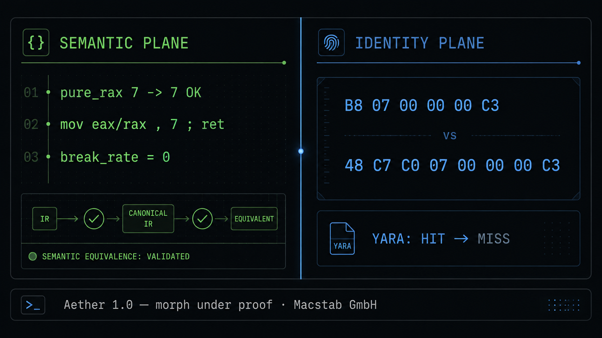

## The six bytes that set the trap

The complete function body is six bytes:

```text
B8 07 00 00 00 C3
```

| Offset | Bytes | Meaning |
|-------:|-------|---------|
| 0 | `B8` | `B8+rd`: `mov imm32` to a register; `B8+0` selects **EAX** |
| 1–4 | `07 00 00 00` | Little-endian `uint32_t` value **7** |
| 5 | `C3` | Near `ret` |

In long mode, writing EAX zero-extends into RAX. After `mov eax, 7`, RAX is exactly 7—not “7 in the low half plus unknown upper bits.” For this shell, Aether’s pure-return comparison observes the value `pure_rax == 7`; the exact width of that oracle matters later.

The teaching rule is equally simple:

```text
{ B8 07 00 00 00 C3 }   // contiguous identity
```

It is intentionally a lab-only YARA rule, not a production blocking signature. Its value is that it makes the identity plane visible: the rule asks whether these exact bytes exist next to each other, not whether some code returns 7.

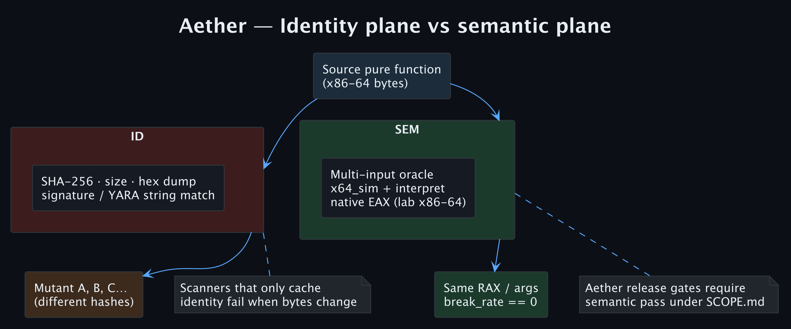

The first SAFE capture uses seed 42:

```bash
export AETHER_LICENSE_ACCEPTED=I_ACCEPT_AETHER_LICENSE
./build/aether_morph --hex B807000000C3 --out m42.bin --policy safe --seed 42
# in=6 out=7 policy=safe pure_rax 7 -> 7 OK
# 90 b8 07 00 00 00 c3
```

The new first byte is `90`, a single-byte NOP. The remaining bytes, beginning at offset +1, are still exactly `B8 07 00 00 00 C3`.

| Search start | Does the rule match? |
|-------------:|:---------------------|
| Offset 0 | No |
| Offset +1 | **Yes — HIT** |

Why the match survives is mechanical, and worth stating precisely because it governs every rule you will ever write. YARA does not scan for the whole pattern. The compiler reduces `{ B8 07 00 00 00 C3 }` to short *atoms* — typically ≤4-byte substrings such as `07 00 00 00` — installs them in an Aho-Corasick automaton, and only at each atom hit runs the full-pattern verifier at that candidate offset. The automaton is position-independent across the entire buffer, so prepending one `90` shifts the needle from offset 0 to offset +1 without touching the atom the scanner keyed on. The corollary is the load-bearing lesson: an identity rule's real strength is the *quality of its rarest atom*, not its overall length. Wildcard the immediate to widen coverage — `{ B8 ?? ?? ?? ?? C3 }` — and YARA is forced to anchor on the 1-byte atoms `B8` and `C3`, both of which saturate real `.text`; the rule degrades into a flood of candidate positions and a slow, low-precision verify pass.

The hash changed. The size changed. The pure return value still holds. Yet the rule still matches. This is why “junk insertion defeated the signature” is not an acceptable conclusion without testing the rule itself: the experiment measured padding, not rule destruction.

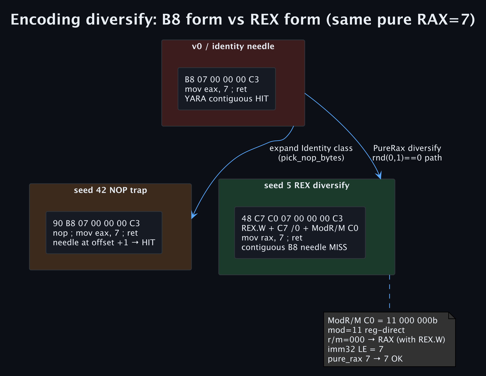

## The byte difference that matters

Seed 5 takes a different path through the same SAFE policy:

```bash
./build/aether_morph --hex B807000000C3 --out m5.bin --policy safe --seed 5
# in=6 out=8 policy=safe pure_rax 7 -> 7 OK
# 48 c7 c0 07 00 00 00 c3
```

This time the original six-byte string does not occur. The function has changed encoding class:

| Byte | Meaning |
|------|---------|
| `48` | REX prefix `0100 WRXB`; W=1 selects 64-bit operand size |
| `C7` | `MOV r/m, imm32` opcode group, using `/0` |
| `C0` | ModR/M `11 000 000`: register-direct, `/0`, RAX |
| `07 00 00 00` | Immediate value 7, little-endian |
| `C3` | `ret` |

The result is effectively `mov rax, 7; ret`. There is an important detail here. Architecturally, `B8` writes EAX and zero-extends it to RAX, while `REX.W + C7 /0` sign-extends its 32-bit immediate into RAX. For the positive immediate 7, both paths yield the same 64-bit value.

That is also the boundary of this demonstration. Aether’s `interpret_real_pure` returns `optional<uint32_t>` and currently assigns the decoded `uint32_t` immediate to its internal RAX state for both forms; `x64_sim` follows the same model for `48 C7 C0`. The native helper also reports a `uint32_t` return. In other words, the field named `pure_rax` is a **32-bit return-value oracle**, not a proof that all 64 bits of architectural RAX are equal.

Formally, the oracle proves a *projected* equivalence: for input function `f` and output `f'`, it establishes `π(⟦f⟧) = π(⟦f'⟧)` where `π = (uint32_t)rax` sampled at the `ret` boundary. For the immediate 7, there is no discrepancy: EAX zero-extension and C7 sign-extension both produce 64-bit RAX=7, and `π` sees `0x00000007` either way. The divergence appears exactly when bit 31 of the immediate is set. Take `imm = 0x80000000`: `B8` yields `RAX = 0x0000000080000000` (zero-extended), while `48 C7 C0` yields `RAX = 0xFFFFFFFF80000000` (sign-extended). The two encodings differ in precisely the upper 32 bits — and `π` collapses both to `0x80000000`. The oracle is therefore *sound for `π`-equivalence and structurally blind to the one difference it cannot observe*; hardware would distinguish the forms in RAX's upper half while the present contract cannot. The diversification code accepts `B8 imm32` generally, so the article’s semantic claim is deliberately restricted to this positive-immediate shell and the declared 32-bit output domain. A publication that calls arbitrary `B8 imm32` ↔ `48 C7 C0 imm32` a full-RAX equivalence would be wrong.

The result is a clean three-way comparison:

| Form | Identity rule | `pure_rax` |
|------|:-------------:|:----------:|
| Original `B8 … C3` | HIT | 7 |
| Seed 42: `90` + original | **HIT** | 7 → 7 OK |
| Seed 5: `48 C7 C0 … C3` | **MISS** | 7 → 7 OK |

The SHA-256 of the author-lab seed-5 output was `76403d5936afaf2b00f65ef0587131defe8b4a443f196e3e61d4b8432a7f5124`. More importantly, the lab YARA rule hits v0 and seed 42 but misses seed 5. A rule that recognizes the two encoding families—for example, the B8 form *or* the REX/C7 form—can still match both. This is not an argument that detection is impossible. It is an argument that a single identity fragment is incomplete.

## Why the seed is not the whole story

It would be tempting to write “seed 5 always produces the REX form.” The source says otherwise:

```text
void seed_rng_u64(uint64_t seed) {
  g_rng.seed(seed ^ (++g_stream_counter * 0x9E3779B97F4A7C15ULL));
}
```

`0x9E3779B97F4A7C15` is the golden-ratio constant used in splitmix-style mixing. Every call advances `g_stream_counter`, so `seed_rng_u64(5)` is not equivalent to calling `mt19937.seed(5)` in isolation. A published capture must state its process discipline: a fresh process, the first seeded morph, and the exact build. Seed 0 is deliberately not used as a fixed demonstration because mixed-run captures were unstable. With no `--seed`, the CLI uses `random_device`/time/pid entropy.

The choice itself is small and auditable. `classify_real_insn` first distinguishes **Control, Memory, Identity, PureRax, PureRcx, PureGpr,** and **Opaque**. Control and memory take precedence. Both demonstration encodings are `PureRax`; `ret` is Control and is never diversified as pure. `real_diversify_encodings` then uses a binary choice for `B8 imm32`:

```text
imm ← LE32(bytes[1..4])
if rnd(0,1) == 0:
    bytes ← [48 C7 C0] || LE32(imm)  // REX mov rax, imm32
else:
    bytes ← [B8] || LE32(imm)        // keep mov eax, imm32
```

The rewrite is symmetric, and the same catalogue covers clear-RAX forms such as `48 31 C0`, `48 29 C0`, and `31 C0`. The point is not random bytes. It is an explicitly classified, semantics-bounded substitution.

Identity is itself a real class, not merely padding. It includes architectural NOPs and `48 87 C0` (`xchg rax, rax`). The catalogue must name those identities because the verifier must later recognize them. In the 0..63 SAFE seed sweep, 26 outputs used the REX `48 C7 C0` form, 13 were exact v0, 7 used a NOP prefix, 5 retained B8 with additional bytes, and 13 took other forms. All 64 passed the pure check. That distribution does not predict another build or stream position; it documents this one.

The same idea is not limited to loading seven. A second capture begins with `31 C0 C3`—`xor eax,eax; ret`—and SAFE/seed 5 produced `48 31 C0 C3`, or `xor rax,rax; ret`. The pure result remained `0 -> 0 OK`. Again, the relevant observation is not that one particular encoding is exotic. It is that the engine has classified a restricted family, substituted within that family, and checked the contract it advertises.

## A proof tree, not a byte dump

The six-byte example is useful because every stage can be inspected. Start at the leaf: `B8 07 00 00 00` decodes as a no-memory, non-control `PureRax` instruction. `C3` decodes as a Control terminator. The classifier therefore permits the first instruction to enter the encoding-diversification catalogue but refuses to treat `ret` as movable arithmetic.

On the seed-42 path, expansion places `90` before the original instruction. The relevant identity string remains in the output at +1, so YARA returns HIT. On the seed-5 path, diversification chooses `48 C7 C0` and emits the REX/C7 encoding; no contiguous `B8 07 00 00 00 C3` remains, so the lab rule returns MISS. Both paths are then re-lifted. The pure interpreter evaluates input and output and compares their `pure_rax` values. The simulator recognizes the same two encodings, and a native EAX-argument check is available on x86-64 or in the amd64 Docker lab.

That chain is the actual claim:

```text
decode → classify → select a legal encoding → assemble
       → re-lift → pure/multi/native oracle → identity-rule result
```

It is deliberately narrower than “this is safe code mutation.” A memory instruction, an unresolved branch, a register/flag hazard, or an unmodelled instruction changes which branch of the proof tree is available. The value of the tree is that it identifies the failed precondition instead of turning a green demo into a general promise.

The lift layer preserves the facts needed to make that decision. `disasm_real` initializes Zydis in x86-64 long mode and records each instruction’s raw bytes, offset, virtual address, Intel text, control-flow role, immediate target, GPR read/write masks, memory/RIP-relative flags, and flag reads/writes in `RealInsn`. `build_real_cfg` then turns the instruction stream into `RealBlock` ranges with explicit fallthrough and taken edges. When Zydis cannot decode a byte, the lifter records a one-byte `db 0xNN` instruction and continues rather than silently dropping data; later classification leaves it opaque. That is a conservative failure mode: a bad decode reduces the transform surface instead of inventing a legal rewrite.

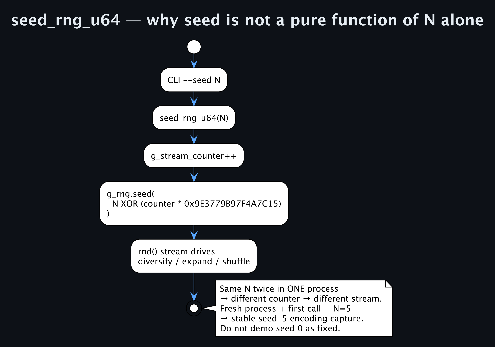

## What makes the six-byte result credible

A six-byte shell can prove a narrow claim, but it does not prove that a binary rewriter is safe. The machinery around it matters.

The actual free-size SAFE path in `MorphEngine::morph` does not follow a simple “diversify, add NOPs, shuffle” slide. It lifts and analyzes first, **splits blocks before the first structural rewrite**, diversifies twice, and shuffles twice:

```text
Lift → Analyze → Split → Diversify → Expand → Shuffle
     → [Permute] → Diversify → Expand → Shuffle
     → [Lab loop] → [Industry extra] → Assemble → Verify
```

The implementation makes the order concrete: `real_split_blocks(f, 6)` is the first structural move; the first expansion calls `real_expand_nops(1..4)` per block; the second expansion uses 0..2. Per-block expansion preserves block IDs, so assembly patches edges from logical targets rather than trusting stale relative bytes.

The size-fit branch is different: diversify, shuffle, assemble; retry with diversify only if the result outgrows its hole; fall back to identity bytes if it still does not fit. That is the algebra a binary rewrite needs and a raw buffer demo avoids.

The gates are intentionally uneven across transforms. `real_may_permute_blocks` requires at least three blocks, resolved CFG edges, no calls, and immediate targets for branch instructions; only then can physical order change. By contrast, NOP expansion may place a NOP island after a Memory-class instruction because it does not reorder the memory operation. It never expands a block containing a mid-block jump, conditional jump, or call, because that would invalidate a relative distance retained in raw bytes. “Memory is a shuffle barrier” and “memory can receive adjacent NOP padding” are different rules for different transforms.

Modes also alter the in-process configuration. `IndustryExperimental` promotes Safe to Lab; if `extra_lab_passes < 2`, the implementation sets it to 3. A caller that explicitly supplies 2 retains 2, so this is the actual source condition—not an unconditional “minimum three” guarantee. `Industry` promotes Safe to Lab; if its pass count is below 2, it sets it to 2, and enables multi-input and native verification. In Lab or Industry, a pure mismatch is fail-closed; Experimental may retain bytes with `pure_verified=false`.

In source terms, the decisive branch is compact:

```text
hard_pure = (Lab || Industry)

mismatch:
  hard_pure    → ok=false          // fail closed
  Experimental → retain bytes; pure_verified=false
```

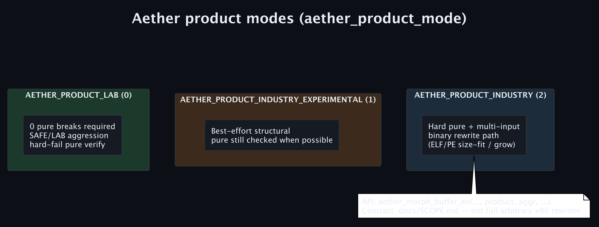

That distinction is important when reporting a result. “SAFE” is not a universal guarantee, and Industry is not SAFE with a different label: the requested product mode rewrites the working configuration before the engine proceeds. A reader reviewing a customer or CI result must know which mode ran, whether size-fit was active, and which oracle gates actually fired.

There are also deliberately two pure contracts. The raw `morph_real()` library configuration sets `verify_pure = false`; the `aether_morph` CLI re-lifts input and output, runs `interpret_real_pure`, prints `pure_rax A -> B OK|BREAK`, and exits 1 on a break. The library makes transformation available; the research CLI applies the hard gate.

The multi-input implementation has two layers. It first asks the host-independent simulator to compare eight pairs: `(0,0)`, `(1,2)`, `(0xFF,0xAA)`, `(7,0)`, `(0,9)`, `(0x1234,0x5678)`, `(3,5)`, and `(100,200)`. If the simulator cannot interpret the body, it falls back to the first six pairs through `interpret_real_pure`. After a successful multi path, the result field is still assigned `multi_input_checked = 6`; it is a fixed reporting field, not the dynamic simulator count. The hardware-native differential uses four pairs—`(0,0)`, `(1,2)`, `(0xFF,0xAA)`, and `(3,5)`.

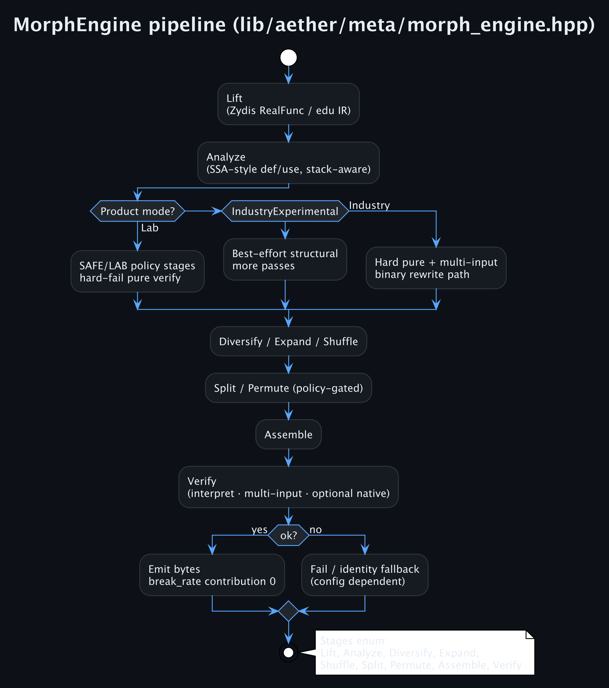

## Where a mutator can silently get the answer wrong

Moving blocks is one of the easy places to manufacture plausible-looking wrong code. `assemble_real` physically places the entry block first, replaces resolved terminal jumps with `E9 rel32` placeholders, writes conditional branches as `0F 8x rel32`, and patches each displacement as:

```text
rel32 = block_off[target_id] - instr_end
```

`rel32` is signed and measured from `instr_end` — the address of the *following* instruction, i.e. RIP after the jump is fetched; for a 5-byte `E9`, `instr_end = block_off[src] + site + 5`. That field is 32 bits, so every patched edge must land within ±2 GiB of its source. This is why the grow-blob branch can append a page-aligned segment and still reach it with a single `E9 rel32` trampoline: the appended `PT_LOAD` stays inside the signed-32 window. A rewriter that outgrew that window would be forced off `E9` entirely and into an indirect `FF /4` jump through a spilled 64-bit target — a different instruction, a different size, a different set of clobbers. If a logical fallthrough would no longer lead to the next physical block, it emits an `E9` seal. Without that seal, block A can fall into a different physical block after permutation, run the wrong instructions, and never crash. A hex dump can look perfectly healthy; the control-flow meaning is not.

Mid-block control-flow instructions retain their original bytes because arbitrary expansion there would invalidate internal distances. Only terminal resolved edges receive the new stable `rel32` encoding. That restriction is less glamorous than block permutation, but it is the difference between a changed listing and an assembled control-flow graph.

Shuffling has the same problem at instruction scale. Aether’s function-local `ssa_analysis.cpp` refuses a pair when either instruction is control, call, or opaque; when non-stack memory is involved; when two stack accesses alias at the same displacement and either defines; on GPR RAW, WAR, or WAW conflicts; or when flags conflict. It also keeps a block terminator last. Only after classic and SSA independence both pass does a coin flip choose whether to move the pair.

Those are Bernstein's conditions applied to machine state: two instructions commute only if neither writes a resource the other reads or writes — no RAW, WAR, or WAW — across *every* shared resource. On x86-64 the easily-missed shared resource is RFLAGS. Reorder a `cmp`/`sub`/`add`/`shl` across the `jcc` that consumes its CF/ZF/SF/OF and the branch now reads stale flags while no register ever looks wrong; the bytes disassemble cleanly, the CFG is intact, and the program silently takes the other edge. Partial-flag writes (`inc`/`dec` leave CF untouched) make this worse, not better. Memory is the second trap: precise alias analysis is undecidable in general, so a sound mover must treat any pair it cannot *prove* disjoint as dependent. Restricting the memory case to stack slots at statically-known displacements is exactly that conservatism — it forfeits reordering opportunities in exchange for the guarantee that it will never transpose two accesses that might resolve to the same address at runtime.

The oracle must understand the identities the transformer inserts. `x64_sim` is host-independent, uses a zeroed 4096-byte stack beginning at `rsp`/`rbp = 0x0800`, and stops after 200,000 steps. It recognizes both `B8+r` via opcode register selection and `48 C7 C0`, plus clear forms, frames, CFG branches, and the NOP set—including `48 87 C0` (`xchg rax, rax`). If the morph catalogue calls that identity but the simulator does not, a green result would be false confidence.

For multi-input bodies, `multi_input_ok` prefers simulator equivalence and otherwise interprets the fixed pairs. A single mismatch fails the check. On x86-64 or the Docker lab, `try_exec_x64_eax_args` provides a native oracle as well; Industry fails closed when a performed native check breaks. The captured run reports 4,862 native checks and zero native breaks, which supports only that tested execution domain.

At `ret` (`C3`), the host-independent simulator returns `(uint32_t)rax`; this is the meaning of `pure_rax` in the shell example. It also models stack-frame operations, `leave`, and conditional branches through the lifted CFG. The simulator is therefore neither a general x86 emulator nor a decorative unit test. It is a deliberately bounded oracle whose supported encodings must be kept in lockstep with the morph catalogue.

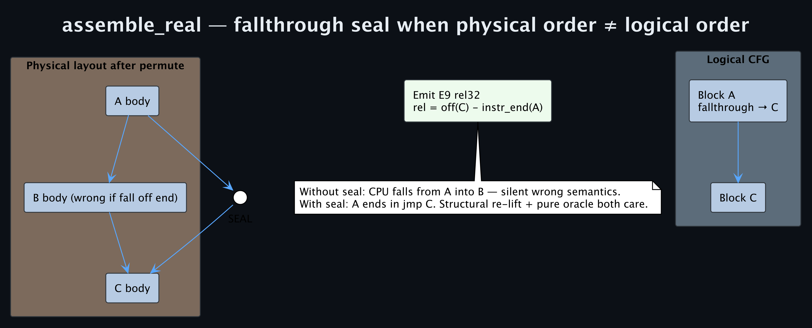
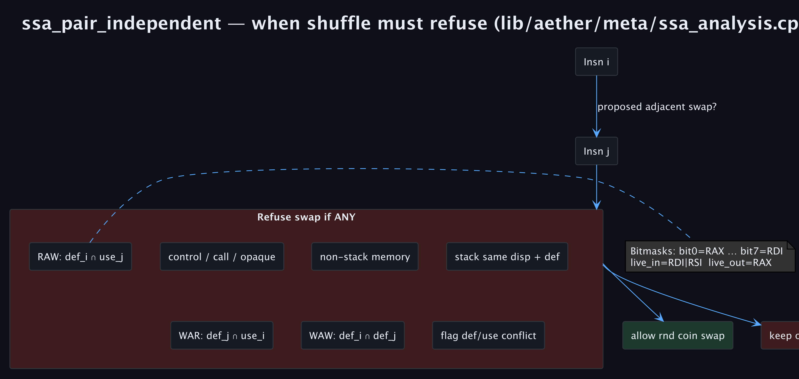

## What the measurements do—and do not—say

The author-lab benchmark was Aether 1.0.0 on Apple Silicon; the native column ran where its host path was available. Every rerun should preserve the UTC date, git commit, architecture, and JSON artifact.

```json
{
  "corpus_total": 5096,
  "corpus_synthetic": 1000,
  "corpus_elf": 4096,
  "morph_ok": 10192,
  "pure_checked": 5020,
  "pure_breaks": 0,
  "structural_checked": 10192,
  "structural_breaks": 0,
  "native_checked": 4862,
  "native_breaks": 0,
  "unique_hashes": 9671,
  "break_rate": 0,
  "avg_size_ratio": 2.19285,
  "pass": true
}
```

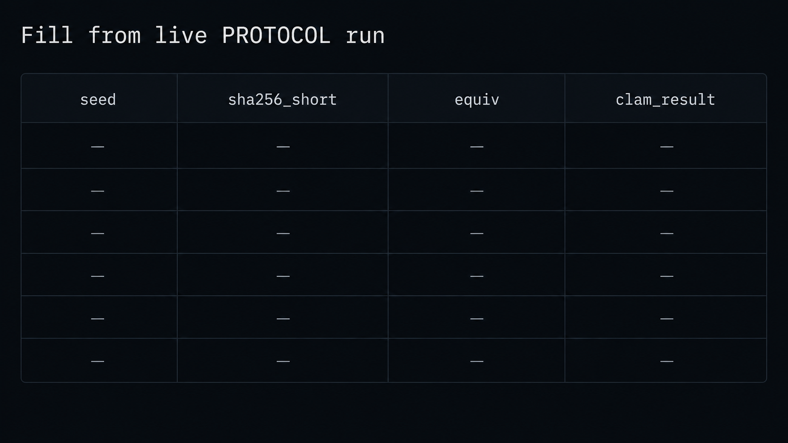

Two default rounds explain why `morph_ok / corpus_total` is approximately 2.0. Outputs were 94.89% unique by SHA-256, and mean expansion was +119.3%. On the focused 128-seed matrix, the lab identity rule hit 30 times (23.44%) and missed 98 times (76.56%), with zero pure breaks.

The bench pass predicate is explicit: `break_rate == 0`, `corpus_total >= 1000`, and `corpus_elf >= 200`. One reporting trap is worth naming: `--count N` supplies the synthetic pure-function count only. ELF extraction is additional. Calling this “a test of 1,000 functions” would misstate the 5,096-function capture.

The columns are not interchangeable. `pure_checked` is the oracle-interpretable pure domain. `structural_checked` means a non-empty result can be re-lifted into a CFG. `native_checked` means hardware EAX-pair execution. Real ELF code contains memory and control instructions: a `victim_clean` capture has 95 Zydis instructions and 30 blocks, beginning with `endbr64`, stack adjustment, an absolute load, a test, a conditional branch, and an indirect call. It is not a `PureRax` toy. Claiming pure-RAX equivalence for arbitrary `.text` would be false.

That leading `endbr64` (`F3 0F 1E FA`) is not decoration either. Under CET-IBT it is the *only* legal landing pad for an indirect branch: the CPU raises a #CP control-protection fault if an indirect `call`/`jmp` transfers to any other byte. A rewriter that relocates such a target must reproduce the landing pad at the new address, or the relocated program faults the instant IBT enforcement is on — and the shadow stack imposes the symmetric constraint on `ret`. A pure-RAX shell never exercises any of this, which is precisely why the shell cannot vouch for the ELF path.

The raw capture puts that function’s executable region at `file_off=0x1000`, `vaddr=0x401000`, and 353 decoded bytes. Those details matter because a rewriter operates simultaneously on instruction semantics, virtual addresses, file offsets, branch displacements, and available physical space. “We transformed an ELF” is not one property; it is several contracts that can fail independently.

The reported elapsed time, 179 ms, is a capture fact rather than a performance promise. It includes this corpus, this build, and this host; it does not establish a throughput SLA. The meaningful benchmark predicate is narrower and stronger: for that run, the recorded checked domains had no reported breaks while corpus thresholds were met. It is evidence to retain with a commit and artifact, not a permanent product number.

## What belongs to the engine—and what does not

The public C surface exposes `aether_morph_buffer`, `aether_morph_buffer_ex` for product mode, `aether_morph_binary_file`, and `aether_run_bench`. Underneath, `RealInsn` retains raw bytes, GPR masks, and branch metadata; it is not a toy `enum` IR. The default morph base is `0x1000`. The implementation mass is approximately 7,164 C++ lines across 25 files: `morph_real.cpp` is about 700 lines, `morph_engine.cpp` 567, `binary_rewrite.cpp` 592, and `x64_sim.cpp` 360.

That inventory matters because Aether also contains research extras that should not be confused with the core morph-and-proof path. The controlled ELF fixture is append-only: it does not rewrite `e_entry` or program headers, and it does not make its payload execute. It marks padding and uses `continuous_mutate` to XOR the first `min(64, payload.size())` bytes. Those bytes are intentionally not valid code. The fixture is a lab artifact for an operator-supplied file, not a loader or an execution mechanism.

Likewise, size-fit is not free-size rewriting. When a file has no suitable hole, the Industry rewrite may use an E9 trampoline to RX growth; when it does have one, the separate size-fit branch must stay within it. That is why the source has a binary-rewrite layer instead of merely emitting a mutated byte vector.

At function level, the binary rewrite first extracts candidate bodies from an executable region—4 to 192 bytes, up to 4,096 candidates in the rewrite path—and attempts a size-fit SAFE morph. A result that fits replaces the original body and pads unused original bytes with NOPs. If it grows and the original site has at least five bytes, the engine runs a full morph with a 16× maximum size ratio, aligns the new body to 16 bytes in a grow blob, and places an `INT3` separator after it. For ELF64, the blob is appended page-aligned and the executable `PT_LOAD` segment is extended; the original site receives an `E9 rel32` jump and remaining old bytes are `INT3` padded. PE32+ has separate section-growth logic. This is a real layout-changing branch, so it must not be confused with the append-only fixture described above.

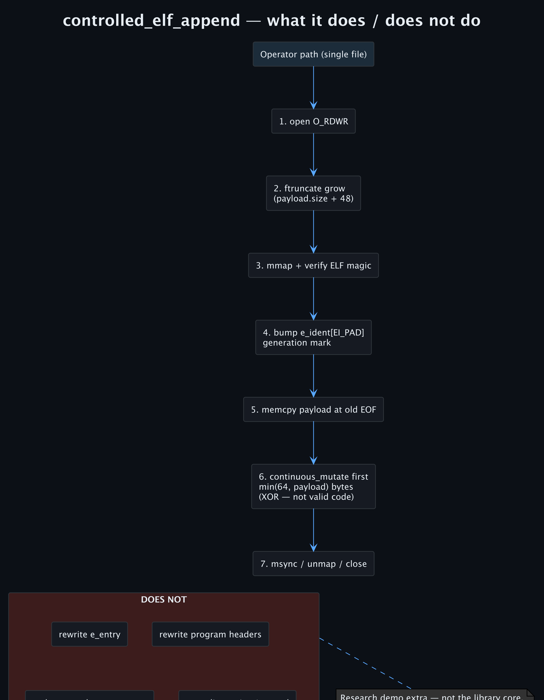

## The detection lesson

The lesson is not “use more signatures” and it is not “morphing wins.” It is to test rules against the plane they actually observe.

An identity-only rule should be evaluated against encoding alternatives, padding, and layout changes. A semantic check needs a stated input/output contract. A behavioural sensor—eBPF, EDR, a debugger, memory inspection, timing, allocation, or an entropy/size heuristic—observes different residuals. Aether’s mean free-morph expansion is about 2.19×, which is itself a signal. None of the green numbers erase those surfaces.

In particular, an encoding-family YARA rule that covers both `B8 ??…C3` and `48 C7 C0 ??…C3` may recognize both forms. The experiment demonstrates a weakness in one contiguous identity rule; it does not establish a universal detection failure.

That is the useful CI pattern: generate legal semantic twins within a narrowly declared domain, run the rule and the oracle, retain the evidence, then repair the sensor that failed. The tool is not the conclusion; the test is.

## The layers that have to agree

The six-byte example is small, but the conclusion crosses five different layers. Treating any one of them as the whole system is how a convincing byte dump becomes a false claim.

| Layer | Aether evidence | The question it can answer |
|-------|-----------------|----------------------------|
| Decode | Zydis → `RealInsn` / `RealBlock` | What bytes and CFG did we actually lift? |
| Analysis | effect class, GPR masks, SSA hazards | Is this transformation permitted by the current model? |
| Lowering | per-block layout and rel32 fixups | Do branches still target the intended logical blocks? |
| Oracle | 32-bit pure return, simulator, optional native execution | Did the stated output contract hold in this domain? |
| Detection | exact YARA rule, hash, size, behavioural sensors | Which observable changed, and which sensor still sees it? |

The table is also an audit checklist. A structural re-lift cannot prove full machine semantics; a passing pure oracle cannot prove an EDR did not alert; a YARA MISS cannot prove an encoding is absent from every detection family. The article’s seed-5 claim survives because it names the byte rule, the value domain, the engine path, and the residuals separately.

## Turning the experiment into detection CI

The smallest useful CI job has four artifacts: the original input, each morphed output, the oracle report, and the detection-engine result. Record the Git commit, Aether version, CPU architecture, seed, policy, command line, and SHA-256 of every output. A rule regression is otherwise impossible to distinguish from a changed generator stream, changed corpus, or changed signature engine.

For a release-quality run, add the exact lab YARA source, the JSON bench report, decoded before/after listings, and the detector version/date if an external scanner is involved. The target and host matter as well: Apple Silicon can perform the host-independent simulation but not execute arbitrary x86-64 natively, so use the amd64 Docker lab when hardware execution is a required column. This is why a report should name the oracle rather than saying merely “validated.”

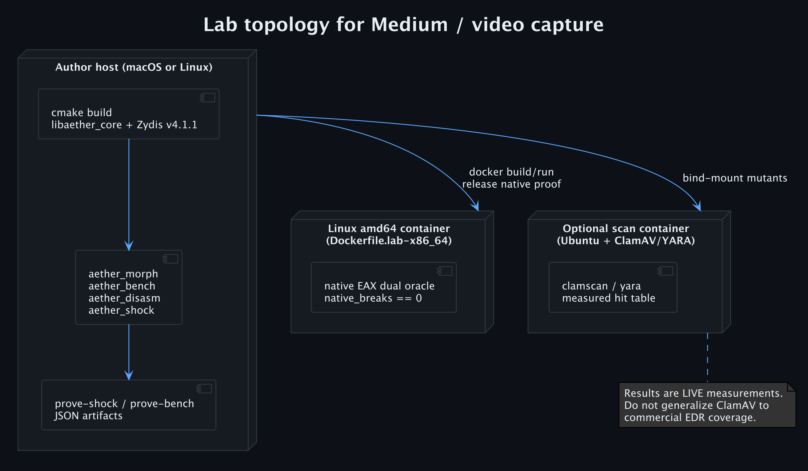

Run the job on at least three planes. First, use the semantic oracle to reject a mutation that violates the declared pure or multi-input contract. Second, record identity with the exact bytes, size, and hash. Third, run the named detector—this article uses lab YARA—and state the exact rule. A ClamAV or EDR observation is a separate fourth measurement, not a replacement for the YARA result and not evidence about every product in that category.

When the rule fails, the repair should follow the plane. A contiguous byte rule may need encoding-family alternatives, context, or a second signal. A size/entropy detector may already see the expansion but need calibration. A behavioural sensor should be tested against execution, allocation, timing, and memory surfaces rather than inferred from a static hash. The right response is not to promise invulnerability; it is to make the rule’s assumptions executable and regression-tested.

## Reproduce the investigation

```bash
export AETHER_LICENSE_ACCEPTED=I_ACCEPT_AETHER_LICENSE
git clone https://github.com/macstab/macstab-security-aether.git && cd macstab-security-aether
cmake -S . -B build -DCMAKE_BUILD_TYPE=Release
cmake --build build -j --target aether_morph aether_bench aether_disasm

./build/aether_morph --hex B807000000C3 --out m42.bin --policy safe --seed 42
./build/aether_morph --hex B807000000C3 --out m5.bin  --policy safe --seed 5
./build/aether_bench --count 1000 --json artifacts/bench_report.json
./build/aether_disasm victim_clean | head -40
```

Read [SCOPE](https://github.com/macstab/macstab-security-aether/blob/main/docs/SCOPE.md), [SCORECARD](https://github.com/macstab/macstab-security-aether/blob/main/docs/SCORECARD.md), [LIBRARY](https://github.com/macstab/macstab-security-aether/blob/main/docs/LIBRARY.md), and [SECURITY](https://github.com/macstab/macstab-security-aether/blob/main/SECURITY.md) before treating any result as a deployment claim.

**Christian Schnapka** — principal+ backend (Java/C++/cloud), [Macstab](https://macstab.com), [Macstab Engineering](https://www.youtube.com/@MacstabEngineering). Security contact: security@macstab.com.

*Authorized lab use. Aether Research License. No warranty. Not legal advice.*
